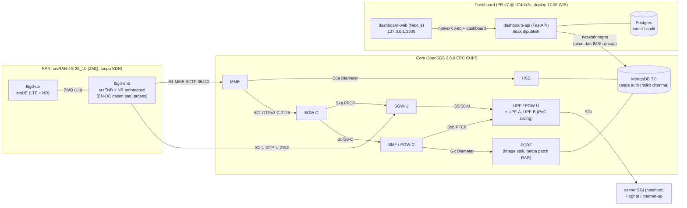
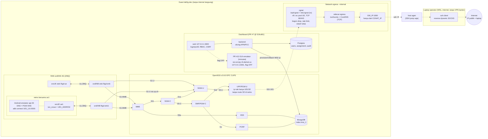

# Arsitektur lab5g-dev saat ini — 11 Nov 2026 16:20 WIB

Status dokumen: 11 Nov 2026 16:20 WIB. Diagram pertama tetap topologi 10 Nov 2026 17:25 WIB; port dashboard di kedua diagram adalah `127.0.0.1:3300`.

Sumber: inventori Lab Ops (read-only, 15:10 WIB), evidence PR #7 (deploy dashboard @ d74db7c, 17:05 WIB) dan PR #8 (Gate B fase 1, 17:01–17:09 WIB). Tanpa secret; IP yang tidak terverifikasi tidak dicantumkan.

## Catatan
- **Status:** semua NF berjalan. SMF sempat mati sejak 6 Nov dan pulih di Day 0. Setelah srsRAN dipulihkan (17:09 WIB): attach berhasil, RRC NR reconfiguration berhasil, ping ke SGi 4/5.
- **Slicing:** berbasis APN/PCC lewat dashboard yang menulis ke Mongo, bukan S-NSSAI. Gx RAR masih dimatikan (`OPEN5G_ENABLE_GX_RAR=0`), jadi perubahan berlaku saat attach ulang.
- **Mongo:** risiko tanpa auth diterima Netdrive (10 Nov 15:49 WIB) selama jendela uji. Dashboard hanya memakai akun student dan IMSI uji, tanpa instructor dan tanpa seed.
- **Gate B:** OAI eNB/en-gNB 2026.w43 sempat diuji di rfsim (`10.99.13.0/24`) dan lulus S1 Setup serta EN-DC X2 Setup. Setelah itu dibongkar. OAI NO-GO; EN-DC penuh (X2 SgNB Addition, E-RAB Modification) masuk Fase 2.
- **Akses:** komputer Netdrive, lalu host agen, lalu guest lab5g-dev. Tidak ada port yang dipublish ke luar guest; lab5g-vm hanya baca.
- **Dashboard:** web di `127.0.0.1:3300` (PR #7 @ 519cd61). `127.0.0.1:3000` adalah Grafana.
- **Subnet yang tercatat:** s1mme `10.99.1.0/24`, s1u `10.99.2.0/24`, x2 `10.99.12.0/24`, rfsim `10.99.13.0/24` (tidak aktif). Subnet lain belum tercatat lengkap di inventori.

## Android UE emulator dan egress SOCKS (PR #12 @ c8d3455)

- Core tidak berubah. Dashboard web sudah ter-deploy di `127.0.0.1:3300` (PR #7 @ 519cd61). `127.0.0.1:3000` adalah Grafana.
- Emulator memakai netns bersama ue1, sehingga semua trafik termasuk DNS lewat tun_srsue lalu EPC.
- adb tidak lagi dipublish di port host 15551. Dari guest: `adb connect <UE1_UU>:5555`. Dari luar guest: `ssh -L`, karena `uu` adalah jaringan internal.
- Route S1-U enb1 menuju SGW-U GTP-U dipasang oleh `up.sh` di netns enb1, pola yang sama dengan lab-routes untuk l5gd-enb. Tidak ada route /32 di netns UPF.
- Skrip cgnat ada di `/opt/cgnat` (ro), konfig di `/etc/cgnat` (ro).
- Jalur internet hanya untuk UE1 /32 lewat ip rule di UPF, lalu cgnat, tun2socks, dan tunnel SOCKS ke laptop operator. Jalur ini fail-closed dan hanya aktif dalam jendela uji yang disetujui Netdrive.
- PR #12 belum di-merge.
- PR #13 (rencana, flag OFF, belum aktif): GUI emulator di dashboard. Sidecar ws-scrcpy di alamat `uu`. Proxy WebSocket di belakang login dan RBAC: user = UE sendiri, instructor = grupnya, admin = semua. Origin layar terpisah `127.0.0.1:3301`.
