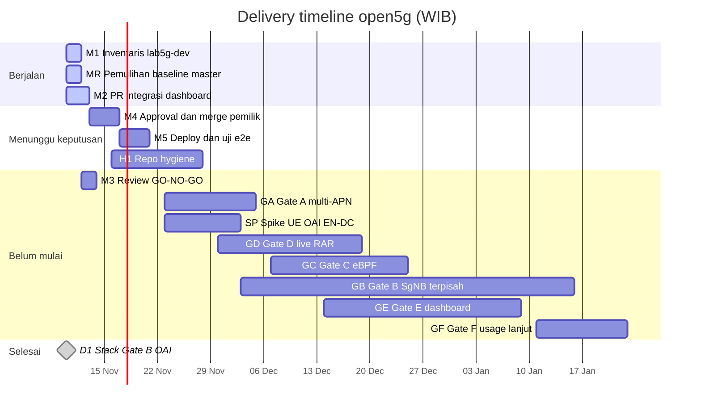

# Delivery timeline open5g

Rencana delivery open5g per minggu, disusun Selasa 10 Nov 2026 pukul 15:02 WIB. Integrasi dashboard ke lab5g-dev ditargetkan ter-deploy 20 Nov 2026, lalu Gate A, D, C, E, dan Gate B (SgNB terpisah) sampai pertengahan Januari 2027. Pada saat rencana disusun, PR terakhir yang sudah digabung adalah #5 (6 Nov 2026, 20:59 WIB).

**Semua tanggal pada dokumen ini adalah target perencanaan, bukan janji.** Hari keputusan yang tertunda menggeser rantai di belakangnya.

**Update terbaru**

- 10 Nov 2026, 15:06 WIB: stack Gate B diputuskan **OAI** (eNB + en-gNB terpisah). **Amarisoft tidak dipakai.**
- 10 Nov 2026, 15:11 WIB: pemilik menyetujui pemulihan lab5g-dev ke baseline `master`. SMF mati sejak 6 Nov 2026, 21:12 WIB. Pekerjaan ini berstatus Berjalan, target 11 Nov 2026, dan menjadi dependensi uji e2e dashboard (M5).

Jalur kritis dashboard: PR integrasi, review, merge oleh pemilik, lalu deploy dan uji e2e. Pemulihan baseline (MR) berjalan paralel dan harus selesai sebelum uji e2e. Gate B memakai OAI dan berjalan paralel; kelanjutannya tergantung hasil spike.

Sumber kriteria gate: [`PRD-v0.6.md`](../prd/PRD-v0.6.md), [`ROADMAP.md`](../prd/ROADMAP.md), dan [`RISKS.md`](../prd/RISKS.md). Aturan tim ada di [`TEAM.md`](TEAM.md). Keadaan lab yang memicu MR ada di [inventaris 10 Nov 2026](../lab/LAB5G-DEV-INVENTORY-20261110.md).

## Timeline

Zona waktu: **WIB** (Asia/Jakarta, UTC+7). Blok diagram memakai `dateFormat YYYY-MM-DD` dan `inclusiveEndDates`, jadi tanggal akhir yang tertulis adalah tanggal target. Belah ketupat adalah keputusan satu hari.

Ada 15 butir: 3 berjalan, 3 menunggu keputusan, 8 belum mulai, 1 selesai.

Bagian pada diagram mengikuti status. Batang `active` sedang berjalan. Belah ketupat `done` sudah selesai. Butir yang menunggu keputusan belum boleh dimulai sebelum pemilik memutuskan.

## Milestone

| Milestone | Owner | Dependensi | Kriteria selesai | Target | Status |
|---|---|---|---|---|---|
| M1 — Inventaris lab5g-dev (read-only) | Lab Ops | — | Tidak ada di PRD. Kriteria kerja: laporan versi, kontainer, dan endpoint yang bisa dibaca dashboard, tanpa mengubah lab. | 11 Nov | Berjalan |
| MR — Pemulihan lab5g-dev ke baseline master (SMF mati sejak 6 Nov 21:12 WIB) | Lab Ops | Disetujui pemilik 10 Nov 2026 15:11 WIB | Lab5g-dev kembali ke baseline `master` dan SMF berjalan lagi. lab5g-vm tidak disentuh. | 11 Nov | Berjalan |
| M2 — PR integrasi dashboard ↔ lab5g-dev | Dev | Cabang `master`; M1 | Tidak ada kriteria khusus di PRD. Kriteria kerja: PR terbuka dengan URL dan SHA, tes backend/frontend lulus, stock adapter tetap menolak RAR langsung sampai Gate D. | 12 Nov | Berjalan |
| M3 — Review GO/NO-GO Architect + QA | Architect, QA | M2 | GO Architect dan QA pada SHA yang sama; QA memisahkan hasil sintetis dari hasil RAN/UE nyata. | 13 Nov | Belum mulai |
| M4 — Approval + merge oleh pemilik | Pemilik repo | M3 | PR di-approve dan di-merge manual oleh pemilik repo. | 16 Nov | Menunggu keputusan |
| M5 — Deploy dashboard ke lab5g-dev + smoke test | Lab Ops, QA | M4; persetujuan deploy pemilik; MR | Tidak ada di PRD untuk tahap ini. Kriteria kerja: deploy pada SHA ter-merge, smoke test QA lulus, lab5g-vm tidak disentuh (NFR-LAB-01..03). Uji e2e dashboard baru setelah MR selesai. | 20 Nov | Menunggu keputusan |
| H1 — Repo hygiene: main↔master, README, CI, lisensi | Dev, QA | Keputusan pemilik (merge master→main, CI, lisensi) | Tidak ada di PRD. Kriteria kerja: `main` memuat `infra/`, README/BOOTSTRAP terbaru, workflow CI menjalankan tes yang ada, file lisensi ada. | 27 Nov | Menunggu keputusan |
| D1 — Keputusan stack Gate B: OAI | Pemilik repo | Rekomendasi NA (OAI eNB + en-gNB terpisah, tag `2026.w43`) | Diputuskan pemilik 10 Nov 2026 15:06 WIB: OAI. Amarisoft tidak dipakai. Architect menyusun rencana spike go/no-go lewat PR. | 10 Nov | Selesai |
| GA — Gate A lengkap: multi-APN/SDF/URR | Lab Ops, QA | lab5g-dev | PRD/ROADMAP: LTE attach; dua APN ke UPF (plus SGW-U); SDF+URR; pcap T1–T2. Bukti attach sudah ACCEPTED 6 Nov; T1–T2 belum dieksekusi. | 4 Des | Belum mulai |
| SP — Spike UE OAI EN-DC over rfsim (go/no-go) | Architect, Lab Ops | D1 | PRD: spike 5–8 hari kerja = go/no-go; jika jalur sim EPC gagal, berhenti sebelum rebuild RAN penuh. | 2 Des | Belum mulai |
| GD — Gate D: live RAR (patch PCRF admin-RAR) | Dev, Lab Ops, QA | Gate A; R-03 | PRD/ROADMAP: PCRF admin-trigger; T4–T8; evidence-chain FR-16 (active bukan RAA 2001 saja). | 18 Des | Belum mulai |
| GC — Gate C: eBPF app detection | Dev, Lab Ops | Gate A | PRD/ROADMAP: IP/DNS/SNI + counters; T3; BTF terverifikasi. | 24 Des | Belum mulai |
| GB — Gate B: EN-DC Option 3x, SgNB terpisah | Architect, Lab Ops, QA | Gate A; D1; spike GO | PRD FR-15/D3: X2 SgNB Addition; S1AP E-RAB Modification Indication/Confirm; S1-U ke gNB dengan TEID baru. Integrated srsENB = achieved-but-not-accepted. | 15 Jan 2027 | Belum mulai |
| GE — Gate E: dashboard self-service | Dev, QA | M0 (PRD); M5; Gate D untuk apply langsung | PRD/ROADMAP: API/RBAC/grup/audit; FR-16/17; T10. | 8 Jan 2027 | Belum mulai |
| GF — Gate F: usage lanjut per-app | Dev, Architect | Gate C dan D | PRD/ROADMAP: SDF bridge; Gx usage hanya dengan patch R-01. Status PRD: Later. | 22 Jan 2027 | Belum mulai |

Kriteria bertanda PRD/ROADMAP dikutip dari `docs/prd/PRD-v0.6.md` dan `docs/prd/ROADMAP.md`. Yang bertanda "Tidak ada di PRD" adalah kriteria kerja tim. ROADMAP masih menulis Gate A "PLANNED / BUILD", sedangkan bukti 6 Nov menyatakan baseline attach ACCEPTED; T1–T2 belum dieksekusi.

MR adalah dependensi uji e2e dashboard (M5). M2 dapat berjalan paralel dengan MR. M5 tidak diuji di lab sebelum baseline pulih, PR ter-merge, dan pemilik menyetujui deploy.

## Keputusan yang dibutuhkan pemilik

Stack Gate B tidak ada di tabel ini: sudah diputuskan OAI pada 10 Nov 2026 pukul 15:06 WIB. Amarisoft tidak dipakai. Pemulihan baseline juga sudah disetujui (10 Nov 2026, 15:11 WIB) dan dilacak sebagai MR, bukan sebagai keputusan terbuka.

| Keputusan | Dibutuhkan | Dampak bila tertunda |
|---|---|---|
| Approve + merge PR integrasi dashboard (manual) | 13–16 Nov, setelah GO Architect+QA | Deploy dan seluruh jalur kritis bergeser 1:1. |
| Izin deploy pertama dashboard ke lab5g-dev | 16–17 Nov | Smoke test, uji e2e, dan Gate A lengkap ikut mundur. |
| Merge `master` ke `main` + update README | 16 Nov | Default branch tetap tanpa `infra/`; risiko PR menuju base yang salah. |
| Pasang CI GitHub Actions | 16 Nov | Verifikasi SHA tetap manual oleh QA; review tiap PR lebih lambat. |
| Lisensi kode baru | Sebelum 27 Nov | Tidak memblok teknis; memblok penggunaan ulang dan kontribusi luar. |
| Urutan setelah dashboard: Gate D (RAR) lalu C (eBPF), atau sebaliknya | Sebelum 30 Nov | Rencana ini mengasumsikan D dulu karena Gate E / FR-16 butuh apply langsung. |
| Sinkron salinan kerja lokal pemilik ke `master` | Kapan saja | Tidak memblok tim; salinan lokal tetap tertinggal. |

## Risiko utama

| ID | Risiko | Dampak | Tingkat |
|---|---|---|---|
| R-12 | Spike UE OAI EN-DC over rfsim berstatus UNKNOWN | Pemilik memilih OAI. Jika spike NO-GO, Gate B perlu keputusan ulang dan target 15 Jan tidak berlaku. | Tinggi |
| R-03 | Patch PCRF admin-RAR masih draft, belum dikompilasi atau dites | Gate D dan apply langsung di dashboard tergantung patch ini; gap QCI/ARP pada bearer yang sudah ada dan APN-AMBR tetap ditolak UI. | Tinggi |
| R-06 | Multi-APN / multi-PDN srsUE UNKNOWN | Bisa menunda Gate A lengkap, yang menjadi dependensi Gate C dan D. | Sedang |
| R-08 | Kernel/BTF belum terverifikasi | Memblok Gate C eBPF; classifier saat ini hanya kerangka. | Sedang |
| Ops | Lab Ops operator tunggal lab5g-dev | Gate A, spike Gate B, dan Gate D berebut lab yang sama pada akhir Nov–Des; restart RAN perlu koordinasi. MR (target 11 Nov) memakai lab yang sama lebih dulu. | Sedang |
| Repo | Divergensi `main` / `master` dan belum ada CI | Base PR salah atau regresi tidak terdeteksi otomatis. | Sedang |
| Kalender | Libur akhir tahun 25 Des dan 1 Jan | Persetujuan dan review bisa melambat; Gate C, E, dan B melintasi periode ini. | — |

## Sumber

- [PRD v0.6](https://github.com/dayat81/open5g/blob/master/docs/prd/PRD-v0.6.md)
- [ROADMAP gate A–F](https://github.com/dayat81/open5g/blob/master/docs/prd/ROADMAP.md)
- [Risk register](https://github.com/dayat81/open5g/blob/master/docs/prd/RISKS.md)
