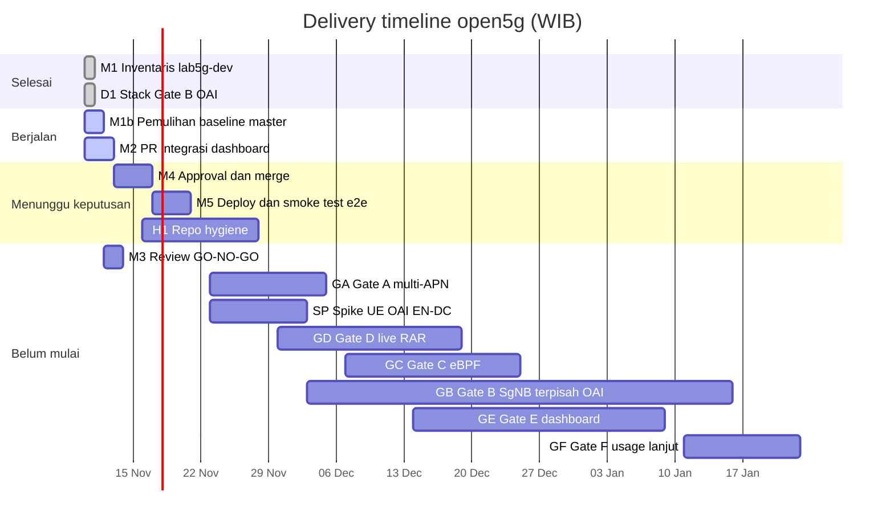

# Delivery timeline open5g

Disusun 10 Nov 2026 pukul 15:02 WIB. Data di bawah sudah memuat update 15:11 WIB.

**Semua tanggal pada dokumen ini adalah target perencanaan, bukan janji.**

Pada update itu, inventaris lab (M1) sudah selesai. Stack Gate B sudah diputuskan OAI pada 10 Nov 2026 pukul 15:06 WIB. Amarisoft tidak dipakai. Pemulihan lab5g-dev ke baseline `master` adalah M1b: disetujui Netdrive pukul 15:11 WIB, status Berjalan, target 11 Nov. M1b menjadi dependensi smoke test e2e dashboard (M5), bersama M4 dan persetujuan deploy.

Urutan dashboard: M2, lalu M3, lalu M4, lalu M5 (target 20 Nov). Gate berikutnya pada rencana ini: A (4 Des), D (18 Des), C (24 Des), E (8 Jan 2027), B (15 Jan 2027), dan F (22 Jan 2027). Urutan D sebelum C masih asumsi.

Ada 15 butir: 2 selesai, 2 berjalan, 3 menunggu keputusan, 8 belum mulai.

## Timeline

Zona waktu: **WIB** (Asia/Jakarta, UTC+7). Blok diagram memakai `dateFormat YYYY-MM-DD` dan `inclusiveEndDates`. Tanggal akhir yang tertulis adalah tanggal selesai pada tabel, inklusif.

Bagian diagram mengikuti status. Batang `done` sudah selesai. Batang `active` sedang berjalan.

## Milestone

| ID | Milestone | Owner | Dependensi | Kriteria selesai | Mulai | Selesai | Target | Status |
|---|---|---|---|---|---|---|---|---|
| M1 | Inventaris lab5g-dev (read-only) | Lab Ops | — | Tidak ada di PRD. Kriteria kerja: laporan versi, kontainer, endpoint, tanpa mengubah lab. | 2026-11-10 | 2026-11-10 | 10 Nov | Selesai |
| M1b | Pemulihan lab5g-dev ke baseline master (SMF mati sejak 6 Nov 21:12 WIB) | Lab Ops | M1; disetujui Netdrive 10 Nov 15:11 WIB | Backup config PoC + Mongo, terapkan baseline master, semua NF up, Sx/Gx/S1 terasosiasi. | 2026-11-10 | 2026-11-11 | 11 Nov | Berjalan |
| M2 | PR integrasi dashboard ↔ lab5g-dev | Dev | `master`; M1 | Tidak ada di PRD. PR terbuka dengan URL dan SHA, tes backend/frontend lulus, stock adapter tetap menolak RAR langsung sampai Gate D. | 2026-11-10 | 2026-11-12 | 12 Nov | Berjalan |
| M3 | Review GO/NO-GO Architect + QA | Architect, QA | M2 | GO pada SHA yang sama; QA memisahkan hasil sintetis dari RAN/UE nyata. | 2026-11-12 | 2026-11-13 | 13 Nov | Belum mulai |
| M4 | Approval + merge oleh Netdrive | Netdrive | M3 | PR di-approve dan di-merge manual. | 2026-11-13 | 2026-11-16 | 16 Nov | Menunggu keputusan |
| M5 | Deploy dashboard ke lab5g-dev + smoke test e2e | Lab Ops, QA | M4; M1b; persetujuan deploy Netdrive | Tidak ada di PRD. Deploy SHA ter-merge, smoke test QA lulus, lab5g-vm tidak disentuh (NFR-LAB-01..03). | 2026-11-17 | 2026-11-20 | 20 Nov | Menunggu keputusan |
| H1 | Repo hygiene: main ↔ master, README, CI, lisensi | Dev, QA | Keputusan Netdrive | Tidak ada di PRD. `main` memuat `infra/`, README terbaru, CI menjalankan tes, file lisensi ada. | 2026-11-16 | 2026-11-27 | 27 Nov | Menunggu keputusan |
| D1 | Keputusan stack Gate B: OAI | Netdrive | Rekomendasi NA (OAI eNB + en-gNB terpisah, tag `2026.w43`) | Diputuskan 10 Nov 15:06 WIB: OAI. Amarisoft tidak dipakai. | 2026-11-10 | 2026-11-10 | 10 Nov | Selesai |
| GA | Gate A lengkap: multi-APN/SDF/URR | Lab Ops, QA | lab5g-dev | PRD/ROADMAP: LTE attach; dua APN ke UPF (plus SGW-U); SDF+URR; pcap T1–T2. Attach ACCEPTED 6 Nov; T1–T2 belum. | 2026-11-23 | 2026-12-04 | 4 Des | Belum mulai |
| SP | Spike UE OAI EN-DC over rfsim (go/no-go) | Architect, Lab Ops | D1 | PRD: spike 5–8 hari kerja = go/no-go; jika gagal, berhenti sebelum rebuild RAN penuh. Lab tanpa SDR, jadi rfsim. | 2026-11-23 | 2026-12-02 | 2 Des | Belum mulai |
| GD | Gate D: live RAR (patch PCRF admin-RAR) | Dev, Lab Ops, QA | Gate A; R-03 | PRD/ROADMAP: PCRF admin-trigger; T4–T8; evidence-chain FR-16. | 2026-11-30 | 2026-12-18 | 18 Des | Belum mulai |
| GC | Gate C: eBPF app detection | Dev, Lab Ops | Gate A | PRD/ROADMAP: IP/DNS/SNI + counters; T3; BTF terverifikasi. | 2026-12-07 | 2026-12-24 | 24 Des | Belum mulai |
| GB | Gate B: EN-DC Option 3x, SgNB terpisah (OAI) | Architect, Lab Ops, QA | Gate A; D1; spike GO | PRD FR-15/D3: X2 SgNB Addition; S1AP E-RAB Modification Indication/Confirm; S1-U ke gNB dengan TEID baru. | 2026-12-03 | 2027-01-15 | 15 Jan 2027 | Belum mulai |
| GE | Gate E: dashboard self-service | Dev, QA | M5; Gate D | PRD/ROADMAP: API/RBAC/grup/audit; FR-16/17; T10. | 2026-12-14 | 2027-01-08 | 8 Jan 2027 | Belum mulai |
| GF | Gate F: usage lanjut per-app | Dev, Architect | Gate C dan D | PRD/ROADMAP: SDF bridge; Gx usage hanya dengan patch R-01. Status PRD: Later. | 2027-01-11 | 2027-01-22 | 22 Jan 2027 | Belum mulai |

M1b adalah dependensi uji e2e dashboard (M5). M2 dapat berjalan paralel dengan M1b.

Kriteria yang menyebut PRD/ROADMAP mengikuti [`PRD-v0.6.md`](../prd/PRD-v0.6.md) dan [`ROADMAP.md`](../prd/ROADMAP.md). Yang bertanda "Tidak ada di PRD" adalah kriteria kerja. Keadaan lab yang memicu M1b ada di [inventaris 10 Nov 2026](../lab/LAB5G-DEV-INVENTORY-20261110.md). Aturan tim ada di [`TEAM.md`](TEAM.md).

## Keputusan yang dibutuhkan dari Netdrive

Stack Gate B tidak ada di tabel ini. Keputusan itu sudah selesai sebagai D1: OAI, 10 Nov 2026 pukul 15:06 WIB. Amarisoft tidak dipakai. Persetujuan pemulihan baseline juga sudah diberikan (M1b, 15:11 WIB).

| Keputusan | Dibutuhkan | Dampak bila tertunda |
|---|---|---|
| Approve + merge PR integrasi dashboard (manual) | 13–16 Nov | Jalur kritis bergeser 1:1. |
| Izin deploy pertama dashboard ke lab5g-dev | 16–17 Nov | Smoke test dan Gate A ikut mundur. |
| Merge `master` ke `main` + update README | 16 Nov | Default branch tanpa `infra/`. |
| Pasang CI GitHub Actions | 16 Nov | Verifikasi SHA tetap manual. |
| Lisensi kode baru | Sebelum 27 Nov | Memblok penggunaan ulang dan kontribusi luar. |
| Urutan Gate D lalu C (asumsi) atau sebaliknya | Sebelum 30 Nov | Rencana mengasumsikan D dulu. |

## Risiko utama

| ID | Risiko | Tingkat |
|---|---|---|
| R-12 | Spike UE OAI EN-DC over rfsim UNKNOWN. Jika NO-GO, Gate B perlu keputusan ulang. | Tinggi |
| R-03 | Patch PCRF admin-RAR masih draft, belum dikompilasi atau dites. | Tinggi |
| R-06 | Multi-APN srsUE UNKNOWN. | Sedang |
| R-08 | Kernel/BTF belum terverifikasi (kernel generik). | Sedang |
| Ops | Lab Ops operator tunggal. Lab tanpa snapshot atau rollback. | Sedang |
| Repo | Divergensi `main` / `master`. Belum ada CI. | Sedang |
| Kalender | Libur 25 Des dan 1 Jan. | — |

Register risiko PRD: [`RISKS.md`](../prd/RISKS.md).
