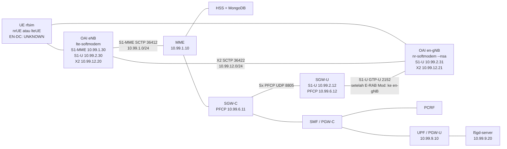

# Rencana uji go/no-go Gate B — OAI eNB + OAI en-gNB

| Field | Isi |
|---|---|
| Status dokumen | Rencana uji. Bukan hasil lab, bukan bukti Gate B, bukan izin eksekusi. |
| Tanggal | 10 November 2026 (WIB, UTC+7) |
| Keputusan stack | Netdrive, 10 November 2026 WIB. Tercatat sebagai [D4](../DECISIONS.md). |
| PRD | [PRD v0.6](../PRD-v0.6.md) FR-15, Gate B, D3. Badan PRD tidak diubah (dibekukan 6 Nov 2026). Dokumen ini tidak menambah gate. |
| Lab | Hanya `lab5g-dev` (`172.22.20.21`). `lab5g-vm` tetap read-only dan tidak disentuh. |
| Core | Open5GS **v2.8.0** EPC CUPS, image `gradiant/open5gs:2.8.0`, **diasumsikan tanpa patch**. |
| RAN | OAI eNB + OAI en-gNB, proses terpisah, tag git **`2026.w43`**. |
| Jendela | Hari 0 plus uji RAN, maksimum **8 hari kerja** (Hari 0–7). GO boleh lebih awal bila bukti lengkap. |
| Eksekusi | Tidak ada rebuild, pull image, perubahan compose, atau restart di lab sebelum PR rencana ini di-approve Netdrive. Merge PR dilakukan manual oleh Netdrive. |

Sumber lab yang dipakai di sini: inventori read-only Open5G Lab Ops, 10 Nov 2026 15:10–15:12 WIB; `lab/compose/docker-compose.yml`; `lab/versions.md` (snapshot 6 Nov 2026 20:17 WIB); `docs/evidence/gate-b-endc-integrated/SUMMARY.md`; `docs/evidence/gate-a-lab5g-dev/SUMMARY.md`.

---

## 1. Tujuan dan exit criteria

Gate B menguji **EN-DC Option 3x** dengan **SgNB / en-gNB terpisah** dari eNB, di EPC yang sudah ada. Master node adalah eNB LTE. Secondary node adalah en-gNB NR. Control plane UE tetap lewat S1-MME di eNB. Pada Option 3x, bearer yang diuji adalah split bearer / SCG bearer: **S1-U downlink berpindah dari eNB ke en-gNB**, dan traffic downlink pengguna lewat NR.

Exit criteria di bawah mengikuti FR-15 dan Gate B pada PRD v0.6. Semuanya wajib. RRC NR saja, atau throughput NR pada proses yang sama, tidak menutup Gate B.

| # | Exit criterion | Bukti yang diterima |
|---|---|---|
| E1 | Dua proses RAN terpisah: OAI eNB dan OAI en-gNB (SgNB) | Dua container atau dua PID. eNB menjalankan `lte-softmodem`. en-gNB menjalankan `nr-softmodem` pada mode NSA. Bukan satu proses srsENB. |
| E2 | X2AP over SCTP port **36422**: X2 Setup, lalu SgNB Addition Request, SgNB Addition Request Acknowledge, dan SgNB Reconfiguration Complete | Pcap pada jaringan X2, plus log kedua proses |
| E3 | RRC reconfiguration yang membawa konfigurasi NR ke UE | Log UE dan pcap RRC (dari proses RAN atau UE) |
| E4 | S1AP **E-RAB Modification Indication** (eNB → MME) dan **E-RAB Modification Confirm** (MME → eNB) | Pcap S1-MME (SCTP 36412) |
| E5 | Downlink S1-U pindah dari eNB ke en-gNB dengan **TEID baru** | Pcap PFCP Session Modification **SGW-C → SGW-U** dan pcap GTP-U. TEID serta alamat GTP sesudah indikasi berbeda dari TEID/alamat eNB sebelumnya, dan menunjuk ke en-gNB. |
| E6 | Split bearer / SCG bearer Option 3x: downlink pengguna lewat NR | Payload downlink uji terlihat pada GTP-U en-gNB, bukan hanya pada GTP-U eNB |
| E7 | Data uplink dan downlink end-to-end sampai SGi | Ping atau transfer ke `l5gd-server` `10.99.9.20` sukses setelah E5, dengan pcap SGi yang sejalan |

S1AP untuk UE tetap di eNB. en-gNB pada Option 3x tidak menggantikan S1-MME. Yang pindah adalah tunnel S1-U downlink bearer yang ditambahkan ke SgNB.

### Kenapa integrated srsENB = achieved-but-not-accepted

Pada 6 Nov 2026 20:17 WIB, srsRAN 4G 25.10 di `lab5g-dev` menjalankan sel LTE dan sel NR **di dalam satu proses srsENB** (ZMQ, satu S1). Ringkasan ada di [docs/evidence/gate-b-endc-integrated/SUMMARY.md](../../evidence/gate-b-endc-integrated/SUMMARY.md).

Yang tercapai pada topologi itu:

- Attach, UE `10.45.0.4` (larian sebelumnya `10.45.0.3`).
- RRC NR reconfiguration dan Random Access Complete (`c-rnti=0x4601`).
- Beban NR tercatat kira-kira DL 3,50–4,66 Mbps dan UL 3,66–4,75 Mbps.
- S1-MME `10.99.1.10:36412` ↔ `10.99.1.20` ESTAB.
- S1-U tetap `10.99.2.20` (eNB) ↔ `10.99.2.12` (SGW-U).

Itu tidak diterima untuk Gate B karena D3 (Hidayat, 6 Nov 2026, “harus sgnb”):

- Tidak ada SgNB terpisah, jadi tidak ada X2 Setup dan tidak ada SgNB Addition.
- E-RAB Modification Indication tidak teramati. Satu proses tidak perlu memindahkan tunnel S1-U ke node lain.
- Tidak ada tunnel S1-U khusus gNB dan tidak ada TEID baru di en-gNB.
- Pcap S1AP di dalam eNB pada set bukti itu kosong. Angka throughput NR tidak menggantikan transaksi S1AP/X2AP.

Keputusan produk itu tetap. Rencana ini menguji bentuk yang D3 minta. Hasil integrated tidak dihitung ulang sebagai lulus.

---

## 2. Topologi target

Tiga proses RAN, plus UE, di guest yang sama dengan core yang sudah jalan:

| Proses | Peran | Binary (dokumen tag) |
|---|---|---|
| OAI eNB | Master LTE, S1-MME, X2 ke en-gNB, S1-U sebelum pindah | `lte-softmodem` |
| OAI en-gNB | SgNB NR, X2, S1-U sesudah E-RAB Modification | `nr-softmodem --nsa` |
| UE | Spike EN-DC lewat rfsim | OAI `nr-uesoftmodem` dan/atau `lte-uesoftmodem`. **Status EN-DC rfsim = UNKNOWN** (lihat §2.4) |

Selama jendela OAI, srsENB dan srsUE **tidak jalan**. Alamat `10.99.1.20` dan `10.99.2.20` tetap milik baseline srsRAN dan tidak dipinjam OAI.

Core yang tetap, tanpa menambah NF 5GC: MongoDB, HSS, PCRF, MME, SGW-C, SGW-U, SMF/PGW-C, UPF/PGW-U. Image Open5GS tetap `gradiant/open5gs:2.8.0`. Patch PCRF admin-RAR tidak masuk ke uji ini (status di repo: DRAFT, NOT COMPILED, NOT TESTED).

`infra/roles/ran_oai` adalah scaffold WIP: service kosong, image `:latest`. Rencana ini **tidak** memakai role itu dan **tidak** mengubahnya. Image `:latest` tidak boleh ditarik untuk spike.

### 2.1 Diagram

Alamat OAI di diagram adalah **rencana**, belum ada di compose.

Jalur downlink yang harus terbaca di pcap setelah E-RAB Modification: server SGi → UPF → SGW-U `10.99.2.12` → en-gNB `10.99.2.31` → UE lewat rfsim NR. Sebelum indikasi, GTP-U downlink masih ke eNB `10.99.2.30`. Kedua arah itu disimpan, supaya pindah TEID kelihatan.

### 2.2 Jaringan yang sudah terpakai

Dari `lab/compose/docker-compose.yml` dan `lab/compose/docker-compose-ran.yml`. Lab Ops (10 Nov 2026) mengunci subnet yang sama: `10.99.1`, `.2`, `.4`–`.9`, `.10` (mgmt), `.11` (ran_uu), ditambah docker `172.17.0.0/16` dan `172.16.0.0/16`. **X2 memakai `10.99.12.0/24`.** `10.99.3.0/24` tidak dipakai compose dan **tidak** dialihkan ke X2.

| Jaringan compose | Subnet | Antarmuka | Port | Alamat yang sudah ada |
|---|---|---|---|---|
| `s1mme` | `10.99.1.0/24` | S1-MME | SCTP 36412 | MME `10.99.1.10`; srsENB `10.99.1.20` |
| `s1u` | `10.99.2.0/24` | S1-U | UDP 2152 | SGW-U `10.99.2.12`; srsENB `10.99.2.20` |
| `s11` | `10.99.4.0/24` | S11 | GTP-C | MME `10.99.4.10`; SGW-C `10.99.4.11` |
| `s5s8` | `10.99.5.0/24` | S5/S8 | GTP-C / GTP-U | SGW-C `.11`; SMF `.12`; SGW-U `.13`; UPF `.14`; UPF-A `.15`; UPF-B `.16` |
| `pfcp` | `10.99.6.0/24` | Sx | UDP 8805 | SGW-C `.11`; SGW-U `.12`; SMF `.13`; UPF `.14`; UPF-A `.15`; UPF-B `.16` |
| `s6a` | `10.99.7.0/24` | S6a | Diameter | MME `10.99.7.10`; HSS `10.99.7.11` |
| `gx` | `10.99.8.0/24` | Gx | Diameter | PCRF `10.99.8.11`; SMF `10.99.8.12` |
| `sgi` | `10.99.9.0/24` | SGi | — | UPF `10.99.9.10`; server `10.99.9.20`. Pool UE `10.45.0.0/16` |
| `mgmt` | `10.99.10.0/24` | DB | Mongo | mongo `10.99.10.2`; HSS `.3`; PCRF `.4` |
| `uu` | `10.99.11.0/24` | ZMQ srsRAN | TCP 2000/2001, 2100/2101 | srsENB `.20`; srsUE `.21` |

Contoh `mme.yaml` di repo: PLMN **001/01**, TAC **1**, GUMMEI group **2** code **1**, S1AP server `10.99.1.10`, tanpa daftar eNB statis. Hari 0 memeriksa file **live** (bukan hanya example) supaya eNB OAI memakai PLMN/TAC yang sama. eNB ID OAI tidak sama dengan eNB ID srsRAN, walaupun keduanya tidak jalan bersamaan.

Pcap Gx diambil bila pada jendela yang sama ada transaksi Diameter. Gx bukan exit Gate B. Option 3x yang diuji tidak membutuhkan Gx RAR.

### 2.3 Alamat yang diusulkan (belum diterapkan)

| Fungsi | Alamat | Port |
|---|---|---|
| OAI eNB S1-MME | `10.99.1.30` | SCTP 36412 ke MME `10.99.1.10` |
| OAI eNB S1-U | `10.99.2.30` | UDP 2152 |
| OAI en-gNB S1-U | `10.99.2.31` | UDP 2152. Ini tujuan GTP-U downlink **sesudah** E-RAB Modification |
| OAI eNB X2 | `10.99.12.20` | SCTP **36422** |
| OAI en-gNB X2 | `10.99.12.21` | SCTP **36422** |
| Jaringan rfsim | usulan `10.99.13.0/24` | TCP. Default upstream rfsimulator **4043** (eNB/gNB sebagai server). Peran client/server EN-DC dan jumlah kanal = **UNKNOWN** sampai Hari 1 |

`10.99.13.0/24` hanya usulan rencana ini agar pcap rfsim tidak bercampur dengan X2. Lab Ops mengunci subnet itu pada Hari 1, atau memilih subnet lain di luar daftar terpakai dan di luar `172.16/17`. Rfsim tidak diletakkan di `10.99.12.0/24`.

Nama jaringan docker yang diusulkan, mengikuti project `lab5g-dev`: `lab5g-dev_x2` (subnet `10.99.12.0/24`, internal) dan, bila usulan diterima, `lab5g-dev_rfsim`. Keduanya belum dibuat. Tidak ada port yang dipublish ke host, sama seperti stack sekarang.

### 2.4 Pin OAI `2026.w43`

Tag **ada**. Diperiksa 10 Nov 2026 terhadap GitLab `oai/openairinterface5g`, GitHub `OPENAIRINTERFACE/openairinterface5g`, dan GitHub `duranta-project/openairinterface5g` (banner GitLab menyatakan pohon resmi pindah ke repo Duranta; objek tag sama).

| Item | Nilai |
|---|---|
| Tag | `2026.w43` |
| Objek tag (annotated) | `facd9c5ec45621ab591c8da0953a6682b17e1ac4` |
| Commit yang ditunjuk | `cfee4c20b45ac1cf6d455d3f01bb3e00200438b0` |
| Pesan | `Merge remote-tracking branch 'origin/integration_2026_w43' into develop` |
| Waktu tag | 23 Oktober 2026 17:45 WIB (10:45:41Z) |

Yang di-pin adalah **commit itu**, pada eNB, en-gNB, dan UE sekaligus. Tag mengambang `develop`, `latest`, `2026.w44`, dan `v3.0.0` ada di Docker Hub pada minggu yang sama dan **bukan** pin. Mereka bukan fallback teknis; mengganti pin adalah keputusan Netdrive yang baru.

Image resmi yang namanya sama dengan tag, arsitektur **linux/amd64** (guest Xeon), dicatat dari Docker Hub pada 10 Nov 2026. Ukuran adalah field `size` API, bukan ukuran terkompresi di disk guest. **Kecocokan image ↔ commit belum diverifikasi di lab** (tidak ada build log di guest). Sampai Lab Ops mencatat RepoDigest saat pull dan mencocokkannya dengan tabel ini, identitas image di dalam guest = **UNKNOWN**.

| Image | Digest yang dicatat | Size (byte) | Last pushed (UTC) |
|---|---|---|---|
| `oaisoftwarealliance/oai-enb:2026.w43` | `sha256:37b6fef0400143f798782a5799c4fd6589e3a61a0e604d0dba3856efba616530` | 148885575 | 2026-10-23T11:27:08Z |
| `oaisoftwarealliance/oai-gnb:2026.w43` (manifest list) | `sha256:b7554483225068fa9c6a03032507b00fc2c663786c436fe61ea89b956fdb4850` | — | 2026-10-23T11:27:25Z |
| indeks amd64 image gNB di atas | `sha256:c994df476134e06cc4f57f7d7621fef00c11002a7999a565b1ee33e511ad41a6` | 171059248 | 2026-10-23T11:27:23Z |
| `oaisoftwarealliance/oai-nr-ue:2026.w43` (manifest list) | `sha256:d7ac8b9566488d6c4e5f04ae9a7a64a2693b3d6947f1045add7b44075176e119` | — | 2026-10-23T11:27:59Z |
| indeks amd64 image nr-ue | `sha256:d6e2fa6bcbb25ceeee58722f207d380400fcdee5a1bfa0e796742486aa7b67a7` | 158813397 | 2026-10-23T11:27:57Z |
| `oaisoftwarealliance/oai-lte-ue:2026.w43` | `sha256:e531ef82da4cedb22710abd7a4a8f32f26584af7b8940637cdc6415efceee48e` | 119559399 | 2026-10-23T11:27:43Z |

Jumlah size amd64 keempat image ≈ **571 MiB**. Itu muat di sisa disk saat ini. Build source di dalam guest adalah risiko lain (§4 dan R-19). Image arm64 gNB/nr-ue tidak dipakai.

Dokumen pada commit `cfee4c20` (dibaca dari pohon tag, bukan dari `develop`):

- `doc/FEATURE_SET.md`: mode NSA disebut untuk **gNB**, “unstable (only one UE connection)”. X2AP gNB: X2 setup dan SgNB Addition Request / Acknowledge / Reconfiguration Complete (36.423 Rel-15). X2AP eNB: EN-DC, rangkaian SgNB Addition yang sama, RRC Connection Reconfiguration dengan info sel 5G, dan S1AP E-RAB Modification Indication / Confirmation.
- `doc/RUNMODEM.md`: `nr-softmodem --nsa` membutuhkan LTE eNB dan menunjuk ke `doc/TESTING_OAI_NSA_COTS_UE.md`.
- `doc/TESTING_OAI_NSA_COTS_UE.md`: eNB = `lte-softmodem`, gNB = `nr-softmodem --nsa`, X2 SCTP **36422**, contoh front-end USRP. Halaman itu menulis bahwa isinya mungkin usang dan masih menyebut tag **2020.w39**. UE pada halaman itu adalah **COTS**, bukan nrUE/lteUE rfsim.
- `radio/rfsimulator/README.md`: `--rfsim`; default klien ke `127.0.0.1:4043`; eNB/gNB memakai `--rfsimulator.[0].serveraddr server`. Dokumen ini **tidak** berisi topologi EN-DC. Rfsim “is not designed to run close to real-time”.
- Bagian LTE UE di `FEATURE_SET.md` tidak menyebut EN-DC. Mode yang disebut untuk nrUE adalah SA, phy-test, dan noS1, bukan NSA.

**UNKNOWN — UE EN-DC rfsim:** tidak ada pernyataan upstream pada commit ini bahwa `nr-uesoftmodem` atau `lte-uesoftmodem` menyelesaikan EN-DC lewat rfsim. Spike ada untuk menguji hal itu, bukan untuk menganggapnya didukung. Hari 1 membaca `--help` binary terpin dan README rfsim pada commit yang sama. Bila tidak ada mode EN-DC, itu NO-GO jalur UE (§3), bukan alasan mencoba `develop`.

### 2.5 Open5GS 2.8.0 tanpa patch — hipotesis yang wajib diuji

Asumsi rencana: core tetap image lab `gradiant/open5gs:2.8.0`, tanpa patch dan tanpa rebuild `open5gs-src`. Id image pada snapshot `lab/versions.md` (6 Nov 2026): `sha256:1740bc23cc56401b81cb1661342879dbe413560613df21fcd64999c49ac7996d`. Hari 0 mengulang `docker image inspect` dan mencatat bila id live berbeda. Perbedaan id tidak menjadi alasan menarik image baru di tengah uji.

Pada tag sumber Open5GS `v2.8.0`, `src/mme/s1ap-handler.c` memuat `s1ap_handle_e_rab_modification_indication`. Isu publik lama (#834, #864) menunjukkan prosedur ini pernah tidak diimplementasi, lalu ada laporan lulus di sekitar v2.2.x, dan ada laporan `Invalid Action` sesudah Indication. **Keberadaan fungsi di pohon sumber bukan hasil lab.** Tiga titik berikut adalah hipotesis. Gagal di salah satu = NO-GO untuk core tanpa patch, bukan izin menambal diam-diam.

| ID | Hipotesis | Cara uji |
|---|---|---|
| H1 | MME pada image lab menerima E-RAB Modification Indication dari OAI eNB dan membalas E-RAB Modification Confirm | T-B5, pcap S1-MME. Log “Not implemented” atau tidak ada Confirm = gagal |
| H2 | SGW-C mengirim PFCP Session Modification ke SGW-U, dan SGW-U mengganti F-TEID downlink ke `10.99.2.31` dengan TEID baru | T-B6 dan T-B7 |
| H3 | HSS dan MME menerima UE yang memasang EN-DC (bit DCNR di UE Network Capability, dan restriction NR-as-secondary tidak menolak) | T-B4. Nilai historis `access_restriction_data=32` pada uji integrated **bukan** bukti DCNR untuk SgNB terpisah. Jangan menyalinnya sebagai konfigurasi baru tanpa membaca field subscriber live |

Subscriber uji, Ki, OPc, dan IMSI tidak ditulis ke git.

---

## 3. Rencana harian (maksimum 8 hari kerja)

Hari kerja dihitung di WIB. Hari 0 adalah prasyarat Gate A yang sudah ada di PRD, bukan gate baru. Uji OAI hanya mulai setelah Hari 0 GO. Bila Hari 0 makan lebih dari satu hari, sisa hari OAI menyusut; batas akhir tetap Hari 7.

Setiap hari menghasilkan bukti di direktori lab di luar git (usulan `/home/lab/lab5g-dev/evidence/gate-b-oai-rfsim/hari-N/`), lalu ringkasan yang sudah disensor masuk ke format §6. Isi bukti per langkah: pcap per antarmuka yang disebut, cuplikan log (`docker logs`, tanpa IMSI/kunci), dan tangkapan layar atau teks `docker ps` / `ss` bila tidak ada GUI. Pcap diambil dari container `nicolaka/netshoot` yang menempel ke jaringan docker yang bersangkutan, atau dari bridge docker di guest. Tidak ada port publish baru.

Perintah di bawah adalah kriteria, bukan skrip baru di repo. Lab Ops menulis perintah operasional di catatan hari itu setelah PR di-approve.

### Henti dini (berlaku setiap hari)

Berhenti pada hari yang sama, jangan lanjut ke langkah RAN berikutnya, bila salah satu ini terjadi:

1. Hari 0 tidak menghasilkan attach LTE dan ping SGi.
2. Sisa disk `/` akan turun di bawah **8 GiB** bila pull atau build berikutnya jalan.
3. Binary terpin tidak memuat mode EN-DC untuk UE, dan tidak ada jalur rfsim yang tertulis di dokumen commit yang sama.
4. MME membalas error atau tidak membalas Confirm untuk E-RAB Modification Indication pada image 2.8.0 tanpa patch, setelah satu kali ulang dengan pcap yang sudah lengkap (PLMN, TAC, alamat, dan TEID sudah dicek).
5. Softmodem tetap kehilangan slot setelah mitigasi §4 (srsRAN mati, bandwidth kecil, pinning), sehingga tidak ada satu larian attach yang utuh untuk dipcap.
6. Batas Hari 7 tercapai tanpa E1–E7.

Henti dini menulis status **NO-GO** untuk jalur yang gagal, menjalankan rollback §5, dan mengembalikan baseline Hari 0 (attach + ping). Henti dini **tidak** membeli Amarisoft. Amarisoft hanya rekomendasi tertulis; biaya tetap keputusan Netdrive.

### Pemicu rekomendasi fallback Amarisoft

Fallback ini sudah ada di PRD v0.6 (Callbox + UEsim). Rencana ini tidak menambah produk lain. Rekomendasi ditulis di ringkasan bukti bila salah satu pemicu berikut yang menyebabkan NO-GO:

- UE OAI tidak punya mode EN-DC rfsim pada tag yang di-pin.
- X2 Setup tidak selesai setelah alamat, port 36422, PLMN, dan TAC sudah sesuai dokumen tag.
- Rangkaian SgNB Addition tidak selesai.
- H1 atau H2 gagal pada Open5GS 2.8.0 tanpa patch.
- Delapan hari kerja habis tanpa E1–E7, dan penyebabnya bukan jendela lab yang dipindah karena prioritas dashboard (§7, R-21).

srsENB + OAI gNB sebagai jembatan X2 tetap tidak dianjurkan (ROADMAP: X2AP srsENB tidak memakai jalur SgNB yang diminta D3).

### Hari 0 — pulihkan baseline Gate A

Lab live pada 10 Nov 2026 15:10 WIB **bukan** baseline Gate A. State-nya PoC slicing. `l5gd-smf` EXITED (255) sejak **6 Nov 2026 21:12 WIB** (`cannot open file /etc/o5/smf.yaml` pada override PoC). UPF lepas asosiasi dari SMF pada 6 Nov 21:05 WIB. Sesi SGW-U terakhir lepas 6 Nov 21:26 WIB. UE yang masih jalan hanya siklus RRC. Ada `upf-a`, `upf-b`, dan `cgnat`. File `.bak-endc`, `.bak-poc`, dan `.lte-endc` tidak dihapus.

Langkah:

1. Catat `docker ps -a`, compose file yang aktif, dan `docker image inspect` Open5GS. Tanpa restart dulu.
2. Kembalikan runtime core ke jalur Gate A: SMF stock `gradiant/open5gs:2.8.0` yang bisa membuka konfigurasi, UPF terasosiasi, **tanpa** rebuild source dan **tanpa** patch PCRF. Override PoC yang mematahkan `smf.yaml` tidak dipakai pada perintah jalan. File PoC tetap di disk.
3. Hentikan kontainer PoC yang tidak ada pada bukti Gate A (`upf-a`, `upf-b`, `cgnat`) setelah core Gate A berdiri. Jangan menghapus volume-nya.
4. RAN baseline: srsUE lalu srsENB **LTE-only** (jalur `lte-only-restore.sh` hanya bila file `.bak-endc` memang konfigurasi LTE yang lulus Gate A). Integrated EN-DC srsRAN tidak dipakai sebagai bukti Hari 0.
5. Verifikasi: S1 ESTAB MME `10.99.1.10` ↔ eNB `10.99.1.20`; attach; ping UE → `10.99.9.20`.

Bukti: log SMF yang menunjukkan file konfigurasi terbuka dan asosiasi PFCP; `docker ps`; pcap S1-MME singkat; log attach tanpa IMSI; keluaran ping.

| Hasil | Arti |
|---|---|
| GO | Attach dan ping SGi berhasil pada baseline LTE. Uji OAI boleh dijadwalkan. |
| NO-GO | SMF tetap mati, atau attach/ping gagal. OAI tidak dimulai. Perbaiki baseline di jendela berikut; hari OAI tidak “dipinjam” untuk debug PoC. |
| Fallback | Tidak ada. Hari 0 bukan uji RAN. Amarisoft tidak relevan. |

### Hari 1 — pin, image, jaringan, baca binary

Langkah: sediakan image amd64 §2.4 lewat mirror (jaringan lab internal tidak punya egress; proxy host port 11080 pada inventori **belum diverifikasi**). Catat RepoDigest. Cocokkan dengan tabel §2.4. Bila digest tidak cocok, image itu tidak dipakai; bangun dari commit `cfee4c20` hanya di mesin yang sisa disknya aman (§4), lalu pindahkan image. Buat jaringan `x2` `10.99.12.0/24` dan jaringan rfsim yang sudah dikunci. Pasang eNB/en-gNB ke `s1mme`, `s1u`, dan `x2` **tanpa** men-start softmodem bila Hari 0 belum GO. Baca `--help` dan contoh konfigurasi NSA pada commit yang sama. Putuskan satu UE yang akan dicoba lebih dulu dan tulis UNKNOWN yang tersisa.

Bukti: digest, `df -h /`, kutipan `--help` (mode NSA / rfsim), daftar jaringan `docker network ls`.

| Hasil | Arti |
|---|---|
| GO | Digest cocok atau image dibangun dari commit yang sama; disk di atas ambang; mode yang akan diuji tertulis. |
| NO-GO | Tidak ada mode UE EN-DC pada binary dan dokumen commit. Spike UE berhenti di sini. |
| Fallback | NO-GO pada baris di atas memicu **rekomendasi** Amarisoft. Tidak ada pembelian pada hari ini. |

### Hari 2 — OAI eNB saja, S1 Setup

srsENB dan srsUE tetap mati. Nyalakan hanya OAI eNB (rfsim server bila itu perannya). Tanpa en-gNB dan tanpa UE.

Bukti: pcap S1-MME (S1 Setup Request/Response), log MME “eNB associated”, `ss` SCTP 36412 antara `10.99.1.10` dan `10.99.1.30`. Satu cuplikan CPU (`docker stats` atau `pidstat`) selama eNB idle.

| Hasil | Arti |
|---|---|
| GO | S1 Setup sukses dengan PLMN 001/01 dan TAC 1 (atau nilai live Hari 0, bila berbeda — catat, jangan menebak). |
| NO-GO | eNB tidak menyelesaikan S1 Setup setelah alamat dan PLMN dicek. Jangan menambah gNB untuk “mencoba untung”. |
| Fallback | Belum, kecuali penyebabnya adalah binary yang salah tag. Ulangi sekali dengan image yang digest-nya benar. Masih gagal pada akhir hari = henti dini RAN. |

### Hari 3 — en-gNB dan X2 Setup

Nyalakan en-gNB `nr-softmodem --nsa` pada tag yang sama. Tanpa UE.

Bukti: pcap X2 SCTP 36422, X2 Setup Request dan X2 Setup Response antara `10.99.12.20` dan `10.99.12.21`. Log kedua proses. Pcap S1-MME tetap menunjukkan satu asosiasi eNB (en-gNB tidak menjadi MME kedua).

| Hasil | Arti |
|---|---|
| GO | X2 Setup sukses. |
| NO-GO | Tidak ada X2 Setup sukses pada hari ini setelah IP dan port 36422 dicek. |
| Fallback | NO-GO hari ini = rekomendasi Amarisoft untuk jalur X2 OAI. Rollback §5 sebelum akhir hari. |

### Hari 4 — UE rfsim dan RRC NR

Nyalakan satu UE. Target: attach LTE lewat eNB, lalu RRC Connection Reconfiguration yang memuat sel NR.

Bukti: log UE (redacted), pcap RRC, pcap S1-MME (Initial Context / E-RAB Setup awal, tunnel masih ke `10.99.2.30`). CPU selama prosedur.

| Hasil | Arti |
|---|---|
| GO | UE attach di LTE dan RRC reconfiguration NR terlihat (E3). Belum cukup untuk Gate B. |
| NO-GO | UE tidak melihat sel, atau tidak ada reconfiguration NR. Satu kali ulang dengan bandwidth §4. Masih gagal = NO-GO UE rfsim. |
| Fallback | NO-GO UE rfsim memicu rekomendasi Amarisoft. Jangan beralih ke image `develop` pada hari yang sama. |

### Hari 5 — SgNB Addition, E-RAB Modification, TEID

Bukti, masing-masing file pcap terpisah:

- X2: SgNB Addition Request, SgNB Addition Request Acknowledge, SgNB Reconfiguration Complete (E2).
- S1-MME: E-RAB Modification Indication dan Confirm (E4, H1).
- Sx: PFCP Session Modification dari `10.99.6.11` ke `10.99.6.12` yang mengubah F-TEID downlink (E5, H2).
- S1-U: GTP-U downlink sesudah itu menuju `10.99.2.31`, TEID sama dengan yang di PFCP, dan berbeda dari TEID eNB `10.99.2.30`.

| Hasil | Arti |
|---|---|
| GO | E2, E4, dan E5 lengkap pada satu larian UE yang sama. |
| NO-GO | Confirm tidak ada, atau PFCP/GTP-U tidak pindah ke en-gNB. Ini NO-GO core-tanpa-patch bila RAN sudah mengirim Indication yang valid. |
| Fallback | NO-GO H1 atau H2 memicu rekomendasi Amarisoft **hanya bila** penyebab yang tersisa adalah UE/RAN. Bila MME Open5GS yang menolak prosedur, rekomendasi ke Netdrive adalah: Gate B pada core ini tidak lulus tanpa keputusan patch terpisah. Rencana ini tidak menulis patch itu. |

### Hari 6 — downlink NR dan data SGi

Kirim ping dan satu aliran downlink (iperf atau setara yang sudah ada di `l5gd-server`) **setelah** pindah TEID.

Bukti: pcap GTP-U di en-gNB berisi payload downlink (E6); pcap SGi `10.99.9.20` sejalan; ping UL dan DL dari UE (E7). Simpan juga cuplikan GTP-U eNB pada jendela yang sama supaya terlihat bearer downlink tidak tetap di eNB.

| Hasil | Arti |
|---|---|
| GO | E6 dan E7 lulus. Gabungan Hari 2–6 menutup E1–E7. |
| NO-GO | Control plane lengkap tetapi downlink tetap di eNB, atau ping SGi gagal setelah pindah TEID. |
| Fallback | Sama dengan Hari 5: tulis pemicu yang mana, lalu rollback. |

### Hari 7 — paket bukti, atau sisa ulang yang sudah diizinkan hari sebelumnya

Tidak ada skenario baru. Ulangan hanya untuk satu langkah yang Hari 5 atau 6 nyatakan “ulang sekali”. Selebihnya: susun ringkasan §6, jalankan rollback §5, ulangi attach + ping baseline, dan hentikan OAI.

| Hasil | Arti |
|---|---|
| GO | Ringkasan bukti E1–E7 lengkap, baseline Hari 0 hidup lagi, `lab5g-vm` tidak tersentuh. |
| NO-GO | Bukti masih bolong pada akhir hari. Status spike = NO-GO. Gate B tetap terbuka. Integrated srsENB tetap achieved-but-not-accepted. |
| Fallback | Rekomendasi Amarisoft ditulis di ringkasan bila pemicu §3 terpenuhi. Tidak ada pesanan pada dokumen ini. |

GO keseluruhan hanya bila E1–E7 lulus pada rfsim **dan** rollback baseline terbukti. Lulus sebagian tetap NO-GO Gate B.

---

## 4. Kebutuhan hardware, RF, dan SDR

### 4.1 Wajib untuk go/no-go: rfsim, tanpa RF

Angka guest dari inventori live Lab Ops, 10 Nov 2026 sekitar 15:12 WIB. Tidak ada SDR, GPSDO, atau UE COTS di guest. **Go/no-go Gate B = rfsim saja.**

| Item | Terukur | Dipakai untuk GO? |
|---|---|---|
| Guest | 8 vCPU, 1 thread/core, Intel Xeon Gold 6140 @ 2,30 GHz | Ya, dengan catatan sizing di bawah |
| RAM | 15 GiB, sekitar 13 GiB available | Ya |
| Disk | `/` 38 GiB, 22 GiB kosong. `/var/lib/docker` di partisi yang sama | Ya |
| Kernel | `6.8.0-136-generic` PREEMPT_DYNAMIC. Bukan lowlatency dan bukan RT | Ya untuk rfsim. Rfsim upstream memang tidak mensyaratkan real-time |
| Docker | 27.5.1 | Ya |
| Compose | v2.29.7, binary **`docker-compose`** (bukan plugin `docker compose`) | Ya. Pakai binary yang ada. Jangan menambah paket plugin di dalam spike |
| Hypervisor | 144 core, 251 GiB RAM | Kapasitas untuk resize. Resize guest butuh approval Netdrive |
| SDR, GPSDO, antena, UE COTS | Tidak ada | **Tidak** untuk go/no-go |

Bukti Gate A (6 Nov) menyebut 8 vCPU / 16 GiB. Angka yang dipakai rencana ini adalah inventori live **15 GiB**. Selisih itu tidak otomatis menjadi resize.

**Sizing.** Delapan vCPU tanpa SMT sudah memuat EPC CUPS. Spike menambah `lte-softmodem`, `nr-softmodem`, dan paling tidak satu UE, masing-masing dengan PHY rfsim. Dokumen rfsim pada tag yang sama menyatakan simulator tidak ditujukan untuk berjalan dekat real-time dan menyarankan bandwidth lebih kecil. Karena beban OAI di guest ini **belum diukur**, 8 vCPU tidak dinyatakan cukup dan tidak dinyatakan gagal.

Rekomendasi ke Netdrive, sebagai **keputusan terbuka** (bukan bagian dari merge dokumen ini):

- Naikkan guest ke **16 vCPU dan 32 GiB** sebelum Hari 2 bila Hari 0 sudah menunjukkan load average mendekati 8 hanya dengan srsRAN LTE + EPC, atau segera setelah softmodem OAI pertama kehilangan slot secara terus-menerus.
- Host punya inti dan RAM untuk itu. Yang dibutuhkan adalah approval mengubah guest, bukan pengadaan mesin.
- 16 vCPU / 32 GiB juga belum terukur terhadap OAI. Itu langkah berikutnya, lalu diuji lagi dengan bukti CPU. Tidak ada harga pada rekomendasi ini.

Bila Netdrive **tidak** me-resize, mitigasi berikut wajib, bukan opsional:

1. srsENB dan srsUE mati selama Hari 1–7.
2. Kontainer PoC (`upf-a`, `upf-b`, `cgnat`) tetap mati setelah Hari 0.
3. Bandwidth kecil: LTE **5 atau 10 MHz** (keduanya ada di feature set eNB tag ini: 5, 10, 20 MHz). NR mulai di **20 MHz**, naik ke **40 MHz** hanya bila 20 MHz sudah lulus E1–E7 dan CPU masih longgar. Jangan mulai dari 100 MHz.
4. CPU pinning seadanya: dua inti untuk proses EPC yang sibuk, dua untuk eNB, dua untuk en-gNB, dua untuk UE. Dengan 8 inti ini sempit; catat `docker stats` supaya pinning yang gagal kelihatan.
5. Ambang disk: hentikan pull/build bila sisa `/` akan turun di bawah **8 GiB**.

Kernel lowlatency **bukan** syarat GO rfsim. Mengganti kernel guest adalah perubahan terpisah dan tidak masuk rencana ini.

### 4.2 Tidak wajib untuk go/no-go: OTA, setelah rfsim GO

Fase ini adalah kebutuhan pengadaan. **Keputusan biaya ada di Netdrive.** Rencana ini tidak menyebut harga dan tidak men-start OTA.

Yang perlu diputuskan bila, dan hanya bila, rfsim sudah GO:

| Kebutuhan | Catatan |
|---|---|
| SDR eNB dan SDR en-gNB | Dua proses butuh dua rantai RF. Contoh yang disebut dokumen NSA upstream pada commit ini: USRP B210 atau B200mini per proses. **Pilihan perangkat ditanyakan ke Netdrive** (2× B210, atau perangkat lain yang setara dan sudah diizinkan lab). Satu B210 untuk kedua proses tidak menjadi asumsi rencana ini. |
| Clock | Referensi bersama: GPSDO atau 10 MHz (dan 1 PPS bila perangkat yang dipilih memerlukannya). Halaman NSA upstream pada commit ini memakai external clock dan menandai detailnya belum lengkap. |
| Antena, kabel, attenuator, shielding | Untuk jalur conducted atau OTA terlindung. Bentuk pastinya mengikuti pilihan SDR dan aturan lab. |
| Band LTE dan NR | Harus band yang diizinkan regulasi lab. Band pada bukti integrated (LTE band 7 EARFCN 3350, NR band 3 ARFCN 368500) adalah ZMQ, bukan izin pancaran. Contoh upstream NSA (n78, 40 MHz, TDD) juga bukan izin lab. Band OTA = pertanyaan terbuka. |
| UE COTS | UE dengan dukungan EN-DC, plus SIM yang bisa diprogram agar PLMN 001/01 (atau PLMN live) cocok. Tidak ada UE COTS di guest hari ini. |
| Kernel lowlatency / RT | Baru relevan untuk OTA. Di luar go/no-go. |

---

## 5. Checklist Open5G Lab Ops (`lab5g-dev`)

Semua baris di bawah **setelah** PR ini di-approve Netdrive. Sebelum itu: tidak ada rebuild, tidak ada pull, tidak ada `docker-compose up`, tidak ada restart, tidak ada perubahan file di `/home/lab/lab5g-dev`. `lab5g-vm` tidak masuk daftar.

- [ ] Guest tetap `lab5g-dev` `172.22.20.21`. Host hypervisor tidak diubah kecuali Netdrive menyetujui resize §4.
- [ ] Sumber daya dicatat ulang pada hari mulai: `nproc`, `lscpu` (harus tetap 1 thread/core), `free -h`, `df -h /`, `uname -r`, `docker version`, `docker-compose version`.
- [ ] Image OAI amd64 dari tag `2026.w43` / commit `cfee4c20b45ac1cf6d455d3f01bb3e00200438b0`. RepoDigest dicatat dan dibandingkan dengan §2.4. Bukan `:latest` dan bukan `develop`.
- [ ] Jalur image: mirror atau build di luar guest. Proxy egress port 11080 tidak diasumsikan hidup.
- [ ] Jaringan docker internal `x2` = `10.99.12.0/24` tanpa port publish. Alamat eNB `10.99.12.20`, en-gNB `10.99.12.21`.
- [ ] Alamat S1 rencana §2.3 dipasang hanya pada container OAI. `10.99.1.20` dan `10.99.2.20` tidak diubah.
- [ ] MME live: TAI/PLMN dan S1 `10.99.1.10` dibaca sebelum eNB OAI start. eNB OAI memakai TAI yang sama. Tidak ada whitelist yang menolak eNB baru; bila ada, catat dan berhenti untuk keputusan, jangan mengedit diam-diam di luar jendela.
- [ ] Subscriber uji di HSS untuk EN-DC, disimpan di lab. Tidak ada IMSI, Ki, atau OPc di git, di ringkasan, atau di tiket.
- [ ] Akses pcap: netshoot atau tcpdump pada bridge `s1mme`, `s1u`, `x2`, `pfcp`, dan `sgi` (plus `gx` bila ada transaksi). File pcap di disk lab, bukan di git. Ringkasan yang di-commit mengikuti §6 dan tidak memuat kunci.
- [ ] Rollback ke srsRAN baseline **tanpa** mengganggu Gate A:
  1. Hentikan dan hapus container OAI saja.
  2. Hapus jaringan `x2` dan jaringan rfsim yang dibuat untuk spike.
  3. Jangan mengganti image Open5GS dan jangan menghapus `.bak-endc` / `.bak-poc`.
  4. Kembalikan RAN ke srsRAN LTE-only yang lulus Hari 0. `lte-only-restore.sh` hanya mengembalikan file RAN dari `.bak-endc` lalu memanggil `lab-up.sh`. Skrip itu **tidak** memperbaiki SMF yang mati. Rollback yang sah adalah kembali ke runtime **sesudah Hari 0 GO**, lalu ulangi attach dan ping `10.99.9.20`.
  5. Direktori bukti Gate A (`docs/evidence/gate-a-lab5g-dev/`) tidak ditulis ulang.
- [ ] Tidak ada snapshot qcow2 hari ini (inventori). Sebelum Hari 0, tanyakan ke Netdrive apakah snapshot akan dibuat. Tanpa jawaban, rollback yang ada hanya prosedural di atas.
- [ ] Kunci jendela dengan pekerjaan dashboard (§7). Spike tidak me-restart stack pada jam integrasi dashboard.

---

## 6. Peran QA

QA memiliki kasus berikut. **T-B0 bukan exit Gate B dan bukan gate baru.** T-B1 sampai T-B9 memetakan E1–E7. Lulus T-B1 saja, atau T-B1+T-B3 tanpa T-B4–T-B7, adalah hasil yang sama kelasnya dengan integrated srsENB: dicapai, tidak diterima.

| ID | Menelusuri | Lulus bila |
|---|---|---|
| T-B0 | Prasyarat Gate A | SMF Up, S1 `10.99.1.10`↔`10.99.1.20`, attach LTE, ping `10.99.9.20`. Dilakukan di Hari 0 dan diulang sesudah rollback |
| T-B1 | E1 | Dua proses OAI terpisah pada tag yang sama; srsENB tidak jalan |
| T-B2 | E2, bagian setup | X2 Setup Request/Response pada SCTP 36422 |
| T-B3 | E3 | RRC Connection Reconfiguration memuat konfigurasi NR ke UE |
| T-B4 | E2, bagian addition | SgNB Addition Request, Acknowledge, dan SgNB Reconfiguration Complete pada X2, satu UE |
| T-B5 | E4, H1 | E-RAB Modification Indication dan Confirm pada S1-MME |
| T-B6 | E5, H2 | PFCP Session Modification SGW-C `10.99.6.11` → SGW-U `10.99.6.12` mengubah F-TEID downlink |
| T-B7 | E5 | GTP-U downlink pindah ke `10.99.2.31` dengan TEID yang sama dengan T-B6 dan berbeda dari TEID eNB |
| T-B8 | E6 | Payload downlink uji ada di GTP-U en-gNB (SCG / Option 3x) |
| T-B9 | E7 | UL dan DL dari UE sampai `10.99.9.20` sesudah T-B7 |

H3 (DCNR / restriction) dicatat sebagai bagian dari T-B4: bila Addition tidak terjadi, log MME/HSS yang sudah disensor harus menunjukkan apakah penolakan ada di capability. Tanpa cuplikan itu, T-B4 yang gagal belum menjelaskan penyebabnya.

### Format bukti

Selaras dengan `docs/evidence/gate-a-lab5g-dev/SUMMARY.md` dan `docs/evidence/gate-b-endc-integrated/SUMMARY.md`. File baru **tidak** dibuat oleh rencana ini. QA menambahkannya hanya setelah ada larian, di jalur yang diusulkan `docs/evidence/gate-b-oai-rfsim/SUMMARY.md`, lewat perubahan terpisah.

Isi ringkasan:

1. Catatan pembuka: siapa yang menjalankan, bahwa `lab5g-vm` tidak dipakai.
2. Judul, **Status** (`GO` / `NO-GO` / `belum dijalankan`), waktu snapshot dalam WIB, scope `lab5g-dev` saja.
3. Tabel versi: commit OAI, RepoDigest amd64, image Open5GS id, kernel, `nproc`, RAM.
4. Tabel hasil per T-B0–T-B9. Angka dari log atau pcap. Tanpa IMSI, Ki, OPc, atau kunci.
5. Cuplikan gaya tshark yang sudah dipotong (S1-MME, X2, S1-U, Sx). Contoh pola yang sudah dipakai bukti integrated: baris `ESTAB` dan baris GTP-U, tanpa payload subscriber.
6. Alasan GO atau NO-GO, termasuk pemicu fallback bila ada. Fallback tetap berlabel rekomendasi.
7. Titik konfigurasi (file lab, bukan secret) dan batas: tidak ada patch core, tidak ada perubahan `lab5g-vm`.

Pcap mentah tetap di lab.

---

## 7. Risiko dan mitigasi

ID baru mengikuti [RISKS.md](../RISKS.md). R-12 tetap untuk riwayat “stack belum diputuskan”; statusnya diperbarui karena D4. Likelihood/impact numerik tidak diisi, sama seperti register PRD.

| ID | Risiko | Mitigasi pada rencana ini |
|---|---|---|
| R-13 | EN-DC rfsim OAI belum stabil. Feature set tag ini menyebut NSA gNB unstable, satu UE. Jalur UE EN-DC rfsim = UNKNOWN | Satu UE. Henti dini Hari 1 atau Hari 4. Tidak ada OTA sebelum GO rfsim |
| R-14 | eNB, en-gNB, dan UE tidak satu commit | Pin `cfee4c20` dan digest §2.4. Tolak `latest`, `develop`, `2026.w44`, `v3.0.0` |
| R-15 | MME image lab tidak menangani E-RAB Modification Indication sesuai OAI | H1 / T-B5. Tanpa patch. NO-GO bila Confirm tidak ada |
| R-16 | PFCP modify di SGW-U tidak memindahkan F-TEID ke en-gNB | H2 / T-B6 / T-B7 |
| R-17 | Rekonsiliasi capability EN-DC/DCNR di HSS/MME menolak NR secondary | Subscriber uji dibaca di lab. Nilai 32 dari uji integrated tidak disalin sebagai bukti |
| R-18 | 8 vCPU non-RT tidak cukup untuk eNB + en-gNB + UE + EPC | Mitigasi §4, atau resize 16 vCPU / 32 GiB bila Netdrive setuju |
| R-19 | Disk 22 GiB. Docker dan root satu partisi. Build source OAI tidak diukur | Pull image terpin (~571 MiB size API). Build di guest hanya bila sisa di atas 8 GiB sesudah build. Ambang: stop di bawah 8 GiB |
| R-20 | Drift `main` / `master`. Inventori 10 Nov: `main` `d0d4bc4` tanpa `infra/`; `master` `3af0834` dengan `infra/` (PR #5). Keduanya divergen | Rencana dan PR ini ke `master`. Eksekusi nanti mengikuti `master`, bukan `main` |
| R-21 | Spike menggeser prioritas tim #1: integrasi dashboard ↔ `lab5g-dev`, yang tetap didahulukan | Dashboard mengambil jendela lab lebih dulu. Gate B hanya di sisa jendela. Bentrok jadwal menunda spike, bukan menunda dashboard. Bukan gate baru |
| R-22 | Baseline hidup rusak (SMF mati sejak 6 Nov 21:12 WIB, state PoC slicing), sehingga uji OAI tidak sah | Hari 0 wajib. OAI tidak start sebelum T-B0 lulus |

R-07 di register (kapasitas disk/agen) tetap berlaku dan tidak diganti oleh R-19.

---

## 8. Asumsi dan pertanyaan terbuka untuk Netdrive

Asumsi yang dipakai dokumen ini, sampai Netdrive mengubahnya:

1. D3 tetap: SgNB terpisah wajib; integrated srsENB tetap achieved-but-not-accepted.
2. D4: stack Gate B adalah OAI eNB + OAI en-gNB terpisah, tag `2026.w43`, di `lab5g-dev`. Core Open5GS 2.8.0 tanpa patch selama hipotesis H1–H3 belum gagal.
3. Go/no-go adalah rfsim. OTA tidak memblokir keputusan GO/NO-GO.
4. Fallback Amarisoft sudah tercatat di PRD. Dokumen ini hanya mendefinisikan pemicu rekomendasi. Pembelian tidak terjadi dari rencana ini.
5. Tidak ada gate baru, tidak ada NF baru, tidak ada perubahan `lab/compose`, role Ansible, atau IaC pada PR dokumen ini.
6. Prioritas integrasi dashboard ↔ `lab5g-dev` tetap di depan spike.
7. PLMN/TAC uji mengikuti MME live (example repo: 001/01, TAC 1) setelah Hari 0 mengonfirmasi file live.
8. `docker-compose` (binary v2.29.7) adalah CLI guest. Perintah di catatan lab yang menulis `docker compose` diterjemahkan ke binary itu, tanpa memasang plugin.

Pertanyaan yang masih terbuka:

1. Apakah guest di-resize ke 16 vCPU dan 32 GiB sebelum Hari 2, atau spike jalan di 8 vCPU / 15 GiB dengan mitigasi §4?
2. Apakah snapshot qcow2 dibuat sebelum Hari 0? Inventori menyatakan tidak ada snapshot.
3. Hari 0 mengembalikan baseline Gate A (SMF stock, tanpa override PoC yang rusak, RAN LTE-only). Apakah file PoC slicing tetap menganggur di disk selama seluruh spike? Rencana ini mengasumikan ya.
4. Apakah `10.99.13.0/24` diterima untuk rfsim, atau Lab Ops menunjuk subnet kosong lain?
5. Siapa yang menyediakan mirror image, mengingat egress guest belum terbukti (port 11080 belum diverifikasi)?
6. Jendela jam mana yang tersisa sesudah integrasi dashboard?
7. Untuk fase OTA **sesudah** GO rfsim saja: perangkat SDR (apakah 2× USRP B210 atau perangkat lain), sumber clock, band yang diizinkan lab, dan model UE COTS? Semua ini keputusan biaya Netdrive. Tidak diperlukan untuk menutup go/no-go.
8. Bila H1 gagal: apakah Netdrive ingin keputusan patch MME terpisah, atau langsung membahas fallback Amarisoft? Rencana ini tidak memilihkan patch.

---

## Daftar UNKNOWN

| Item | Kenapa belum diketahui |
|---|---|
| UE OAI (nrUE atau lteUE) dapat menyelesaikan EN-DC lewat rfsim pada commit `cfee4c20` | Feature set tidak mendokumentasikan mode itu. Tutorial NSA pada commit yang sama memakai COTS UE dan USRP, dan menyebut halaman itu mungkin usang (masih menulis tag 2020.w39) |
| Topologi rfsim EN-DC: siapa TCP server, berapa kanal, apakah port tetap 4043 | README rfsim menjelaskan satu server/klien, bukan pasangan eNB + en-gNB + UE |
| Image Docker Hub `*:2026.w43` benar-benar dibangun dari commit `cfee4c20` | Digest dicatat dari API Hub pada 10 Nov 2026. Belum ada `docker image inspect` di guest dan belum ada build log |
| Id image Open5GS **live** masih `sha256:1740bc23…7996d` | Angka itu dari `lab/versions.md` (6 Nov). Inventori 10 Nov menyebut tag `2.8.0` tanpa mengulang id |
| H1, H2, H3 (MME E-RAB Mod, PFCP SGW-U, DCNR/HSS) | Fungsi ada di sumber v2.8.0. Perilaku image lab terhadap OAI belum diuji |
| 8 vCPU / 15 GiB cukup untuk tiga proses OAI plus EPC | Belum ada pengukuran OAI di guest ini |
| Proxy host port 11080 bisa menarik image | Inventori: belum diverifikasi |
| Band, SDR, dan UE COTS untuk OTA | Tidak ada perangkatnya. Di luar go/no-go |
