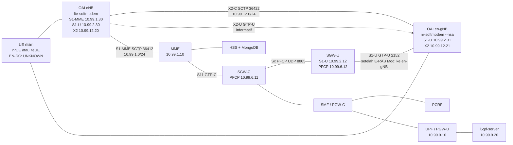

# Rencana uji go/no-go Gate B — OAI eNB + OAI en-gNB

| Field | Isi |
|---|---|
| Status dokumen | Rencana uji. Bukan hasil lab, bukan bukti Gate B, bukan izin eksekusi. |
| Tanggal | 10 November 2026 (WIB, UTC+7) |
| Keputusan stack | Netdrive, 10 November 2026 WIB. Tercatat sebagai [D4](../DECISIONS.md). |
| PRD | [PRD v0.6](../PRD-v0.6.md) FR-15, Gate B, D3. Badan PRD tidak diubah (dibekukan 6 Nov 2026). Dokumen ini tidak menambah gate. |
| Lab | Hanya `lab5g-dev` (`172.22.20.21`). `lab5g-vm` tetap read-only dan tidak disentuh. |
| Core | Open5GS **v2.8.0** EPC CUPS, image `gradiant/open5gs:2.8.0`, **diasumsikan tanpa patch**. |
| RAN | OAI eNB + OAI en-gNB, proses terpisah, tag git **`2026.w43`**. |
| Jendela | Hari 0 plus uji RAN, maksimum **8 hari kerja** (Hari 0–7). Hasil tiap hari: **LANJUT** atau **STOP**. **GO / NO-GO** hanya pada rekomendasi akhir. |
| Eksekusi | Tidak ada rebuild, pull image, perubahan compose, atau restart di lab sebelum PR rencana ini di-approve Netdrive. Merge PR dilakukan manual oleh Netdrive. |

Sumber lab yang dipakai di sini: inventori read-only Open5G Lab Ops, 10 Nov 2026 15:10–15:12 WIB; `lab/compose/docker-compose.yml`; `lab/versions.md` (snapshot 6 Nov 2026 20:17 WIB); `docs/evidence/gate-b-endc-integrated/SUMMARY.md`; `docs/evidence/gate-a-lab5g-dev/SUMMARY.md`.

---

## 1. Tujuan dan exit criteria

Gate B menguji **EN-DC Option 3x** dengan **SgNB / en-gNB terpisah** dari eNB, di EPC yang sudah ada. Master node adalah eNB LTE. Secondary node adalah en-gNB NR. Control plane UE tetap lewat S1-MME di eNB.

Istilah arsitektur yang dipakai dokumen ini:

| Opsi | Arti di rencana ini |
|---|---|
| **Option 3x** | S1-U terminated di en-gNB, dengan **SCG split bearer** (PDCP di en-gNB). Sebagian downlink boleh diteruskan lewat X2-U ke eNB. |
| Option 3a | SCG bearer tanpa split. Bukan target exit Gate B. |
| Option 3 | MCG split bearer di eNB. Bukan target exit Gate B. |

Exit criteria di bawah (ID **E1–E7**) mengikuti FR-15 dan Gate B pada PRD v0.6. Semuanya wajib untuk rekomendasi GO. RRC NR saja, atau throughput NR pada proses yang sama, tidak menutup Gate B. ID ini adalah acuan [B-S1](https://github.com/dayat81/open5g/pull/6) pada draf QA.

| # | Exit criterion | Bukti yang diterima |
|---|---|---|
| E1 | Dua proses RAN terpisah: OAI eNB dan OAI en-gNB (SgNB) | Dua container atau dua PID. eNB menjalankan `lte-softmodem`. en-gNB menjalankan `nr-softmodem` pada mode NSA. Bukan satu proses srsENB. |
| E2 | X2AP over SCTP port **36422**: X2 Setup, lalu SgNB Addition Request, SgNB Addition Request Acknowledge, dan SgNB Reconfiguration Complete | Pcap pada jaringan X2, plus log kedua proses |
| E3 | RRC reconfiguration yang membawa konfigurasi NR ke UE | Log UE dan pcap RRC (dari proses RAN atau UE) |
| E4 | S1AP **E-RAB Modification Indication** (eNB → MME) dan **E-RAB Modification Confirm** (MME → eNB) | Pcap S1-MME (SCTP 36412) |
| E5 | Downlink S1-U pindah dari eNB ke en-gNB dengan **TEID baru** | Pcap S11 Modify Bearer Request/Response (MME → SGW-C), PFCP Session Modification **SGW-C → SGW-U** (F-TEID downlink), dan GTP-U. TEID serta alamat GTP sesudah indikasi berbeda dari TEID/alamat eNB sebelumnya, dan menunjuk ke en-gNB. |
| E6 | Option 3x: **SCG split bearer, S1-U terminated di en-gNB** | Selama aliran uji, sedikitnya 100 paket GTP-U downlink pada S1-U dari SGW-U ke en-gNB memakai TEID_en-gNB yang baru. Sisa downlink di S1-U eNB atau di X2-U dicatat sebagai informasi, bukan syarat gagal. |
| E7 | Data uplink dan downlink end-to-end sampai SGi | `ping -c 5` ke `10.99.9.20` berhasil 100%, dan satu aliran `iperf3` downlink 30 detik selesai tanpa putus. Throughput bukan syarat lulus pada rfsim. |

S1AP untuk UE tetap di eNB. en-gNB pada Option 3x tidak menggantikan S1-MME. Yang pindah adalah tunnel S1-U downlink bearer yang ditambahkan ke SgNB.

### Kenapa integrated srsENB = achieved-but-not-accepted

Pada 6 Nov 2026 20:17 WIB, srsRAN 4G 25.10 di `lab5g-dev` menjalankan sel LTE dan sel NR **di dalam satu proses srsENB** (ZMQ, satu S1). Ringkasan ada di [docs/evidence/gate-b-endc-integrated/SUMMARY.md](../../evidence/gate-b-endc-integrated/SUMMARY.md).

Yang tercapai pada topologi itu:

- Attach, alamat PDN UE `<UE-PDN>` (larian sebelumnya juga `<UE-PDN>`; angka mentah tidak diulang di dokumen ini).
- RRC NR reconfiguration dan Random Access Complete (`c-rnti=0x4601`).
- Beban NR tercatat kira-kira DL 3,50–4,66 Mbps dan UL 3,66–4,75 Mbps.
- S1-MME `10.99.1.10:36412` ↔ `10.99.1.20` ESTAB.
- S1-U tetap `10.99.2.20` (eNB) ↔ `10.99.2.12` (SGW-U).

Itu tidak diterima untuk Gate B karena D3 (Hidayat, 6 Nov 2026, “harus sgnb”):

- Tidak ada SgNB terpisah, jadi tidak ada X2 Setup dan tidak ada SgNB Addition.
- E-RAB Modification Indication tidak teramati. Satu proses tidak perlu memindahkan tunnel S1-U ke node lain.
- Tidak ada tunnel S1-U khusus gNB dan tidak ada TEID baru di en-gNB.
- Pcap S1AP di dalam eNB pada set bukti itu kosong. Angka throughput NR tidak menggantikan transaksi S1AP/X2AP.

Keputusan produk itu tetap. Rencana ini menguji bentuk yang D3 minta. Hasil integrated tidak dihitung ulang sebagai lulus.

---

## 2. Topologi target

Tiga proses RAN, plus UE, di guest yang sama dengan core yang sudah jalan:

| Proses | Peran | Binary (dokumen tag) |
|---|---|---|
| OAI eNB | Master LTE, S1-MME, X2 ke en-gNB, S1-U sebelum pindah | `lte-softmodem` |
| OAI en-gNB | SgNB NR, X2, S1-U sesudah E-RAB Modification | `nr-softmodem --nsa` |
| UE | Spike EN-DC lewat rfsim | OAI `nr-uesoftmodem` dan/atau `lte-uesoftmodem`. **Status EN-DC rfsim = UNKNOWN** (lihat §2.4) |

Selama jendela OAI, srsENB dan srsUE **tidak jalan**. Alamat `10.99.1.20` dan `10.99.2.20` tetap milik baseline srsRAN dan tidak dipinjam OAI.

Core yang tetap, tanpa menambah NF 5GC: MongoDB, HSS, PCRF, MME, SGW-C, SGW-U, SMF/PGW-C, UPF/PGW-U. Image Open5GS tetap `gradiant/open5gs:2.8.0`. Patch PCRF admin-RAR tidak masuk ke uji ini (status di repo: DRAFT, NOT COMPILED, NOT TESTED).

`infra/roles/ran_oai` adalah scaffold WIP: service kosong, image `:latest`. Rencana ini **tidak** memakai role itu dan **tidak** mengubahnya. Image `:latest` tidak boleh ditarik untuk spike.

### 2.1 Diagram

Alamat OAI di diagram adalah **rencana**, belum ada di compose.



Jalur downlink yang harus terbaca di pcap setelah E-RAB Modification: server SGi → UPF → SGW-U `10.99.2.12` → en-gNB `10.99.2.31` → UE lewat rfsim NR. Sebelum indikasi, GTP-U downlink masih ke eNB `10.99.2.30`. Kedua arah itu disimpan, supaya pindah TEID kelihatan.

### 2.2 Jaringan yang sudah terpakai

Dari `lab/compose/docker-compose.yml` dan `lab/compose/docker-compose-ran.yml`. Lab Ops (10 Nov 2026) mengunci subnet yang sama: `10.99.1`, `.2`, `.4`–`.9`, `.10` (mgmt), `.11` (ran_uu), ditambah docker `172.17.0.0/16` dan `172.16.0.0/16`. **X2 memakai `10.99.12.0/24`.** `10.99.3.0/24` tidak dipakai compose dan **tidak** dialihkan ke X2.

| Jaringan compose | Subnet | Antarmuka | Port | Alamat yang sudah ada |
|---|---|---|---|---|
| `s1mme` | `10.99.1.0/24` | S1-MME | SCTP 36412 | MME `10.99.1.10`; srsENB `10.99.1.20` |
| `s1u` | `10.99.2.0/24` | S1-U | UDP 2152 | SGW-U `10.99.2.12`; srsENB `10.99.2.20` |
| `s11` | `10.99.4.0/24` | S11 | GTP-C | MME `10.99.4.10`; SGW-C `10.99.4.11` |
| `s5s8` | `10.99.5.0/24` | S5/S8 | GTP-C / GTP-U | SGW-C `.11`; SMF `.12`; SGW-U `.13`; UPF `.14`; UPF-A `.15`; UPF-B `.16` |
| `pfcp` | `10.99.6.0/24` | Sx | UDP 8805 | SGW-C `.11`; SGW-U `.12`; SMF `.13`; UPF `.14`; UPF-A `.15`; UPF-B `.16` |
| `s6a` | `10.99.7.0/24` | S6a | Diameter | MME `10.99.7.10`; HSS `10.99.7.11` |
| `gx` | `10.99.8.0/24` | Gx | Diameter | PCRF `10.99.8.11`; SMF `10.99.8.12` |
| `sgi` | `10.99.9.0/24` | SGi | — | UPF `10.99.9.10`; server `10.99.9.20`. Pool UE `10.45.0.0/16` |
| `mgmt` | `10.99.10.0/24` | DB | Mongo | mongo `10.99.10.2`; HSS `.3`; PCRF `.4` |
| `uu` | `10.99.11.0/24` | ZMQ srsRAN | TCP 2000/2001, 2100/2101 | srsENB `.20`; srsUE `.21` |

Contoh `mme.yaml` di repo: PLMN **001/01**, TAC **1**, GUMMEI group **2** code **1**, S1AP server `10.99.1.10`, tanpa daftar eNB statis. Hari 0 memeriksa file **live** (bukan hanya example) supaya eNB OAI memakai PLMN/TAC yang sama. eNB ID OAI tidak sama dengan eNB ID srsRAN, walaupun keduanya tidak jalan bersamaan.

Pcap Gx diambil bila pada jendela yang sama ada transaksi Diameter. Gx bukan exit Gate B. Option 3x yang diuji tidak membutuhkan Gx RAR.

### 2.3 Alamat yang diusulkan (belum diterapkan)

| Fungsi | Alamat | Port |
|---|---|---|
| OAI eNB S1-MME | `10.99.1.30` | SCTP 36412 ke MME `10.99.1.10` |
| OAI eNB S1-U | `10.99.2.30` | UDP 2152 |
| OAI en-gNB S1-U | `10.99.2.31` | UDP 2152. Ini tujuan GTP-U downlink **sesudah** E-RAB Modification |
| OAI eNB X2 | `10.99.12.20` | SCTP **36422** |
| OAI en-gNB X2 | `10.99.12.21` | SCTP **36422** |
| Jaringan rfsim | usulan `10.99.13.0/24` | TCP. Default upstream rfsimulator **4043** (eNB/gNB sebagai server). Peran client/server EN-DC dan jumlah kanal = **UNKNOWN** sampai Hari 1 |

`10.99.13.0/24` hanya usulan rencana ini agar pcap rfsim tidak bercampur dengan X2. Lab Ops mengunci subnet itu pada Hari 1, atau memilih subnet lain di luar daftar terpakai dan di luar `172.16/17`. Rfsim tidak diletakkan di `10.99.12.0/24`.

Nama jaringan docker yang diusulkan, mengikuti project `lab5g-dev`: `lab5g-dev_x2` (subnet `10.99.12.0/24`, internal) dan, bila usulan diterima, `lab5g-dev_rfsim`. Keduanya belum dibuat. Tidak ada port yang dipublish ke host, sama seperti stack sekarang.

### 2.4 Pin OAI `2026.w43`

Tag **ada**. Diperiksa 10 Nov 2026 terhadap GitLab `oai/openairinterface5g`, GitHub `OPENAIRINTERFACE/openairinterface5g`, dan GitHub `duranta-project/openairinterface5g` (banner GitLab menyatakan pohon resmi pindah ke repo Duranta; objek tag sama).

| Item | Nilai |
|---|---|
| Tag | `2026.w43` |
| Objek tag (annotated) | `facd9c5ec45621ab591c8da0953a6682b17e1ac4` |
| Commit yang ditunjuk | `cfee4c20b45ac1cf6d455d3f01bb3e00200438b0` |
| Pesan | `Merge remote-tracking branch 'origin/integration_2026_w43' into develop` |
| Waktu tag | 23 Oktober 2026 17:45 WIB (10:45:41Z) |

Yang di-pin adalah **commit itu**, pada eNB, en-gNB, dan UE sekaligus. Tag mengambang `develop`, `latest`, `2026.w44`, dan `v3.0.0` ada di Docker Hub pada minggu yang sama dan **bukan** pin. Mereka bukan fallback teknis; mengganti pin adalah keputusan Netdrive yang baru.

Image resmi yang namanya sama dengan tag, arsitektur **linux/amd64** (guest Xeon), dicatat dari Docker Hub pada 10 Nov 2026. Ukuran adalah field `size` API, bukan ukuran terkompresi di disk guest. **Kecocokan image ↔ commit belum diverifikasi di lab** (tidak ada build log di guest). Sampai Lab Ops mencatat RepoDigest saat pull dan mencocokkannya dengan tabel ini, identitas image di dalam guest = **UNKNOWN**.

| Image | Digest yang dicatat | Size (byte) | Last pushed (UTC) |
|---|---|---|---|
| `oaisoftwarealliance/oai-enb:2026.w43` | `sha256:37b6fef0400143f798782a5799c4fd6589e3a61a0e604d0dba3856efba616530` | 148885575 | 2026-10-23T11:27:08Z |
| `oaisoftwarealliance/oai-gnb:2026.w43` (manifest list) | `sha256:b7554483225068fa9c6a03032507b00fc2c663786c436fe61ea89b956fdb4850` | — | 2026-10-23T11:27:25Z |
| indeks amd64 image gNB di atas | `sha256:c994df476134e06cc4f57f7d7621fef00c11002a7999a565b1ee33e511ad41a6` | 171059248 | 2026-10-23T11:27:23Z |
| `oaisoftwarealliance/oai-nr-ue:2026.w43` (manifest list) | `sha256:d7ac8b9566488d6c4e5f04ae9a7a64a2693b3d6947f1045add7b44075176e119` | — | 2026-10-23T11:27:59Z |
| indeks amd64 image nr-ue | `sha256:d6e2fa6bcbb25ceeee58722f207d380400fcdee5a1bfa0e796742486aa7b67a7` | 158813397 | 2026-10-23T11:27:57Z |
| `oaisoftwarealliance/oai-lte-ue:2026.w43` | `sha256:e531ef82da4cedb22710abd7a4a8f32f26584af7b8940637cdc6415efceee48e` | 119559399 | 2026-10-23T11:27:43Z |

Jumlah size amd64 keempat image ≈ **571 MiB**. Itu muat di sisa disk saat ini. Build source di dalam guest adalah risiko lain (§4 dan R-19). Image arm64 gNB/nr-ue tidak dipakai.

Dokumen pada commit `cfee4c20` (dibaca dari pohon tag, bukan dari `develop`):

- `doc/FEATURE_SET.md`: mode NSA disebut untuk **gNB**, “unstable (only one UE connection)”. X2AP gNB: X2 setup dan SgNB Addition Request / Acknowledge / Reconfiguration Complete (36.423 Rel-15). X2AP eNB: EN-DC, rangkaian SgNB Addition yang sama, RRC Connection Reconfiguration dengan info sel 5G, dan S1AP E-RAB Modification Indication / Confirmation.
- `doc/RUNMODEM.md`: `nr-softmodem --nsa` membutuhkan LTE eNB dan menunjuk ke `doc/TESTING_OAI_NSA_COTS_UE.md`.
- `doc/TESTING_OAI_NSA_COTS_UE.md`: eNB = `lte-softmodem`, gNB = `nr-softmodem --nsa`, X2 SCTP **36422**, contoh front-end USRP. Halaman itu menulis bahwa isinya mungkin usang dan masih menyebut tag **2020.w39**. UE pada halaman itu adalah **COTS**, bukan nrUE/lteUE rfsim.
- `radio/rfsimulator/README.md`: `--rfsim`; default klien ke `127.0.0.1:4043`; eNB/gNB memakai `--rfsimulator.[0].serveraddr server`. Dokumen ini **tidak** berisi topologi EN-DC. Rfsim “is not designed to run close to real-time”.
- Bagian LTE UE di `FEATURE_SET.md` tidak menyebut EN-DC. Mode yang disebut untuk nrUE adalah SA, phy-test, dan noS1, bukan NSA.

**UNKNOWN — UE EN-DC rfsim:** tidak ada pernyataan upstream pada commit ini bahwa `nr-uesoftmodem` atau `lte-uesoftmodem` menyelesaikan EN-DC lewat rfsim. Spike ada untuk menguji hal itu, bukan untuk menganggapnya didukung. Hari 1 membaca `--help` binary terpin dan README rfsim pada commit yang sama, lalu **menuliskan** topologi rfsim (siapa TCP server, jumlah kanal, port) dan nama field HSS yang dipakai untuk H3. T-B3 dan semua kasus sesudahnya **diblokir** sampai tulisan itu ada (§3, §6). Bila tidak ada mode EN-DC, hari itu **STOP**. Rekomendasi akhir NO-GO disusun Architect; Netdrive yang memutuskan. Bukan alasan mencoba `develop`.

### 2.5 Open5GS 2.8.0 tanpa patch — hipotesis yang wajib diuji

Asumsi rencana: core tetap image lab `gradiant/open5gs:2.8.0`, tanpa patch dan tanpa rebuild `open5gs-src`. Id image pada snapshot `lab/versions.md` (6 Nov 2026): `sha256:1740bc23cc56401b81cb1661342879dbe413560613df21fcd64999c49ac7996d`. Hari 0 mengulang `docker image inspect` dan mencatat bila id live berbeda. Perbedaan id tidak menjadi alasan menarik image baru di tengah uji.

Pada tag sumber Open5GS `v2.8.0`, `src/mme/s1ap-handler.c` memuat `s1ap_handle_e_rab_modification_indication`. Isu publik lama (#834, #864) menunjukkan prosedur ini pernah tidak diimplementasi, lalu ada laporan lulus di sekitar v2.2.x, dan ada laporan `Invalid Action` sesudah Indication. **Keberadaan fungsi di pohon sumber bukan hasil lab.** Tiga titik berikut adalah hipotesis. Gagal di salah satu = NO-GO untuk core tanpa patch, bukan izin menambal diam-diam.

| ID | Hipotesis | Cara uji |
|---|---|---|
| H1 | MME pada image lab menerima E-RAB Modification Indication dari OAI eNB dan membalas E-RAB Modification Confirm dalam **10 detik** | T-B5, pcap S1-MME. Log “Not implemented”, tidak ada Confirm, atau Confirm setelah 10,0 detik = gagal |
| H2 | SGW-C mengirim PFCP Session Modification ke SGW-U, dan SGW-U mengganti F-TEID downlink ke `10.99.2.31` dengan TEID baru | T-B6 dan T-B7 |
| H3 | HSS dan MME menerima UE yang memasang EN-DC (bit DCNR di UE Network Capability, dan restriction NR-as-secondary tidak menolak) | T-B4. Nilai historis `access_restriction_data=32` pada uji integrated **bukan** bukti DCNR untuk SgNB terpisah. Jangan menyalinnya sebagai konfigurasi baru tanpa membaca field subscriber live |

Subscriber uji, IMSI, GUTI, IMEI, SUPI, Ki, dan OPc tidak ditulis ke git.

---

## 3. Rencana harian (maksimum 8 hari kerja)

Hari kerja dihitung di WIB. Hari 0 memulihkan **subset** baseline yang dipakai T-B0: attach LTE dan ping SGi. Itu bukan penutupan Gate A. T1 dan T2 Gate A (dua APN, SDF+URR) tetap terbuka. Uji OAI hanya mulai setelah Hari 0 berstatus **LANJUT**. Bila Hari 0 makan lebih dari satu hari, sisa hari OAI menyusut; batas akhir tetap Hari 7.

Hasil tiap hari hanya **LANJUT** atau **STOP**. **GO** dan **NO-GO** tidak ditulis pada baris hari. Keduanya hanya muncul sekali, sebagai rekomendasi Architect atas seluruh spike, setelah QA menyusun evidence. Netdrive yang memutuskan dan menandatangani (§6.4).

Setiap hari menghasilkan bukti di direktori lab di luar git (usulan `/home/lab/lab5g-dev/evidence/gate-b-oai-rfsim/hari-N/`). Pcap memakai nama §6.0. Cuplikan log mengikuti SOP redaksi §6.2. Pcap diambil dari container `nicolaka/netshoot` yang menempel ke jaringan docker yang bersangkutan, atau dari bridge docker di guest. Tidak ada port publish baru.

Perintah di bawah adalah kriteria, bukan skrip baru di repo. Lab Ops menulis perintah operasional di catatan hari itu setelah PR di-approve.

`lab/scripts/endc-up.sh` dan T9 di `docs/plan-poc-slicing-core.md` (srsENB integrated) **tidak dijalankan** pada hari mana pun. Keduanya bukan bukti Gate B (B-L2).

### STOP (berlaku setiap hari)

Berhenti pada hari yang sama, jangan lanjut ke langkah RAN berikutnya, bila salah satu ini terjadi:

1. Hari 0 tidak menghasilkan attach LTE dan ping SGi.
2. Sisa disk `/` akan turun di bawah **8 GiB** bila pull atau build berikutnya jalan.
3. Binary terpin tidak memuat mode EN-DC untuk UE, dan tidak ada jalur rfsim yang tertulis di dokumen commit yang sama. Keluaran Hari 1 yang menyatakan hal ini memblokir T-B3 dan sesudahnya.
4. Keluaran tertulis Hari 1 (topologi rfsim EN-DC dan field HSS/DCNR untuk H3) belum ada ketika seseorang hendak memulai T-B3.
5. MME membalas error, tidak membalas Confirm, atau Confirm tiba lebih dari **10,0 detik** setelah E-RAB Modification Indication, pada image 2.8.0 tanpa patch, setelah satu kali ulang dengan pcap yang sudah lengkap (PLMN, TAC, alamat, dan TEID sudah dicek).
6. Softmodem tetap kehilangan slot setelah mitigasi §4 (srsRAN mati, bandwidth kecil, pinning), sehingga tidak ada satu larian attach yang utuh untuk dipcap.
7. Batas Hari 7 tercapai tanpa E1–E7 pada satu sesi UE yang sama.

STOP menjalankan rollback §5 dan mengembalikan jalur attach + ping Hari 0. STOP **tidak** membeli Amarisoft. Architect kemudian merekomendasikan NO-GO. Netdrive memutuskan. Amarisoft hanya rekomendasi tertulis; biaya tetap keputusan Netdrive.

### Pemicu rekomendasi fallback Amarisoft

Fallback ini sudah ada di PRD v0.6 (Callbox + UEsim). Rencana ini tidak menambah produk lain. Architect menulis rekomendasi itu di evidence bila STOP disebabkan salah satu hal berikut:

- UE OAI tidak punya mode EN-DC rfsim pada tag yang di-pin.
- X2 Setup tidak selesai setelah alamat, port 36422, PLMN, dan TAC sudah sesuai dokumen tag.
- Rangkaian SgNB Addition tidak selesai pada larian emas.
- H1 atau H2 gagal pada Open5GS 2.8.0 tanpa patch, termasuk Confirm yang melewati 10 detik.
- Delapan hari kerja habis tanpa E1–E7, dan penyebabnya bukan jendela lab yang dipindah karena prioritas dashboard (§7, R-21).

srsENB + OAI gNB sebagai jembatan X2 tetap tidak dianjurkan (ROADMAP: X2AP srsENB tidak memakai jalur SgNB yang diminta D3).

### Hari 0 — pulihkan attach + ping (bukan tutup Gate A)

Lab live pada 10 Nov 2026 15:10 WIB **bukan** baseline attach yang dipakai T-B0. State-nya PoC slicing. `l5gd-smf` EXITED (255) sejak **6 Nov 2026 21:12 WIB** (`cannot open file /etc/o5/smf.yaml` pada override PoC). UPF lepas asosiasi dari SMF pada 6 Nov 21:05 WIB. Sesi SGW-U terakhir lepas 6 Nov 21:26 WIB. UE yang masih jalan hanya siklus RRC. Ada `upf-a`, `upf-b`, dan `cgnat`. File `.bak-endc`, `.bak-poc`, dan `.lte-endc` tidak dihapus.

Langkah:

1. Catat `docker ps -a`, compose file yang aktif, dan `docker image inspect` Open5GS. Tanpa restart dulu.
2. Kembalikan runtime core ke jalur yang bisa attach: SMF stock `gradiant/open5gs:2.8.0` yang bisa membuka konfigurasi, UPF terasosiasi, **tanpa** rebuild source dan **tanpa** patch PCRF. Override PoC yang mematahkan `smf.yaml` tidak dipakai pada perintah jalan. File PoC tetap di disk.
3. Hentikan kontainer PoC yang tidak diperlukan untuk attach + ping (`upf-a`, `upf-b`, `cgnat`) setelah core itu berdiri. Jangan menghapus volume-nya.
4. RAN: srsUE lalu srsENB **LTE-only**. Integrated EN-DC srsRAN, `endc-up.sh`, dan T9 tidak dipakai.
5. Verifikasi T-B0: S1 ESTAB MME `10.99.1.10` ↔ eNB `10.99.1.20`; attach; `ping -c 5` UE → `10.99.9.20` dengan 0% loss. Dua APN dan SDF+URR **tidak** diuji di sini.

Bukti: log SMF yang menunjukkan file konfigurasi terbuka dan asosiasi PFCP; `docker ps`; `hari-0-s1mme.pcap`; log attach yang sudah disensor; keluaran ping.

| Hasil hari | Arti |
|---|---|
| LANJUT | T-B0 lulus. Uji OAI boleh dijadwalkan. Gate A tetap terbuka pada T1/T2. |
| STOP | SMF tetap mati, atau attach/ping gagal. OAI tidak dimulai. |
| Fallback | Tidak ada. Hari 0 bukan uji RAN. Amarisoft tidak relevan. |

### Hari 1 — pin, image, jaringan, keluaran tertulis (B-L3)

Langkah: sediakan image amd64 §2.4 lewat mirror (jaringan lab internal tidak punya egress; proxy host port 11080 pada inventori **belum diverifikasi**). Catat RepoDigest. Cocokkan dengan tabel §2.4. Bila digest tidak cocok, image itu tidak dipakai; bangun dari commit `cfee4c20` hanya di mesin yang sisa disknya aman (§4), lalu pindahkan image. Buat jaringan `x2` `10.99.12.0/24` dan jaringan rfsim yang sudah dikunci. Pasang eNB/en-gNB ke `s1mme`, `s1u`, dan `x2` **tanpa** men-start softmodem bila Hari 0 belum LANJUT. S11 tetap hanya MME `10.99.4.10` dan SGW-C `10.99.4.11`; OAI tidak mendapat alamat S11. Baca `--help` dan contoh konfigurasi NSA pada commit yang sama.

**Keluaran wajib, tertulis, sebelum T-B3:** satu catatan `hari-1-keluaran.md` di direktori bukti lab (bukan git) yang memuat dua hal:

1. Topologi rfsim EN-DC: proses mana TCP server, proses mana klien, jumlah kanal, port (default upstream 4043 atau port lain yang terbaca di binary). Bila tidak bisa ditetapkan dari binary dan dokumen commit, tulis UNKNOWN dan hari ini STOP.
2. Field HSS/MME untuk H3: nama field subscriber yang mengatur DCNR dan “NR as secondary RAT”, plus kelas nilainya (diizinkan atau ditolak). Tanpa IMSI, Ki, OPc, GUTI, IMEI, atau SUPI. Nilai historis `access_restriction_data=32` tidak disalin sebagai konfigurasi.

| Hasil hari | Arti |
|---|---|
| LANJUT | Digest cocok atau image dibangun dari commit yang sama; disk di atas ambang; `hari-1-keluaran.md` lengkap dan tidak berstatus UNKNOWN pada topologi. T-B3 boleh dimulai pada hari berikutnya. |
| STOP | Tidak ada mode UE EN-DC, atau topologi rfsim tidak bisa ditulis. T-B3 dan sesudahnya tidak dijalankan. |
| Fallback | STOP pada baris mode UE memicu **rekomendasi** Amarisoft di rekomendasi akhir. Tidak ada pembelian pada hari ini. |

### Hari 2 — OAI eNB saja, S1 Setup (T-B1 bagian eNB)

srsENB dan srsUE tetap mati. Nyalakan hanya OAI eNB. Tanpa en-gNB dan tanpa UE. Simpan `hari-2-s1mme.pcap`.

Bukti: S1 Setup Request/Response, log MME, `ss` SCTP 36412 antara `10.99.1.10` dan `10.99.1.30`, plus bukti proses § T-B1 untuk container eNB. Satu cuplikan CPU selama eNB idle.

| Hasil hari | Arti |
|---|---|
| LANJUT | S1 Setup sukses dengan PLMN 001/01 dan TAC 1 (atau nilai live Hari 0, bila berbeda — catat, jangan menebak). |
| STOP | eNB tidak menyelesaikan S1 Setup setelah alamat dan PLMN dicek. Jangan menambah gNB. |
| Fallback | Ulangi sekali bila digest image salah. Masih gagal pada akhir hari = STOP. |

### Hari 3 — en-gNB dan X2 Setup (T-B1 lengkap, T-B2)

Nyalakan en-gNB `nr-softmodem --nsa` pada tag yang sama. Tanpa UE. Simpan `hari-3-x2c.pcap` dan `hari-3-s1mme.pcap`.

Bukti: X2 Setup Request/Response pada SCTP 36422 antara `10.99.12.20` dan `10.99.12.21`. Argv kedua proses sesuai T-B1. S1-MME tetap satu asosiasi eNB.

| Hasil hari | Arti |
|---|---|
| LANJUT | T-B2 lulus dan T-B1 lengkap (kedua argv, digest, srsENB tidak berjalan). |
| STOP | Tidak ada X2 Setup sukses pada hari ini setelah IP dan port 36422 dicek. |
| Fallback | STOP hari ini masuk pemicu rekomendasi Amarisoft untuk jalur X2 OAI. Rollback §5 sebelum akhir hari. |

### Hari 4 — UE rfsim dan RRC NR (T-B3)

**Diblokir** bila `hari-1-keluaran.md` belum ada atau topologinya UNKNOWN. Setelah blokir lepas: nyalakan satu UE sesuai topologi tertulis itu. Target: attach LTE lewat eNB, lalu RRC Connection Reconfiguration yang memuat sel NR.

Bukti: `hari-4-s1mme.pcap`, log UE yang sudah disensor, pcap RRC. Tunnel S1-U awal masih ke `10.99.2.30` (TEID_eNB). CPU selama prosedur.

| Hasil hari | Arti |
|---|---|
| LANJUT | T-B3 lulus. Belum cukup untuk Gate B. |
| STOP | UE tidak melihat sel, atau tidak ada reconfiguration NR, setelah satu kali ulang dengan bandwidth §4. |
| Fallback | STOP UE rfsim masuk pemicu rekomendasi Amarisoft. Jangan beralih ke image `develop`. |

### Hari 5 — satu larian terkorelasi (T-B4..T-B7, dan aliran bila sesi masih hidup)

Satu sesi UE. Jangan menggabungkan ID dari attach yang berbeda. Semua pesan di bawah memakai kunci yang sama, dicatat di `hari-5-korelasi.csv` dengan stempel waktu WIB:

`stempel_waktu_WIB`, `MeNB_UE_X2AP_ID`, `SgNB_UE_X2AP_ID`, `MME_UE_S1AP_ID`, `eNB_UE_S1AP_ID`, `E-RAB_ID`, `TEID_eNB`, `TEID_en-gNB`, `Transport_Layer_Address`.

File pcap wajib, satu set, dari larian ini saja:

`hari-5-s1mme.pcap`, `hari-5-x2c.pcap`, `hari-5-x2u.pcap`, `hari-5-s11.pcap`, `hari-5-pfcp.pcap`, `hari-5-s1u.pcap`, `hari-5-sgi.pcap`.

Isi yang harus satu sama lain cocok:

- X2-C: SgNB Addition Request, SgNB Addition Request Acknowledge, SgNB Reconfiguration Complete.
- Pada Acknowledge: MeNB UE X2AP ID, SgNB UE X2AP ID, E-RAB ID, Transport Layer Address, GTP-TEID. GTP-TEID itu = **TEID_en-gNB**.
- S1-MME: E-RAB Modification Indication dan Confirm. Indication memuat E-RAB ID yang sama, Transport Layer Address en-gNB (`10.99.2.31`), dan GTP-TEID = TEID_en-gNB. Confirm tiba dalam **10,0 detik** (selisih `frame.time_epoch`).
- S11: Modify Bearer Request dan Modify Bearer Response, MME `10.99.4.10` ↔ SGW-C `10.99.4.11`, F-TEID yang sama.
- PFCP: Session Modification **Request** SGW-C `10.99.6.11` → SGW-U `10.99.6.12` dengan F-TEID downlink = TEID_en-gNB.
- S1-U: GTP-U downlink sesudah Confirm menuju `10.99.2.31` dengan TEID_en-gNB, berbeda dari TEID_eNB yang sebelumnya menuju `10.99.2.30`.
- X2-U: GTP-U eNB ↔ en-gNB disimpan. Ini artefak informatif, bukan syarat lulus T-B8.

| Hasil hari | Arti |
|---|---|
| LANJUT | T-B4, T-B5, T-B6, dan T-B7 lulus pada ID yang sama. |
| STOP | Confirm tidak ada, Confirm melewati 10 detik, atau S11/PFCP/GTP-U tidak memindahkan TEID ke en-gNB. Satu kali ulang seluruh larian (bukan gabungan dua larian) masih di hari ini. Masih gagal = STOP. |
| Fallback | Bila MME yang menolak prosedur pada image tanpa patch, rekomendasi akhir ke Netdrive: Gate B pada core ini tidak lulus tanpa keputusan patch terpisah. Rencana ini tidak menulis patch itu. |

### Hari 6 — aliran downlink pada sesi yang sama (T-B8, T-B9)

Lanjutkan sesi Hari 5. ID di `hari-6-korelasi.csv` harus sama dengan Hari 5. Bila sesi putus, seluruh T-B4..T-B9 diulang sebagai **satu** larian baru pada hari ini; larian Hari 5 ditandai tidak dipakai untuk E2E-02.

Aliran uji: `ping -c 5` ke `10.99.9.20`, lalu satu `iperf3` downlink 30 detik ke server yang sama. Hitung paket DL GTP-U pada `hari-6-s1u.pcap` (atau `hari-5-s1u.pcap` bila aliran sempat selesai di sesi Hari 5) dengan filter §6.0 dan TEID_en-gNB.

| Hasil hari | Arti |
|---|---|
| LANJUT | T-B8 (≥ 100 paket) dan T-B9 (ping 100% dan iperf3 30 detik utuh) lulus. |
| STOP | Kurang dari 100 paket pada TEID_en-gNB, ping loss, atau iperf3 putus. Paket sisa di TEID_eNB atau di X2-U dicatat dan tidak menjadi alasan STOP. |
| Fallback | Sama dengan Hari 5 bila penyebabnya control plane. Bila control plane utuh dan hanya aliran yang gagal, STOP tanpa otomatis merekomendasikan Amarisoft sampai Architect melihat CPU dan rfsim. |

### Hari 7 — kasus negatif, evidence, rollback

Tidak ada skenario positif baru. Urutan:

1. T-B10, T-B11, dan T-B12 pada larian **terpisah** dari larian emas E2E-02. Pcap `hari-7-*`.
2. QA menyusun ringkasan §6.3.
3. Rollback §5, ulangi T-B0 (attach + ping). T1/T2 tidak dijalankan.
4. Architect menulis rekomendasi GO atau NO-GO. Netdrive memutuskan dan menandatangani.

| Hasil hari | Arti |
|---|---|
| LANJUT | Bukti E1–E7 lengkap pada satu sesi, T-B10..T-B12 tercatat, T-B0 sesudah rollback lulus, `lab5g-vm` tidak tersentuh. Architect boleh merekomendasikan GO. |
| STOP | Bukti positif masih bolong, atau rollback tidak mengembalikan attach + ping. Architect merekomendasikan NO-GO. Gate B tetap terbuka. Integrated srsENB tetap achieved-but-not-accepted. |

Rekomendasi GO hanya bila E1–E7 lulus pada rfsim dalam satu sesi **dan** T-B0 sesudah rollback lulus. Lulus sebagian tetap rekomendasi NO-GO. T-B10..T-B12 yang tercatat sebagai temuan tidak menahan GO bila larian emas utuh; yang menahan GO adalah kegagalan larian emas atau kegagalan T-B12 (attach dan ping lewat eNB OAI, S1-U di eNB, saat en-gNB mati atau SCG dilepas). Rollback srsRAN tidak menggantikan T-B12.

## 4. Kebutuhan hardware, RF, dan SDR

### 4.1 Wajib untuk go/no-go: rfsim, tanpa RF

Angka guest dari inventori live Lab Ops, 10 Nov 2026 sekitar 15:12 WIB. Tidak ada SDR, GPSDO, atau UE COTS di guest. **Go/no-go Gate B = rfsim saja.**

| Item | Terukur | Dipakai untuk GO? |
|---|---|---|
| Guest | 8 vCPU, 1 thread/core, Intel Xeon Gold 6140 @ 2,30 GHz | Ya, dengan catatan sizing di bawah |
| RAM | 15 GiB, sekitar 13 GiB available | Ya |
| Disk | `/` 38 GiB, 22 GiB kosong. `/var/lib/docker` di partisi yang sama | Ya |
| Kernel | `6.8.0-136-generic` PREEMPT_DYNAMIC. Bukan lowlatency dan bukan RT | Ya untuk rfsim. Rfsim upstream memang tidak mensyaratkan real-time |
| Docker | 27.5.1 | Ya |
| Compose | v2.29.7, binary **`docker-compose`** (bukan plugin `docker compose`) | Ya. Pakai binary yang ada. Jangan menambah paket plugin di dalam spike |
| Hypervisor | 144 core, 251 GiB RAM | Kapasitas untuk resize. Resize guest butuh approval Netdrive |
| SDR, GPSDO, antena, UE COTS | Tidak ada | **Tidak** untuk go/no-go |

Bukti Gate A (6 Nov) menyebut 8 vCPU / 16 GiB. Angka yang dipakai rencana ini adalah inventori live **15 GiB**. Selisih itu tidak otomatis menjadi resize.

**Sizing.** Delapan vCPU tanpa SMT sudah memuat EPC CUPS. Spike menambah `lte-softmodem`, `nr-softmodem`, dan paling tidak satu UE, masing-masing dengan PHY rfsim. Dokumen rfsim pada tag yang sama menyatakan simulator tidak ditujukan untuk berjalan dekat real-time dan menyarankan bandwidth lebih kecil. Karena beban OAI di guest ini **belum diukur**, 8 vCPU tidak dinyatakan cukup dan tidak dinyatakan gagal.

Rekomendasi ke Netdrive, sebagai **keputusan terbuka** (bukan bagian dari merge dokumen ini):

- Naikkan guest ke **16 vCPU dan 32 GiB** sebelum Hari 2 bila Hari 0 sudah menunjukkan load average mendekati 8 hanya dengan srsRAN LTE + EPC, atau segera setelah softmodem OAI pertama kehilangan slot secara terus-menerus.
- Host punya inti dan RAM untuk itu. Yang dibutuhkan adalah approval mengubah guest, bukan pengadaan mesin.
- 16 vCPU / 32 GiB juga belum terukur terhadap OAI. Itu langkah berikutnya, lalu diuji lagi dengan bukti CPU. Tidak ada harga pada rekomendasi ini.

Bila Netdrive **tidak** me-resize, mitigasi berikut wajib, bukan opsional:

1. srsENB dan srsUE mati selama Hari 1–7.
2. Kontainer PoC (`upf-a`, `upf-b`, `cgnat`) tetap mati setelah Hari 0.
3. Bandwidth kecil: LTE **5 atau 10 MHz** (keduanya ada di feature set eNB tag ini: 5, 10, 20 MHz). NR mulai di **20 MHz**, naik ke **40 MHz** hanya bila 20 MHz sudah lulus E1–E7 dan CPU masih longgar. Jangan mulai dari 100 MHz.
4. CPU pinning seadanya: dua inti untuk proses EPC yang sibuk, dua untuk eNB, dua untuk en-gNB, dua untuk UE. Dengan 8 inti ini sempit; catat `docker stats` supaya pinning yang gagal kelihatan.
5. Ambang disk: hentikan pull/build bila sisa `/` akan turun di bawah **8 GiB**.

Kernel lowlatency **bukan** syarat GO rfsim. Mengganti kernel guest adalah perubahan terpisah dan tidak masuk rencana ini.

### 4.2 Tidak wajib untuk go/no-go: OTA, setelah rfsim GO

Fase ini adalah kebutuhan pengadaan. **Keputusan biaya ada di Netdrive.** Rencana ini tidak menyebut harga dan tidak men-start OTA.

Yang perlu diputuskan bila, dan hanya bila, rfsim sudah GO:

| Kebutuhan | Catatan |
|---|---|
| SDR eNB dan SDR en-gNB | Dua proses butuh dua rantai RF. Contoh yang disebut dokumen NSA upstream pada commit ini: USRP B210 atau B200mini per proses. **Pilihan perangkat ditanyakan ke Netdrive** (2× B210, atau perangkat lain yang setara dan sudah diizinkan lab). Satu B210 untuk kedua proses tidak menjadi asumsi rencana ini. |
| Clock | Referensi bersama: GPSDO atau 10 MHz (dan 1 PPS bila perangkat yang dipilih memerlukannya). Halaman NSA upstream pada commit ini memakai external clock dan menandai detailnya belum lengkap. |
| Antena, kabel, attenuator, shielding | Untuk jalur conducted atau OTA terlindung. Bentuk pastinya mengikuti pilihan SDR dan aturan lab. |
| Band LTE dan NR | Harus band yang diizinkan regulasi lab. Band pada bukti integrated (LTE band 7 EARFCN 3350, NR band 3 ARFCN 368500) adalah ZMQ, bukan izin pancaran. Contoh upstream NSA (n78, 40 MHz, TDD) juga bukan izin lab. Band OTA = pertanyaan terbuka. |
| UE COTS | UE dengan dukungan EN-DC, plus SIM yang bisa diprogram agar PLMN 001/01 (atau PLMN live) cocok. Tidak ada UE COTS di guest hari ini. |
| Kernel lowlatency / RT | Baru relevan untuk OTA. Di luar go/no-go. |

---

## 5. Checklist Open5G Lab Ops (`lab5g-dev`)

Semua baris di bawah **setelah** PR ini di-approve Netdrive. Sebelum itu: tidak ada rebuild, tidak ada pull, tidak ada `docker-compose up`, tidak ada restart, tidak ada perubahan file di `/home/lab/lab5g-dev`. `lab5g-vm` tidak masuk daftar.

- [ ] Guest tetap `lab5g-dev` `172.22.20.21`. Host hypervisor tidak diubah kecuali Netdrive menyetujui resize §4.
- [ ] Sumber daya dicatat ulang pada hari mulai: `nproc`, `lscpu` (harus tetap 1 thread/core), `free -h`, `df -h /`, `uname -r`, `docker version`, `docker-compose version`.
- [ ] Image OAI amd64 dari tag `2026.w43` / commit `cfee4c20b45ac1cf6d455d3f01bb3e00200438b0`. RepoDigest dicatat dan dibandingkan dengan §2.4. Bukan `:latest` dan bukan `develop`.
- [ ] Jalur image: mirror atau build di luar guest. Proxy egress port 11080 tidak diasumsikan hidup.
- [ ] Jaringan docker internal `x2` = `10.99.12.0/24` tanpa port publish. Alamat eNB `10.99.12.20`, en-gNB `10.99.12.21`.
- [ ] Alamat S1 rencana §2.3 dipasang hanya pada container OAI. `10.99.1.20` dan `10.99.2.20` tidak diubah.
- [ ] MME live: TAI/PLMN dan S1 `10.99.1.10` dibaca sebelum eNB OAI start. eNB OAI memakai TAI yang sama. Tidak ada whitelist yang menolak eNB baru; bila ada, catat dan berhenti untuk keputusan, jangan mengedit diam-diam di luar jendela.
- [ ] Subscriber uji di HSS untuk EN-DC, disimpan di lab. Tidak ada IMSI, GUTI, IMEI, SUPI, Ki, atau OPc di git, di ringkasan, atau di tiket. Redaksi mengikuti SOP §6.2.
- [ ] Akses pcap: netshoot atau tcpdump pada bridge `s1mme`, `s1u`, `x2` (X2-C dan X2-U), `s11`, `pfcp`, dan `sgi` (plus `gx` bila ada transaksi). Nama file `hari-N-{s1mme|x2c|x2u|s11|pfcp|s1u|sgi}.pcap` (§6). File pcap di disk lab, bukan di git. Ringkasan yang di-commit mengikuti §6 dan SOP redaksi.
- [ ] Rollback ke srsRAN baseline **tanpa** mengganggu Gate A:
  1. Hentikan dan hapus container OAI saja.
  2. Hapus jaringan `x2` dan jaringan rfsim yang dibuat untuk spike.
  3. Jangan mengganti image Open5GS dan jangan menghapus `.bak-endc` / `.bak-poc`.
  4. Kembalikan RAN ke srsRAN LTE-only yang lulus Hari 0. `lte-only-restore.sh` hanya mengembalikan file RAN dari `.bak-endc` lalu memanggil `lab-up.sh`. Skrip itu **tidak** memperbaiki SMF yang mati, dan **bukan** prosedur lulus Gate B (T9 / `endc-up.sh` tidak dipakai). Rollback yang sah adalah kembali ke runtime **sesudah Hari 0 LANJUT**, lalu ulangi attach dan ping `10.99.9.20`.
  5. Direktori bukti Gate A (`docs/evidence/gate-a-lab5g-dev/`) tidak ditulis ulang.
- [ ] Tidak ada snapshot qcow2 hari ini (inventori). Sebelum Hari 0, tanyakan ke Netdrive apakah snapshot akan dibuat. Tanpa jawaban, rollback yang ada hanya prosedural di atas.
- [ ] Kunci jendela dengan pekerjaan dashboard (§7). Spike tidak me-restart stack pada jam integrasi dashboard.

---

## 6. Peran QA

QA menyusun evidence. Architect memberi rekomendasi GO atau NO-GO. Netdrive memutuskan dan menandatangani. Hasil harian tetap LANJUT/STOP (§3).

**T-B0 bukan exit Gate B, bukan penutupan Gate A, dan bukan gate baru.** T-B0 hanya subset attach LTE + ping SGi. T1 dan T2 Gate A (dua APN, SDF+URR) tetap terbuka. T-B1 sampai T-B9 memetakan E1–E7. Lulus T-B1 saja, atau T-B1+T-B3 tanpa T-B4–T-B7, adalah hasil yang sama kelasnya dengan integrated srsENB: dicapai, tidak diterima.

**Blokir:** T-B3, T-B4, T-B5, T-B6, T-B7, T-B8, T-B9, T-B10, T-B11, dan T-B12 tidak dimulai sebelum `hari-1-keluaran.md` tertulis dan memuat topologi rfsim EN-DC serta field HSS/DCNR untuk H3 (§3 Hari 1). T-B0, T-B1, dan T-B2 tidak menunggu catatan itu.

`docs/plan-poc-slicing-core.md` T9 dan `lab/scripts/endc-up.sh` (srsENB integrated) **tidak dipakai** sebagai prosedur atau bukti lulus. Itu jawaban eksplisit untuk B-L2 pada draf QA PR #6.

### 6.0 Filter, nama pcap, IE, dan kolom wajib

Nama file, N = nomor hari:

`hari-N-s1mme.pcap`, `hari-N-x2c.pcap`, `hari-N-x2u.pcap`, `hari-N-s11.pcap`, `hari-N-pfcp.pcap`, `hari-N-s1u.pcap`, `hari-N-sgi.pcap`.

Filter tampilan. Port S11 diasumsikan UDP **2123**. Hari 0 mengonfirmasi dengan `ss` di MME dan SGW-C. Bila port live berbeda, filter memakai port itu dan selisihnya ditulis di lembar korelasi.

| Artefak | Filter tshark |
|---|---|
| X2-C | `sctp.port == 36422 && x2ap` |
| S1-MME | `sctp.port == 36412 && s1ap` |
| Sx / PFCP | `udp.port == 8805 && pfcp` |
| S1-U dan X2-U | `udp.port == 2152 && gtp` |
| S11 | `udp.port == 2123 && gtpv2` |

IE yang wajib ada dan wajib disalin ke lembar korelasi:

| Pesan | IE |
|---|---|
| SgNB Addition Request Acknowledge (X2AP) | MeNB UE X2AP ID, SgNB UE X2AP ID, E-RAB ID, Transport Layer Address, GTP-TEID |
| E-RAB Modification Indication (S1AP) | MME UE S1AP ID, eNB UE S1AP ID, E-RAB ID, Transport Layer Address, GTP-TEID |
| PFCP Session Modification Request, SGW-C → SGW-U | F-TEID downlink |

GTP-TEID pada Acknowledge dan pada Indication, serta F-TEID downlink pada PFCP Request, harus sama. Nilai itu adalah **TEID_en-gNB**. **TEID_eNB** adalah GTP-TEID S1-U downlink ke `10.99.2.30` sebelum Indication. Keduanya, bersama **E-RAB ID**, adalah kolom wajib. Kolom lengkap larian emas ada di Hari 5.

X2AP ID tidak diharapkan muncul di dalam pesan S1AP. Lembar korelasi yang mengikat keduanya. Pesan S1AP tanpa E-RAB ID, Transport Layer Address, dan GTP-TEID gagal pada T-B5 meskipun X2AP lengkap.

Timeout T-B5: `frame.time_epoch` Confirm dikurangi `frame.time_epoch` Indication ≤ **10,0** detik, diukur pada `hari-5-s1mme.pcap` (atau pcap larian ulang yang menggantikan larian itu seluruhnya).

### 6.1 Pemetaan ke draf QA PR #6

Sumber ID: [PR #6](https://github.com/dayat81/open5g/pull/6), file `docs/qa/TEST-PLAN-gate-A-F.md` pada cabang `qa/test-plan-gate-a-f`. Dibaca 10 Nov 2026. B-S2 pada draf itu adalah review render IaC, bukan langkah lab rencana ini.

| ID draf QA | Di rencana ini |
|---|---|
| B-S1 | §1, exit criteria **E1–E7**, plus alasan integrated srsENB achieved-but-not-accepted |
| B-L1 | T-B1 .. T-B9 |
| E2E-02 | T-B4 .. T-B9 pada **satu** sesi UE (Hari 5, dilanjutkan Hari 6 hanya bila ID tidak berubah) |
| B-L3 | Hari 1 (`hari-1-keluaran.md`: topologi rfsim dan field HSS/DCNR) dan T-B3 |
| B-L2 | T9 dan `endc-up.sh` **tidak dipakai**. Bukan prosedur, bukan bukti lulus |

### 6.2 SOP redaksi

Berlaku untuk ringkasan yang di-commit, cuplikan tshark, CSV korelasi, tiket, dan log yang meninggalkan lab. Pcap mentah tetap di lab dan tidak di-commit.

| Objek | Di artefak yang di-commit |
|---|---|
| IMSI | `<IMSI-UE-1>` |
| GUTI | `<GUTI-UE-1>` |
| IMEI | `<IMEI-UE-1>` |
| SUPI | `<SUPI-UE-1>` |
| Ki, OPc, kunci | tidak ditulis |
| Alamat PDN UE pada narasi bukti lama | `<UE-PDN>` |

Sebelum commit, pencarian teks pada ringkasan harus kosong untuk pola IMSI 14–15 digit, IMEI 15 digit, dan label `GUTI` atau `SUPI` yang diikuti nilai mentah. Filter tshark untuk cuplikan yang di-commit tidak menampilkan field itu (`-T fields` hanya frame time, prosedur, ID X2AP/S1AP yang bukan GUTI, E-RAB ID, TEID, dan alamat transport RAN).

Identitas UE (IMSI, GUTI, IMEI, SUPI) dan alamat PDN UE memakai placeholder (`<IMSI-UE-1>`, `<GUTI-UE-1>`, `<IMEI-UE-1>`, `<SUPI-UE-1>`, `<UE-PDN>`). Alamat manajemen `172.22.20.21` **tetap ditulis**. Keputusan Architect pada re-review d544e13: ikuti konvensi yang sudah ada di `master`, yaitu `docs/prd/PRD-v0.6.md`, `docs/evidence/gate-a-lab5g-dev/SUMMARY.md`, dan IaC `infra/group_vars/all/lab.yml` (`lab_vm_ip`). Scan provenance v0.6 memperlakukan alamat manajemen lab sebagai konteks topologi, bukan secret. Draf QA PR #6 memakai placeholder untuk IP; rencana ini tidak mengganti alamat manajemen yang sudah dipakai dokumen `master`.

### 6.3 Kasus

Tiap kasus memakai lima bagian. “Lulus” di sini adalah hasil kasus, bukan GO spike.

#### T-B0 — subset attach + ping

- **Precondition:** SMF stock dapat membuka konfigurasinya. Bukan override PoC yang gagal sejak 6 Nov 2026 21:12 WIB. srsRAN LTE-only, bukan `endc-up.sh`.
- **Langkah:** S1 Setup srsENB ke MME. Attach satu UE. `ping -c 5` ke `10.99.9.20`.
- **Lulus:** S1 ESTAB `10.99.1.10` ↔ `10.99.1.20`. Attach sukses. Ping 5/5, 0% loss. Tidak mengklaim T1 atau T2.
- **Artefak:** `hari-0-s1mme.pcap`, keluaran ping, log attach tersensor.
- **Gagal:** SMF tidak Up, tidak ada ESTAB, attach gagal, atau ping loss. Hari 0 = STOP.

#### T-B1 — dua proses OAI, srsENB mati

- **Precondition:** Hari 0 LANJUT. Image §2.4 sudah punya digest.
- **Langkah:** Jalankan container eNB dan en-gNB. Rekam `docker ps -a`, argv, dan digest. Pastikan container srsENB tidak berstatus running.
- **Lulus:** `docker ps` menunjukkan dua container OAI sekaligus. Argv eNB memuat `lte-softmodem`. Argv en-gNB memuat `nr-softmodem` dan `--nsa`. RepoDigest amd64 sama dengan §2.4 (atau image dibangun dari commit `cfee4c20` dan digest build itu yang dicatat). Tidak ada container srsENB yang running.
- **Artefak:** salinan teks `docker ps -a`; `docker inspect` bidang `Config.Cmd` atau `docker exec … tr '\\0' ' ' < /proc/1/cmdline`; `docker image inspect` RepoDigest; baris yang menunjukkan srsENB Exited atau tidak ada.
- **Gagal:** satu proses, `--nsa` tidak ada, digest lain, atau srsENB masih running. Hari terkait = STOP.

#### T-B2 — X2 Setup

- **Precondition:** T-B1 lulus. Kedua proses di `10.99.12.20` dan `10.99.12.21`.
- **Langkah:** Biarkan X2 Setup selesai tanpa UE.
- **Lulus:** `hari-3-x2c.pcap` (atau pcap hari saat setup terjadi) memuat X2 Setup Request dan X2 Setup Response sukses. Filter `sctp.port == 36422 && x2ap`.
- **Artefak:** pcap X2-C dan log kedua proses, tersensor.
- **Gagal:** tidak ada Response sukses setelah alamat dan port dicek. Hari 3 = STOP.

#### T-B3 — RRC reconfiguration NR

- **Precondition:** `hari-1-keluaran.md` lengkap. T-B2 lulus. Satu UE sesuai topologi tertulis.
- **Langkah:** Attach LTE. Pada DL RRC, dekode `RRCConnectionReconfiguration`. Pada UL RRC, catat `RRCConnectionReconfigurationComplete` dari UE.
- **Lulus:** di dalam `RRCConnectionReconfiguration` LTE terlihat sekaligus:
  - `nr-Config-r15` / `nr-SecondaryCellGroupConfig-r15`, dan isinya memuat `CellGroupConfig` NR (`scg-Config`);
  - `sk-Counter-r15`.
  `RRCConnectionReconfigurationComplete` dari UE tercatat pada pcap atau log yang sama. TEID_eNB ke `10.99.2.30` sudah tercatat untuk Hari 5. Nama field Wireshark boleh berbeda antar versi dissector; yang mengikat adalah nama IE pada hasil decode, bukan string filter.
- **Artefak:** `hari-4-s1mme.pcap` atau pcap RRC dari proses UE/eNB, cuplikan decode ketiga IE di atas plus Complete, tanpa IMSI, GUTI, IMEI, atau SUPI.
- **Gagal:** salah satu IE tidak ada, Complete tidak tercatat, atau tidak ada reconfiguration NR setelah satu ulang dengan bandwidth §4. Hari 4 = STOP. Kasus ini tidak dimulai bila tulisan Hari 1 belum ada.

#### T-B4 — SgNB Addition

- **Precondition:** T-B3 lulus pada UE yang sama, atau larian ulang utuh yang menggantikan sesi itu. Bukan larian T-B10.
- **Langkah:** satu larian Hari 5. Jangan menyambung ID dari attach lain.
- **Lulus:** filter `sctp.port == 36422 && x2ap` menunjukkan SgNB Addition Request, SgNB Addition Request Acknowledge, dan SgNB Reconfiguration Complete. Acknowledge memuat MeNB UE X2AP ID, SgNB UE X2AP ID, E-RAB ID, Transport Layer Address, dan GTP-TEID. GTP-TEID disalin ke kolom TEID_en-gNB. E-RAB ID terisi di kolom wajib.
- **Artefak:** `hari-5-x2c.pcap`, baris `hari-5-korelasi.csv` dengan stempel WIB.
- **Gagal:** salah satu dari tiga pesan tidak ada, atau salah satu IE kosong. Larian emas gagal. Satu ulang seluruh larian masih di Hari 5; gabungan dua larian tidak sah.

#### T-B5 — E-RAB Modification, batas 10 detik

- **Precondition:** T-B4 lulus pada larian yang sama. Kolom TEID_en-gNB dan E-RAB ID sudah terisi.
- **Langkah:** ukur Indication dan Confirm pada `hari-5-s1mme.pcap`.
- **Lulus:** filter `sctp.port == 36412 && s1ap` menunjukkan E-RAB Modification Indication lalu E-RAB Modification Confirm. Indication memuat MME UE S1AP ID, eNB UE S1AP ID, E-RAB ID yang sama dengan T-B4, Transport Layer Address `10.99.2.31`, dan GTP-TEID = TEID_en-gNB. Selisih waktu Confirm − Indication ≤ 10,0 detik.
- **Artefak:** `hari-5-s1mme.pcap` dan dua stempel WIB di CSV.
- **Gagal:** tidak ada Confirm, Confirm setelah 10,0 detik, E-RAB ID berbeda, atau TEID/alamat bukan en-gNB. H1 gagal. Hari 5 = STOP setelah satu ulang seluruh larian.

#### T-B6 — S11 Modify Bearer dan PFCP

- **Precondition:** T-B5 lulus pada larian yang sama.
- **Langkah:** bandingkan S11 dan PFCP dengan TEID_en-gNB.
- **Lulus:** filter `udp.port == 2123 && gtpv2` pada `hari-5-s11.pcap` menunjukkan Modify Bearer Request (MME `10.99.4.10` → SGW-C `10.99.4.11`) dan Modify Bearer Response. Filter `udp.port == 8805 && pfcp` pada `hari-5-pfcp.pcap` menunjukkan Session Modification Request dari `10.99.6.11` ke `10.99.6.12` yang memuat F-TEID downlink = TEID_en-gNB dan alamat `10.99.2.31`.
- **Artefak:** `hari-5-s11.pcap`, `hari-5-pfcp.pcap`, kolom TEID_en-gNB dan E-RAB ID.
- **Gagal:** salah satu dari dua transaksi tidak ada, atau F-TEID bukan TEID_en-gNB. H2 gagal.

#### T-B7 — GTP-U pindah ke en-gNB

- **Precondition:** T-B6 lulus. TEID_eNB dari sebelum Indication sudah tercatat dan berbeda dari TEID_en-gNB.
- **Langkah:** pada `hari-5-s1u.pcap`, cari GTP-U downlink pertama sesudah stempel Confirm.
- **Lulus:** filter `udp.port == 2152 && gtp` menunjukkan paket dari `10.99.2.12` ke `10.99.2.31` dengan TEID = TEID_en-gNB. Kolom TEID_eNB tetap terisi dengan nilai lama ke `10.99.2.30`.
- **Artefak:** `hari-5-s1u.pcap` dan CSV.
- **Gagal:** downlink sesudah Confirm masih hanya ke eNB, atau TEID tidak sama dengan PFCP.

#### T-B8 — SCG split bearer, ambang 100 paket

- **Precondition:** T-B7 lulus. Sesi dan ID tidak berubah. Aliran uji T-B9 sedang atau sudah berjalan.
- **Langkah:** hitung paket downlink GTP-U SGW-U → en-gNB selama aliran `iperf3` 30 detik.
- **Lulus:** jumlah paket dengan `ip.src == 10.99.2.12 && ip.dst == 10.99.2.31 && gtp.teid == TEID_en-gNB` **≥ 100**. Option 3x yang diterima adalah SCG split bearer dengan S1-U terminated di en-gNB. Paket sisa di S1-U menuju eNB, dan paket X2-U pada `hari-N-x2u.pcap`, dicatat jumlahnya sebagai informasi. Keduanya tidak menggagalkan T-B8.
- **Artefak:** pcap S1-U aliran, `hari-N-x2u.pcap`, angka hitungan, CSV.
- **Gagal:** kurang dari 100 paket pada TEID_en-gNB selama aliran 30 detik.

#### T-B9 — ping dan iperf3

- **Precondition:** T-B7 lulus pada sesi yang sama.
- **Langkah:** dari UE, `ping -c 5` ke `10.99.9.20`, lalu satu aliran `iperf3` downlink selama 30 detik ke server itu.
- **Lulus:** ping 5/5, 0% loss, dan iperf3 selesai 30 detik tanpa putus. Angka throughput ditulis bila ada, dan **tidak** menjadi syarat lulus pada rfsim. Pcap `hari-N-sgi.pcap` menunjukkan aliran yang sama.
- **Artefak:** keluaran ping, keluaran iperf3, `hari-N-sgi.pcap`.
- **Gagal:** loss pada ping, atau iperf3 berhenti sebelum 30 detik.

#### T-B10 — SgNB Addition Reject

- **Precondition:** X2 Setup sukses pada larian ini, en-gNB tetap running. Bukan larian emas E2E-02. `hari-1-keluaran.md` sudah ada.
- **Langkah (jalur utama):** picu Reject dari en-gNB yang tetap hidup, lewat konfigurasi atau penolakan admisi. Kandidat yang disebut QA: batas UE/admission, band atau ARFCN yang tidak didukung UE, atau kapabilitas yang tidak cocok. Pada commit `cfee4c20`, `openair2/X2AP/x2ap_eNB_generate_messages.h` memuat SgNB Addition Request, ACK, Reconfiguration Complete, dan Release, dan **tidak** memuat generator SgNB Addition Request Reject. Kenop konfigurasi yang memaksa Reject **belum terverifikasi = UNKNOWN**. Hari 1 menuliskan hasil baca pohon yang sama. Bila kenop ketemu, pakai kenop itu. Bila tetap UNKNOWN, jangan mengarang batas UE atau band.
- **Lulus:** hanya jalur utama. `hari-7-x2c.pcap` memuat SgNB Addition Reject dengan Cause (nama dan nilai). `docker ps` menunjukkan en-gNB masih running dan X2 Setup pada larian yang sama sudah sukses. UE tetap LTE-only: tidak ada SCG, dan S1-U downlink tetap ke eNB `10.99.2.30`.
- **Jalur cadangan:** hanya bila pemicu Reject masih UNKNOWN atau larian utama tidak menghasilkan Reject. Hentikan en-gNB setelah X2 Setup, lalu catat timeout addition. Ini bukti jalur **tanpa respons**, bukan Reject, dan **bukan** lulus T-B10.
- **Artefak:** pcap X2-C, `docker ps`, Cause bila ada, atau catatan timeout jalur cadangan.
- **Gagal:** tidak ada larian, atau hasilnya tidak ditulis. Tidak lulus karena pemicu UNKNOWN tidak membatalkan T-B4 pada larian emas. Yang menahan rekomendasi GO tetap kegagalan larian emas atau kegagalan T-B12.

#### T-B11 — SgNB Release atau kegagalan SCG

- **Precondition:** ada sesi yang sudah melewati T-B4, pada larian yang tidak dipakai sebagai satu-satunya bukti T-B8. Keluaran Hari 1 ada.
- **Langkah:** hentikan en-gNB atau picu SgNB Release / SCG failure. Amati UE dan S1-U.
- **Lulus:** bukti menunjukkan UE kembali ke LTE-only. Bila MME memproses perubahan E-RAB, S1-U kembali ke eNB (`10.99.2.30`, TEID yang baru atau TEID_eNB) dan itu tertulis. Bila S1-U tidak kembali ke eNB, tulis **temuan** (MME/E-RAB Modification tidak mengembalikan tunnel). Temuan itu tetap membuat T-B11 tercatat; bukan kegagalan larian emas.
- **Artefak:** `hari-7-s1mme.pcap`, `hari-7-s1u.pcap`, `hari-7-x2c.pcap`, kalimat temuan bila tunnel tidak kembali.
- **Gagal:** tidak ada bukti keadaan UE sesudah release. Kasus belum selesai, bukan NO-GO otomatis atas E1–E7.

#### T-B12 — fallback Option 3x pada stack OAI

- **Precondition:** stack OAI. eNB OAI (`lte-softmodem`) tetap running. Bukan srsRAN. Keluaran Hari 1 ada.
- **Langkah:** matikan en-gNB, atau lepas SCG, lalu attach LTE dan `ping -c 5` ke `10.99.9.20` lewat eNB OAI. S1-U downlink harus di eNB (`10.99.2.30`), bukan di en-gNB.
- **Lulus:** attach sukses, ping 5/5 dengan 0% loss, `docker ps` menunjukkan eNB OAI running, dan GTP-U downlink pada `hari-7-s1u.pcap` menuju `10.99.2.30`.
- **Artefak:** keluaran ping, `docker ps`, `hari-7-s1mme.pcap`, `hari-7-s1u.pcap`.
- **Gagal:** attach atau ping gagal, atau S1-U tidak di eNB OAI. Rekomendasi GO tidak diberikan.
- **Bukan kasus ini:** rollback ke srsRAN. Itu prosedur §5 dan bukti T-B0 (baseline attach+ping), diulang terpisah pada Hari 7 langkah 3.

### 6.4 Template SUMMARY dan tanda tangan

File baru **tidak** dibuat oleh rencana ini. QA menulisnya setelah ada larian, di jalur yang diusulkan `docs/evidence/gate-b-oai-rfsim/SUMMARY.md`, lewat perubahan terpisah. Heading mengikuti `docs/evidence/gate-b-endc-integrated/SUMMARY.md` dan catatan pembuka yang sama bentuknya dengan `docs/evidence/gate-a-lab5g-dev/SUMMARY.md`.

Status di heading memakai kosakata evidence yang sudah ada: rekomendasi Architect **GO** ditulis **ACCEPTED** hanya setelah Netdrive menandatangani setuju. Rekomendasi **NO-GO** ditulis **NOT ACCEPTED**. Sebelum tanda tangan Netdrive, status yang di-commit adalah `NOT ACCEPTED` bila spike sudah STOP, atau kalimat “Architect merekomendasikan GO; menunggu tanda tangan Netdrive” bila evidence lengkap dan keputusan belum ada. Jangan menulis ACCEPTED sebelum tanda tangan.

```markdown
> Repository note: evidence summary for the Gate B OAI rfsim run. Raw pcaps stay on lab5g-dev and are not in this checkout. IMSI, GUTI, IMEI, SUPI, Ki, and OPc are not included. lab5g-vm was not used.

# Gate B — EN-DC Option 3x (OAI eNB + OAI en-gNB, rfsim)

**Status:** ACCEPTED atau NOT ACCEPTED, sesuai keputusan Netdrive.
**Snapshot time:** YYYY-MM-DD HH:MM:SS +07 (WIB).
**Scope:** `lab5g-dev` only (`172.22.20.21`). Live lab `lab5g-vm` not modified.

## Source / versions

| Component | Version / note |
|---|---|
| OAI | tag `2026.w43`, commit, RepoDigest amd64 eNB/en-gNB/UE |
| Open5GS | `gradiant/open5gs:2.8.0`, image id |
| Kernel / CPU | `uname -r`, `nproc` |

## Redacted results (numbers from actual logs/metrics)

| Check | Result |
|---|---|
| T-B0 .. T-B12 | lulus / gagal / temuan, dengan E-RAB ID, TEID_eNB, TEID_en-gNB |
| UE PDN | `<UE-PDN>` |

### Short redacted tshark-style excerpt (no IMSI/keys)

Cuplikan S1-MME, X2-C, S11, PFCP, S1-U. Tanpa IMSI, GUTI, IMEI, SUPI.

## Why ACCEPTED atau Why NOT ACCEPTED

Satu sesi atau alasan STOP. Pemicu Amarisoft, bila ada, sebagai rekomendasi.

## Config touchpoints (sanitized examples in this package)

File lab yang dipakai, tanpa secret.

## Coordination / limits

- T9 / `endc-up.sh` tidak dipakai.
- T1/T2 Gate A tidak ditutup oleh T-B0.
- X2-U dan sisa DL di eNB: informasi.
- Architect recommendation: GO atau NO-GO. Nama dan waktu WIB.
- Netdrive decision: ACCEPTED atau NOT ACCEPTED. Nama dan waktu WIB.
```

Pcap mentah tetap di lab.

## 7. Risiko dan mitigasi

ID baru mengikuti [RISKS.md](../RISKS.md). R-12 tetap untuk riwayat “stack belum diputuskan”; statusnya diperbarui karena D4. Likelihood/impact numerik tidak diisi, sama seperti register PRD.

| ID | Risiko | Mitigasi pada rencana ini |
|---|---|---|
| R-13 | EN-DC rfsim OAI belum stabil. Feature set tag ini menyebut NSA gNB unstable, satu UE. Jalur UE EN-DC rfsim = UNKNOWN | Satu UE. Henti dini Hari 1 atau Hari 4. Tidak ada OTA sebelum GO rfsim |
| R-14 | eNB, en-gNB, dan UE tidak satu commit | Pin `cfee4c20` dan digest §2.4. Tolak `latest`, `develop`, `2026.w44`, `v3.0.0` |
| R-15 | MME image lab tidak menangani E-RAB Modification Indication sesuai OAI | H1 / T-B5. Confirm wajib dalam 10 detik. Tanpa patch. Rekomendasi NO-GO bila Confirm tidak ada atau terlambat |
| R-16 | PFCP modify di SGW-U tidak memindahkan F-TEID ke en-gNB | H2 / T-B6 / T-B7 |
| R-17 | Rekonsiliasi capability EN-DC/DCNR di HSS/MME menolak NR secondary | Subscriber uji dibaca di lab. Nilai 32 dari uji integrated tidak disalin sebagai bukti |
| R-18 | 8 vCPU non-RT tidak cukup untuk eNB + en-gNB + UE + EPC | Mitigasi §4, atau resize 16 vCPU / 32 GiB bila Netdrive setuju |
| R-19 | Disk 22 GiB. Docker dan root satu partisi. Build source OAI tidak diukur | Pull image terpin (~571 MiB size API). Build di guest hanya bila sisa di atas 8 GiB sesudah build. Ambang: stop di bawah 8 GiB |
| R-20 | Drift `main` / `master`. Inventori 10 Nov: `main` `d0d4bc4` tanpa `infra/`; `master` `3af0834` dengan `infra/` (PR #5). Keduanya divergen | Rencana dan PR ini ke `master`. Eksekusi nanti mengikuti `master`, bukan `main` |
| R-21 | Spike menggeser prioritas tim #1: integrasi dashboard ↔ `lab5g-dev`, yang tetap didahulukan | Dashboard mengambil jendela lab lebih dulu. Gate B hanya di sisa jendela. Bentrok jadwal menunda spike, bukan menunda dashboard. Bukan gate baru |
| R-22 | Baseline hidup rusak (SMF mati sejak 6 Nov 21:12 WIB, state PoC slicing), sehingga uji OAI tidak sah | Hari 0 wajib. OAI tidak start sebelum T-B0 lulus |

R-07 di register (kapasitas disk/agen) tetap berlaku dan tidak diganti oleh R-19.

---

## 8. Asumsi dan pertanyaan terbuka untuk Netdrive

Asumsi yang dipakai dokumen ini, sampai Netdrive mengubahnya:

1. D3 tetap: SgNB terpisah wajib; integrated srsENB tetap achieved-but-not-accepted.
2. D4: stack Gate B adalah OAI eNB + OAI en-gNB terpisah, tag `2026.w43`, di `lab5g-dev`. Core Open5GS 2.8.0 tanpa patch selama hipotesis H1–H3 belum gagal.
3. Go/no-go adalah rfsim. OTA tidak memblokir keputusan GO/NO-GO.
4. Fallback Amarisoft sudah tercatat di PRD. Dokumen ini hanya mendefinisikan pemicu rekomendasi. Pembelian tidak terjadi dari rencana ini.
5. Tidak ada gate baru, tidak ada NF baru, tidak ada perubahan `lab/compose`, role Ansible, atau IaC pada PR dokumen ini.
6. Prioritas integrasi dashboard ↔ `lab5g-dev` tetap di depan spike.
7. PLMN/TAC uji mengikuti MME live (example repo: 001/01, TAC 1) setelah Hari 0 mengonfirmasi file live.
8. `docker-compose` (binary v2.29.7) adalah CLI guest. Perintah di catatan lab yang menulis `docker compose` diterjemahkan ke binary itu, tanpa memasang plugin.

Pertanyaan yang masih terbuka:

1. Apakah guest di-resize ke 16 vCPU dan 32 GiB sebelum Hari 2, atau spike jalan di 8 vCPU / 15 GiB dengan mitigasi §4?
2. Apakah snapshot qcow2 dibuat sebelum Hari 0? Inventori menyatakan tidak ada snapshot.
3. Hari 0 mengembalikan baseline T-B0 (subset attach+ping; SMF stock, tanpa override PoC yang rusak, RAN LTE-only). Apakah file PoC slicing tetap menganggur di disk selama seluruh spike? Rencana ini mengasumikan ya. T1/T2 Gate A tidak ikut tertutup.
4. Apakah `10.99.13.0/24` diterima untuk rfsim, atau Lab Ops menunjuk subnet kosong lain?
5. Siapa yang menyediakan mirror image, mengingat egress guest belum terbukti (port 11080 belum diverifikasi)?
6. Jendela jam mana yang tersisa sesudah integrasi dashboard?
7. Untuk fase OTA **sesudah** GO rfsim saja: perangkat SDR (apakah 2× USRP B210 atau perangkat lain), sumber clock, band yang diizinkan lab, dan model UE COTS? Semua ini keputusan biaya Netdrive. Tidak diperlukan untuk menutup go/no-go.
8. Bila H1 gagal: apakah Netdrive ingin keputusan patch MME terpisah, atau langsung membahas fallback Amarisoft? Rencana ini tidak memilihkan patch.

---

## Daftar UNKNOWN

| Item | Kenapa belum diketahui |
|---|---|
| UE OAI (nrUE atau lteUE) dapat menyelesaikan EN-DC lewat rfsim pada commit `cfee4c20` | Feature set tidak mendokumentasikan mode itu. Tutorial NSA pada commit yang sama memakai COTS UE dan USRP, dan menyebut halaman itu mungkin usang (masih menulis tag 2020.w39) |
| Topologi rfsim EN-DC: siapa TCP server, berapa kanal, apakah port tetap 4043 | README rfsim menjelaskan satu server/klien, bukan pasangan eNB + en-gNB + UE |
| Image Docker Hub `*:2026.w43` benar-benar dibangun dari commit `cfee4c20` | Digest dicatat dari API Hub pada 10 Nov 2026. Belum ada `docker image inspect` di guest dan belum ada build log |
| Id image Open5GS **live** masih `sha256:1740bc23…7996d` | Angka itu dari `lab/versions.md` (6 Nov). Inventori 10 Nov menyebut tag `2.8.0` tanpa mengulang id |
| H1, H2, H3 (MME E-RAB Mod, PFCP SGW-U, DCNR/HSS) | Fungsi ada di sumber v2.8.0. Perilaku image lab terhadap OAI belum diuji |
| 8 vCPU / 15 GiB cukup untuk tiga proses OAI plus EPC | Belum ada pengukuran OAI di guest ini |
| Proxy host port 11080 bisa menarik image | Inventori: belum diverifikasi |
| Band, SDR, dan UE COTS untuk OTA | Tidak ada perangkatnya. Di luar go/no-go |
| Cara memicu SgNB Addition Reject pada commit `cfee4c20` sementara en-gNB tetap hidup | Generator X2AP pada tag itu memuat ACK dan Release, bukan Reject. Kenop admission, band/ARFCN, atau capability belum terverifikasi |
