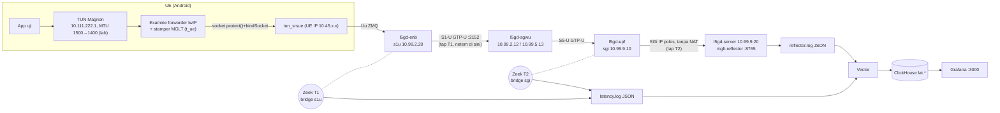
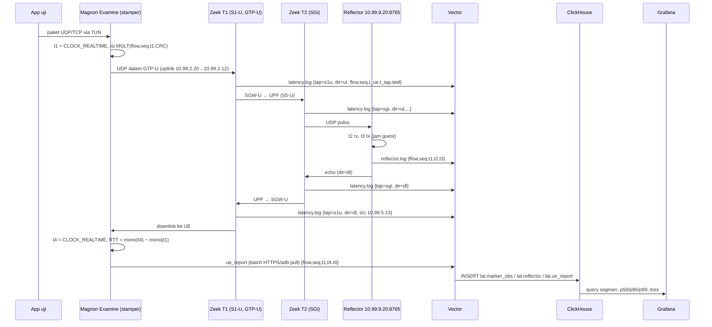

# Arsitektur PoC — Pengukuran Latency per Paket End-to-End (magnon-app Examine × lab5g-dev × Zeek → ClickHouse)

Versi draf: 17 Nov 2026, 11:15 WIB (UTC+7). Status: **draf desain, belum ada yang dieksekusi di lab.** Semua repo dibaca read-only.

Label: **[FAKTA REPO]** = terbaca di repo (path + commit/branch disebut). **[USULAN]** = desain baru dokumen ini. **[KONTEKS USER]** = info dari user, belum terkonfirmasi di repo.

Keputusan user (17 Nov): target akurasi **level milidetik** (error ≤ 1–2 ms). Sinkronisasi jam utama **NTP/chrony + offset NTP-style 4-timestamp**; **PTP hanya opsi masa depan**.

---

## 0. Commit yang dibaca

| Repo | Ref | Commit | Catatan |
|---|---|---|---|
| dayat81/magnon-app | `main` | `9d4eb98c50` (13 Nov 2026 08:02 WIB) | VpnService "black-hole" Option A, tanpa forwarder |
| dayat81/magnon-app | `cursor/examine-underlying-physical-848e` | `8bc9904f4a` (15 Nov 2026 13:45 WIB) | Branch Examine terbaru (63 commit di depan main). Juga `cursor/examine-android-d5ab` @ `9e91a26929` |
| dayat81/open5g | `main` | `d0d4bc4b68` (6 Nov 2026 20:48 WIB) | compose lab, config contoh, skrip |
| dayat81/open5g | `cursor/android-emulator-dashboard-8cae` | `a680f8b469` (12 Nov 2026 16:37 WIB) | infra/ (Ansible), runbook android-ue, versions.md |
| dayat81/open5g | `cursor/lab5g-dev-architecture-462b` | `073926373d` (11 Nov 2026 16:22 WIB) | `docs/architecture/LAB5G-DEV-CURRENT.md` |
| dayat81/telcoagent | `main` | `bd3fdd20ef` | NetProbe (server/netprobe), Android udp-client |
| dayat81/telcoagent | `master` | `5cd3a1dcf3` | ClickHouse migrations (edr/cdr), Grafana datasource ClickHouse |

---

## 1. Ringkasan & tujuan PoC

**Tujuan:** mengukur latency **per paket** dari aplikasi di Android (UE) sampai server di SGi, dipecah per segmen (UE→S1-U, S1-U→SGi, SGi→server, dan jalur balik), dengan akurasi milidetik, lalu menyimpannya di ClickHouse dan menampilkannya di Grafana.

**Inti desain [USULAN]:**
1. Forwarder **Examine** di magnon-app (lwIP, native) mencap setiap datagram probe dengan **marker MGLT** (magic + versi + flow-id + seq + `t_ue` ns + flags + CRC32C).
2. **Zeek** di guest lab5g-dev men-tap bridge **S1-U** (di dalam GTP-U, didekapsulasi) dan **SGi**, mendeteksi marker, menulis `latency.log` (JSON).
3. **Reflector UDP** di `l5gd-server` (10.99.9.20) memantulkan probe (t2/t3) → RTT + 4 timestamp untuk estimasi offset jam UE.
4. **Vector** membaca `latency.log` → **ClickHouse** (`lat.*`) → **Grafana**.
5. Validasi: delay **netem** yang diinjeksi di S1-U harus muncul di segmen yang benar dengan error ≤ 1–2 ms.

---

## 2. Fakta dari repo vs usulan

### 2.1 magnon-app — apa itu mode "Examine" (Periksa)

- [FAKTA REPO] Di `main`, VpnService adalah **black-hole lokal**: paket TUN dibaca lalu dibuang, "This is not a forwarder" — `android/app/src/main/kotlin/site/magnon/app/vpn/MagnonVpnService.kt` @ `9d4eb98c50` (loop `Os.poll` + `Os.read`, buffer 32767, `TunPacketSink.onPacket`).
- [FAKTA REPO] Mode **Examine** = sesi diagnosa sementara: **satu aplikasi target** dimasukkan ke TUN dan **benar-benar diteruskan** ke internet lewat forwarder userspace berbasis **lwIP**, sambil mencatat byte per host/jaringan. Commit kunci di `cursor/examine-android-d5ab`: `baaa937326` "Add the lwIP Examine forwarder…", `89a4c33a45` "Wire Examine into the VPN service and add a minimal Periksa screen", `b0c594003e` "Run the Examine forwarder in its own process", `61fd180741` "keep an idle session for 5 minutes".
- [FAKTA REPO] Plan TUN Examine: `TunnelMode.EXAMINE_ONE`, `HEMAT_PLUS_EXAMINE`, `DARURAT_PLUS_EXAMINE`; "The TUN contains only the app being examined. Magnon stays outside." — `android/core/src/main/kotlin/site/magnon/core/vpn/TunPlan.kt` @ `8bc9904f4a`.
- [FAKTA REPO] TUN: `MTU = 1500` (kontrak `mtu >= 1280`), IPv4 `10.111.222.1/32`, IPv6 `fd00:6d61:676e::1/128`, route `0.0.0.0/0` + `::/0`, DNS `10.111.222.2`, `allowBypass=false`, `blocking=false` — `TunPlan.kt` (main & branch Examine).
- [FAKTA REPO] Struktur forwarder native — `android/app/src/main/cpp/magnon_forward.c` @ `8bc9904f4a`:
  - `nativeRun(tun_fd)` (JNI dari `ExamineNative.kt`) membaca TUN (`read(g_tun, …)`), parse (`magnon_pkt_parse`), **drop fragmen IP** (`magnon_pkt_is_fragment` → `g_frag_dropped`), tabel NAT (`magnon_nat_put`, `MAGNON_NAT_MAX`).
  - **UDP**: payload dikirim ulang lewat socket upstream baru (`send(fd, payload)`), balasan dibangun ulang sebagai paket IP ke TUN (`magnon_udp_reply`, `write_tun`).
  - **TCP**: tujuan ditulis ulang ke `10.111.222.1:1`, diterminasi di **lwIP** (`ip4_input/ip6_input`, `tcp_write`), lalu di-relay ke socket upstream; `TCP_MSS 1460`, `TCP_WND 4*MSS` — `android/app/src/main/cpp/lwipopts.h`; `IP_REASSEMBLY 0`, `IP_FRAG 0`.
  - DNS di-relay (`relay_dns`); jam internal `clock_gettime(CLOCK_MONOTONIC)` (`mono_ms`).
- [FAKTA REPO] Socket upstream dibuat di Kotlin `ExamineNative.openUpstream()` → `openUdp`/`openTcp`: `DatagramChannel`/`SocketChannel`, **`protect()` via AIDL `IExamineProtector`** (diimplementasikan di `MagnonVpnService`, `protect(socket.fd)`), lalu `network.bindSocket(socket)` ke jaringan fisik — `android/app/src/main/kotlin/site/magnon/app/examine/ExamineNative.kt`, `.../aidl/site/magnon/app/examine/IExamineProtector.aidl` @ `8bc9904f4a`.
- [FAKTA REPO] Build: `minSdk 29`, `targetSdk 37`, NDK `27.2.12479018`, CMake `src/main/cpp/CMakeLists.txt`, `EXAMINE_ENABLED=true`, `EXAMINE_UNDERLYING_PHYSICAL=true`, **`RTT_ENABLED=false`** + `-DMAGNON_RTT_ENABLED=0` ("Lite does not measure RTT") — `android/app/build.gradle.kts` @ `8bc9904f4a`; commit `37abbdc9e4` "Stop Lite from measuring or storing RTT".
- [FAKTA REPO] Kode RTT sudah ada tapi dimatikan: `jni_quic_rtt`, SYN→connect RTT (`#if MAGNON_RTT_ENABLED`), `core/examine/QuicRtt.kt`, `RttFeature.kt`.
- **Implikasi desain [USULAN]:** karena Examine adalah proxy L4 (bukan forwarder L3), **header IP/TCP asli aplikasi tidak pernah sampai ke jaringan**; yang lewat S1-U adalah paket dari socket Magnon. Jadi stamping harus di **payload** yang dikirim Magnon (bukan IP option di paket TUN), dan checksum IP/UDP dihitung kernel secara otomatis.
- Tidak ditemukan di repo: mode latency/timestamp per paket, marker in-band, integrasi Zeek.

### 2.2 open5g — lab5g-dev

- [FAKTA REPO] Guest `lab5g-dev` `172.22.20.21`, libvirt `lab5g-dev-iso` 172.22.20.0/24 — `infra/group_vars/all/lab.yml` @ `a680f8b469` (branch `cursor/android-emulator-dashboard-8cae`, juga `infra/iac-lab5g-dev` @ `e88512883f`).
- [FAKTA REPO] Jaringan docker: s1mme 10.99.1.0/24, **s1u 10.99.2.0/24**, s11 10.99.4.0/24, s5s8 10.99.5.0/24, pfcp 10.99.6.0/24, **sgi 10.99.9.0/24**, mgmt 10.99.10.0/24, uu 10.99.11.0/24 — `lab.yml` di atas.
- [FAKTA REPO] Kontainer & IP — `lab/compose/docker-compose.yml`, `lab/compose/docker-compose-ran.yml` @ `d0d4bc4b68` (main):
  - `l5gd-enb` s1u **10.99.2.20**, uu 10.99.11.20; `l5gd-ue` uu 10.99.11.21 (`NET_ADMIN`, `/dev/net/tun`); image `gradiant/srsran-4g:25_10` (ZMQ, tanpa SDR).
  - `l5gd-sgwu` s1u **10.99.2.12**, s5s8 **10.99.5.13**, pfcp 10.99.6.12; `l5gd-upf` s5s8 10.99.5.14, sgi **10.99.9.10** (`NET_ADMIN`); image `gradiant/open5gs:2.8.0`.
  - `l5gd-server` = `nicolaka/netshoot:latest`, sgi **10.99.9.20**, `ip route add 10.45.0.0/16 via 10.99.9.10; exec iperf3 -s`.
- [FAKTA REPO] SGW-U GTP-U bind dua alamat `10.99.2.12` dan `10.99.5.13` — `lab/config/examples/open5gs/sgwu.yaml.example`; UPF pool `10.45.0.0/16` gw `10.45.0.1` dnn `internet` — `upf.yaml.example`.
- [FAKTA REPO] Bukti GTP-U S1-U: uplink `10.99.2.20.2152 > 10.99.2.12.2152`, downlink **`10.99.5.13.2152 > 10.99.2.20.2152`** — `docs/evidence/gate-b-endc-integrated/SUMMARY.md` (main). Route `l5gd-enb 10.99.5.13/32 dev eth2` — `lab/scripts/lab-routes.sh`.
- [FAKTA REPO] Ping UE → server 10.99.9.20 ~**30 ms** RTT — `docs/evidence/gate-a-lab5g-dev/SUMMARY.md` (main).
- [FAKTA REPO] Android emulator api-33 berbagi netns dengan srsUE `ue1` (`tun_srsue`), egress internet lewat cgnat/tun2socks hanya untuk UE1/32 — `docs/architecture/LAB5G-DEV-CURRENT.md` @ `073926373d`; runbook `docs/deploy/android-ue-lab5g-dev.md` @ `a680f8b469` ("not executed against the lab").
- [FAKTA REPO] Grafana sudah ada di guest `127.0.0.1:3000` — `LAB5G-DEV-CURRENT.md`.
- [FAKTA REPO] Rujukan pcap: `tcpdump -i any 'udp port 2152 or host 10.99.9.20'` — `docs/plan-poc-slicing-core.md`; netshoot/tcpdump pada bridge `s1u`, `sgi` — `docs/prd/gate-b/OAI-GO-NOGO-TEST-PLAN.md` @ `cursor/gate-b-oai-go-nogo-00e8`.
- [FAKTA REPO] eBPF hanya skeleton tc (`TC_ACT_UNSPEC`, tidak membaca paket) — `ebpf/README.md` (main).
- Tidak ditemukan di repo: **Zeek**, **NTP/chrony/PTP**, pengaturan **timezone UTC** guest, **netem**.
- [KONTEKS USER] Guest memakai UTC; netem di S1-U sudah dites hari ini; baseline RTT ~**56 ms**; container l5gd-ue / l5gd-enb / l5gd-sgwu / l5gd-upf / l5gd-server; netshoot tersedia. (Catatan: repo mencatat ~30 ms di Gate A; selisih ke 56 ms perlu dicek — jalur emulator/netem/beban.)

### 2.3 telcoagent — NetProbe, ClickHouse, Grafana

- [FAKTA REPO] Protokol probe UDP NetProbe **sudah NTP-style 4 timestamp**: magic `UD`, v1 `>2sBIq` (seq u32, t1 i64), reply `>2sBIqqq` (t1,t2,t3); v2 `>2sBHHq` + reply `+server_rx/server_tx`; `compute_latency` (uplink=t2−t1, downlink=t4−t3, ns→ms), `clock_offset_ms=(up−down)/2`, `estimate_offset_from_samples` = **median**, `correct_latency` — `server/netprobe/udp_probe_protocol.py` @ `bd3fdd20ef`.
- [FAKTA REPO] Klien probe memakai `time.time_ns()`, port default **8765** — `server/netprobe/udp_probe.py`.
- [FAKTA REPO] Penyimpanan NetProbe = **SQLite** (`sessions`, `log_rows` dengan `udp_latency_ms`, `udp_loss_pct`, `udp_jitter_ms`) — `server/netprobe/db.py`.
- [FAKTA REPO] Dashboard Grafana NetProbe = **Prometheus** (WireGuard peer/flow) — `monitoring/grafana/dashboards/netprobe-user-journey.json`.
- [FAKTA REPO] ClickHouse ada di branch `master` (bukan main): konvensi `MergeTree`, `PARTITION BY toYYYYMM(...)`, `LowCardinality(String)`, `TTL ... + INTERVAL 90 DAY` — `scripts/clickhouse/migrations/edr_events_v2_schema.sql` @ `5cd3a1dcf3`; datasource `grafana-clickhouse-datasource` http 8123 — `scripts/monitoring/grafana/provisioning/datasources/clickhouse.yml` (**berisi password plaintext — risiko**).
- Tidak ditemukan di repo: **netprobe-zeeklive-vector**, Zeek, Vector, pipeline Zeek→Vector→ClickHouse (dicek: tree `main`, `master`, `dalang` telcoagent; repo `dayat81/netprobe-ms`; code search & commit search "zeek" = 0 hasil).

---

## 3. Komponen & topologi

| Komponen | Lokasi | Status |
|---|---|---|
| App uji + Magnon Examine (build `lab`) | Android emulator api-33 di netns ue1, atau HP fisik | [USULAN] (Examine = [FAKTA REPO]) |
| srsUE / srsENB (ZMQ) | `l5gd-ue`, `l5gd-enb` | [FAKTA REPO] |
| SGW-U, UPF/PGW-U | `l5gd-sgwu`, `l5gd-upf` | [FAKTA REPO] |
| Reflector UDP `mglt-reflector` :8765 | proses di `l5gd-server` atau sidecar `--network container:l5gd-server` | [USULAN] |
| Zeek 7.x (af_packet) | kontainer di guest, `network_mode: host`, sniff bridge s1u + sgi | [USULAN] |
| Vector | kontainer di guest | [USULAN] |
| ClickHouse `lat` | kontainer di guest (internal) | [USULAN] |
| Grafana | guest `127.0.0.1:3000` | [FAKTA REPO] (dashboard baru [USULAN]) |
| chrony | guest lab5g-dev (sumber: host magen) | [USULAN] |



Titik tap [USULAN]:
- **T0** (opsional) `tun_srsue` di netns ue1 — sebelum radio emulasi; dipakai untuk memisahkan latensi stack Android vs radio ZMQ.
- **T1** bridge docker `lab5g-dev_s1u` (veth enb↔sgwu). Uplink `10.99.2.20→10.99.2.12`, downlink **`10.99.5.13→10.99.2.20`** (filter BPF harus mencakup keduanya: `udp port 2152`).
- **T2** bridge `lab5g-dev_sgi`. Paket IP polos UE IP ↔ 10.99.9.20.
- Semua tap & reflector berada di **kernel guest yang sama → satu jam**; delta T1→T2 dan T2→server bebas clock skew.

---

## 4. Format timestamp — evaluasi opsi

Konteks penentu: Examine adalah proxy L4 → paket di jaringan dibuat oleh socket Magnon. Kernel menghitung checksum. Ruang MTU: Docker bridge 1500, GTP-U menambah 36 B (IPv4 20 + UDP 8 + GTP 8) → inner ≤ 1464 tanpa fragmentasi di S1-U.

| Opsi | MTU/fragmentasi | Checksum | Transparansi app & server | TCP vs UDP | Deteksi Zeek di GTP-U | NAT di SGi |
|---|---|---|---|---|---|---|
| A. Trailer di payload app UDP | +32 B; perlu clamp MTU TUN | Otomatis (kernel) | App: ya. Server: **tidak** (perlu strip di reflector/proxy) | UDP saja; TCP stream tidak bisa (re-segmentasi lwIP) | Mudah (`udp_contents`, cari magic di ekor) | Aman (di payload) |
| B. IP option (mis. option 0x88/eksperimen) | +12–40 B header | Kernel; opsi bisa ditolak router | App & server: ya | Keduanya, tapi **Android non-root tidak bisa set per paket untuk socket TCP lwIP**; banyak hop drop/slow-path | Sulit: Zeek script tidak mengekspos opsi IPv4; perlu plugin | NAT biasanya mempertahankan, CGNAT bisa drop |
| C. Enkapsulasi UDP/header custom (tunnel ke decap di SGi) | +8+32 B | Kernel di kedua ujung | App: ya; server: ya (setelah decap) | Keduanya (bawa paket utuh) | Mudah (port khusus) | Butuh decap sebelum NAT; menambah komponen; mengukur tunnel, bukan jalur asli |
| D. **Probe khusus MGLT (magic+seq+ts) di datagram sendiri** | Ukuran diatur sendiri (64–1400 B) | Kernel | App & server asli: ya (tidak disentuh) | Jalur sama (socket, bindSocket, netns sama); tidak mengukur paket app itu sendiri | Paling mudah (UDP :8765, prefix magic) | Aman; korelasi via flow-id+seq, bukan 5-tuple |

**Rekomendasi [USULAN]:**
- **Utama = D**: forwarder Examine membuka flow probe MGLT (UDP → `10.99.9.20:8765`) lewat jalur yang sama dengan app target (protect + `bindSocket` ke Network yang sama), setiap datagram dicap; reflector memantulkan → RTT + 4 timestamp. Ukuran & laju probe meniru profil paket app (mis. 64/512/1200 B, 50–200 pps).
- **Fallback = A (trailer MGLT)**: untuk flow UDP app yang tujuannya di allow-list lab (mis. reflector/echo di l5gd-server), forwarder menempelkan trailer 32 B ke payload sebelum `send()`; reflector/server lab men-strip. Memberi latency paket app asli. TCP tidak di-stamp in-band; untuk TCP pakai RTT SYN→connect yang sudah ada di kode (`MAGNON_RTT_ENABLED`) + pengukuran pasif Zeek (handshake di T1/T2).

### Layout byte MGLT v1 (32 B, network byte order) [USULAN]

| Offset | Size | Field | Keterangan |
|---|---|---|---|
| 0 | 4 | `magic` | `0x4D474C54` ("MGLT") |
| 4 | 1 | `ver` | `1` |
| 5 | 1 | `flags` | bit0 dir (0=UL,1=DL echo), bit1 trailer-mode, bit2 clock-synced, bit3 monotonic-only, bit4 retrans |
| 6 | 2 | `hdr_len` | 32 (ruang ekstensi) |
| 8 | 4 | `flow_id` | random per sesi Examine × flow (u32) |
| 12 | 4 | `seq` | per flow, naik 1 per paket |
| 16 | 8 | `t_ue_ns` | `CLOCK_REALTIME` (epoch UTC, ns) saat `send()` di native |
| 24 | 4 | `t_ue_mono_us` | `CLOCK_MONOTONIC` µs (u32, wrap ~71 menit) untuk RTT di device |
| 28 | 4 | `crc32c` | CRC32C atas byte 0–27 (validasi, hindari false positive) |

- Mode probe: MGLT di **awal** payload; sisa payload padding acak (ukuran uji).
- Mode trailer: MGLT di **akhir** payload, `flags.bit1=1`; Zeek membaca 32 B terakhir.
- Reflector menambah blok balasan 24 B: `t2_ns` (rx), `t3_ns` (tx), `srv_rx_count` — kompatibel semangatnya dengan NetProbe v2 (`server/netprobe/udp_probe_protocol.py`), namun magic berbeda agar tidak bentrok dengan `UD`.

### Clamp MSS/MTU [USULAN]
- Build `lab`: **MTU TUN Examine 1400** (kontrak `mtu >= 1280` tetap terpenuhi) → payload UDP app ≤ 1372 B; + trailer 32 = 1404 B → outer IPv4 1432 B; + GTP-U 36 = 1468 B ≤ 1500. Tidak ada fragmentasi (forwarder memang men-drop fragmen: `magnon_pkt_is_fragment`).
- TCP (tidak di-stamp): turunkan `TCP_MSS` lwIP ke 1360 di build `lab` agar segmen ke app konsisten; socket upstream kernel menegosiasi MSS sendiri; set `IP_MTU_DISCOVER=IP_PMTUDISC_DO` di socket probe agar oversize ditolak (bukan difragmen).

---

## 5. Alur data



Jalur balik RTT: reflector mengembalikan MGLT asli + blok t2/t3; device menghitung RTT dari jam monotonic (tanpa sinkronisasi) dan offset dari (t1,t2,t3,t4).

Transport `ue_report` [USULAN]: fase awal `adb pull` file CSV/JSONL dari app (lab, emulator via `adb connect <UE1_UU>:5555` — [FAKTA REPO] runbook); fase lanjut POST ke endpoint ingest di guest (jalur mgmt, bukan lewat EPC agar tidak mengganggu ukur).

---

## 6. Desain Zeek

- **Pilihan PoC: Zeek script** (`.zeek`) — cepat, cukup untuk ≤ beberapa ribu pps di lab. **Produksi/beban tinggi: Spicy analyzer** (`mglt.spicy` + `.evt`, port 8765/udp) yang mem-parse MGLT dan memunculkan event `mglt::marker(c, is_orig, flow, seq, t_ue, flags)`. BinPAC tidak disarankan (lebih berat dirawat).
- **Dekapsulasi GTP-U:** Zeek punya analyzer GTPv1 (packet analyzer `PacketAnalyzer::GTPV1`, port 2152/udp) yang membuka tunnel dan menganalisis koneksi inner; `conn.log` inner memiliki `tunnel_parents`, `tunnel.log` mencatat tunnel. Pastikan port 2152 terdaftar (default) dan `Tunnel::delay_gtp_confirmation=F` agar paket pertama tidak tertahan.
- **Event:** `udp_contents(u, is_orig, contents)` (aktif dengan `udp_content_deliver_all_orig=T`, `udp_content_deliver_all_resp=T`, atau per port `udp_content_ports`). Timestamp tap = `network_time()` (waktu capture af_packet, presisi µs). `raw_packet`/`new_packet` tidak dipakai (mahal). Untuk TEID: `gtpv1_g_pdu_packet(outer, inner_gtp, inner_ip)` memberi TEID outer.
- **Dua tap**: jalankan dua worker/instance dengan `redef Latency::tap_name` berbeda (`s1u`, `sgi`), atau satu instance `-i af_packet::br-s1u -i af_packet::br-sgi` dan bedakan via `packet_source()`/interface.
- **Clock:** Zeek di guest → jam sama dengan reflector; `network_time()` epoch UTC.

Log schema `latency.log` [USULAN]:

| Field | Tipe | Ket. |
|---|---|---|
| `ts` | time | `network_time()` di tap |
| `tap` | string | `s1u` / `sgi` |
| `dir` | string | `ul` / `dl` (dari flags + arah) |
| `uid` | string | uid koneksi inner |
| `orig_h/orig_p/resp_h/resp_p` | addr/port | 5-tuple inner |
| `outer_src/outer_dst` | addr | IP GTP-U (kosong di sgi) |
| `teid` | count | TEID GTP-U (kosong di sgi) |
| `flow_id`, `seq` | count | dari MGLT |
| `t_ue_ns` | int | dari MGLT |
| `flags` | count | dari MGLT |
| `ip_len` | count | panjang IP inner |
| `crc_ok` | bool | validasi CRC32C |
| `owd_raw_ms` | double | `ts − t_ue` (belum dikoreksi offset) |

Skeleton `latency.zeek` [USULAN]:

```zeek
@load base/frameworks/tunnels
module Latency;

export {
  redef enum Log::ID += { LOG };
  const tap_name = "s1u" &redef;
  const mglt_port = 8765/udp &redef;
  type Info: record {
    ts: time &log; tap: string &log; dir: string &log; uid: string &log;
    orig_h: addr &log; orig_p: port &log; resp_h: addr &log; resp_p: port &log;
    outer_src: addr &log &optional; outer_dst: addr &log &optional;
    flow_id: count &log; seq: count &log; t_ue_ns: int &log; flags: count &log;
    ip_len: count &log; crc_ok: bool &log; owd_raw_ms: double &log;
  };
}

redef udp_content_deliver_all_orig = T;
redef udp_content_deliver_all_resp = T;
redef Tunnel::delay_gtp_confirmation = F;
redef LogAscii::use_json = T;

const MAGIC = "\x4d\x47\x4c\x54";

event zeek_init() {
  Log::create_stream(LOG, [$columns=Info, $path="latency"]);
}

function parse_and_log(c: connection, is_orig: bool, m: string) {
  if ( |m| < 32 || sub_bytes(m, 1, 4) != MAGIC ) return;
  local flags = bytestring_to_count(sub_bytes(m, 6, 1));
  local flow  = bytestring_to_count(sub_bytes(m, 9, 4));
  local seq   = bytestring_to_count(sub_bytes(m, 13, 4));
  local t_ue  = bytestring_to_count(sub_bytes(m, 17, 8));
  # CRC32C: crc32c() via plugin/BIF bila tersedia; PoC: cek magic+ver saja
  local crc_ok = bytestring_to_count(sub_bytes(m, 5, 1)) == 1;
  local t_ue_s = double_to_time(t_ue / 1e9);
  local info = Info($ts=network_time(), $tap=tap_name,
    $dir=(flags % 2 == 1 ? "dl" : "ul"), $uid=c$uid,
    $orig_h=c$id$orig_h, $orig_p=c$id$orig_p, $resp_h=c$id$resp_h, $resp_p=c$id$resp_p,
    $flow_id=flow, $seq=seq, $t_ue_ns=to_int(fmt("%d", t_ue)), $flags=flags,
    $ip_len=|m| + 28, $crc_ok=crc_ok,
    $owd_raw_ms=interval_to_double(network_time() - t_ue_s) * 1000.0);
  if ( c?$tunnel && |c$tunnel| > 0 ) {
    info$outer_src = c$tunnel[0]$cid$orig_h;
    info$outer_dst = c$tunnel[0]$cid$resp_h;
  }
  Log::write(LOG, info);
}

event udp_contents(u: connection, is_orig: bool, contents: string) {
  # mode probe: magic di awal payload
  parse_and_log(u, is_orig, contents);
  # mode trailer: magic di 32 B terakhir
  if ( |contents| >= 32 )
    parse_and_log(u, is_orig, sub_bytes(contents, |contents| - 31, 32));
}
```

(Catatan: `bytestring_to_count` big-endian default; `t_ue_ns` > 2^53 hilang presisi di `double` — simpan integer mentah dan hitung selisih di ClickHouse.)

---

## 7. Kalkulasi latency & jam

Notasi: t1 = `t_ue_ns` (jam UE), T_s1u/T_sgi = `network_time()` Zeek (jam guest), t2/t3 = reflector (jam guest), t4 = terima di UE (jam UE). θ = offset jam UE − guest.

- **RTT (bebas offset):** `RTT = mono(t4) − mono(t1)` di device; atau `(t4 − t1) − (t3 − t2)`.
- **Offset NTP-style:** `θ = ((t1 − t2) + (t4 − t3)) / 2` (tanda: θ positif = jam UE lebih cepat). Sama dengan logika `clock_offset_ms` NetProbe ([FAKTA REPO] `udp_probe_protocol.py`).
- **One-way per segmen (UL):**
  - UE→T1 (Android stack + radio ZMQ + eNB + netem S1-U): `T_s1u − (t1 − θ)`
  - T1→T2 (SGW-U + UPF): `T_sgi − T_s1u` — **satu jam, tanpa koreksi**.
  - T2→server: `t2 − T_sgi` — satu jam.
  - DL simetris: server→T2, T2→T1, T1→UE `= (t4 − θ) − T_s1u,dl`.
- **Korelasi:** kunci `(run_id, flow_id, seq, dir)`; jangan pakai 5-tuple (emulator NAT & socket baru bisa ganti port).

### Sinkronisasi & koreksi skew (keputusan: NTP/chrony, target ms)
- [USULAN] **Guest lab5g-dev: chrony** client ke host magen (atau sumber NTP internal); semua kontainer berbagi jam kernel guest → Zeek, reflector, SGW-U satu domain waktu. Target `chronyc tracking` |offset| < 0,5 ms. Guest UTC [KONTEKS USER] tidak masalah: semua timestamp epoch UTC; konversi ke WIB hanya di Grafana.
- [USULAN] **Android tanpa root tidak bisa menjalankan chrony/menyetel jam.** Jadi jam UE **tidak disetel**, melainkan **diukur**: offset θ diestimasi di aplikasi/ClickHouse dari pertukaran 4-timestamp terhadap reflector (yang jamnya disiplin chrony).
  1. Kalibrasi 30 s di awal setiap run **tanpa netem/beban** (asimetri minimal), 20 pps.
  2. Filter **min-RTT**: ambil 10–20% sampel dengan RTT terendah (paling sedikit antrian) → median θ.
  3. **Drift:** regresi linear θ(t) = a + b·t selama run (kalibrasi ulang tiap 60 s atau via probe ringan kontinu); b dalam ppm. HP biasa drift 1–20 ppm → 0,06–1,2 ms/menit, jadi perlu re-estimasi.
  4. Deteksi **step** jam (NITZ/NTP Android menyetel jam): `|Δ(realtime − monotonic)| > 1 ms` → segmentasi ulang regresi; simpan `t_ue_mono_us` untuk itu.
- **Batas akurasi realistis:** error θ ≤ asimetri/2. Di lab: radio ZMQ srsRAN punya granularitas TTI 1 ms + penjadwalan UL (SR/grant) beberapa ms → asimetri baseline beberapa ms; dengan filter min-RTT diharapkan **±1–2 ms** untuk one-way UE→T1. Segmen T1→T2→server (satu jam) akurat sub-ms. Pada emulator, jam guest Android dari QEMU bisa melompat — perlu pengamatan.
- **Penting:** netem yang diinjeksi hanya satu arah membuat asimetri → **jangan** estimasi θ saat netem aktif; bekukan θ dari kalibrasi sebelum injeksi.
- **PTP:** opsi masa depan (perlu NIC/driver hwts dan root di device); tidak di-scope PoC ini.

---

## 8. ClickHouse, query, Grafana

Konvensi mengikuti telcoagent master (`MergeTree`, `PARTITION BY toYYYYMM`, `LowCardinality`, TTL) — [FAKTA REPO] `scripts/clickhouse/migrations/edr_events_v2_schema.sql`. Skema berikut [USULAN].

```sql
CREATE DATABASE IF NOT EXISTS lat;

CREATE TABLE lat.marker_obs (
  ts_tap      DateTime64(6, 'UTC'),
  run_id      LowCardinality(String),
  tap         LowCardinality(String),      -- s1u | sgi | ue_tun
  dir         Enum8('ul' = 1, 'dl' = 2),
  flow_id     UInt32,
  seq         UInt32,
  t_ue_ns     Int64,
  flags       UInt8,
  teid        Nullable(UInt32),
  outer_src   Nullable(IPv4),
  outer_dst   Nullable(IPv4),
  inner_src   IPv6,                        -- IPv4-mapped
  inner_dst   IPv6,
  inner_sport UInt16,
  inner_dport UInt16,
  ip_len      UInt16,
  crc_ok      Bool,
  zeek_uid    String
) ENGINE = MergeTree
PARTITION BY toYYYYMMDD(ts_tap)
ORDER BY (run_id, flow_id, seq, dir, tap)
TTL toDate(ts_tap) + INTERVAL 30 DAY;

CREATE TABLE lat.reflector (
  run_id LowCardinality(String), flow_id UInt32, seq UInt32,
  t1_ue_ns Int64, t2_srv_ns Int64, t3_srv_ns Int64, ip_len UInt16
) ENGINE = MergeTree ORDER BY (run_id, flow_id, seq);

CREATE TABLE lat.ue_report (
  run_id LowCardinality(String), device LowCardinality(String),
  flow_id UInt32, seq UInt32, t1_ue_ns Int64, t4_ue_ns Int64,
  rtt_mono_us UInt32, lost Bool
) ENGINE = MergeTree ORDER BY (run_id, flow_id, seq);

CREATE TABLE lat.clock_offset (
  run_id LowCardinality(String), device LowCardinality(String),
  ts DateTime64(3, 'UTC'), theta_ns Int64, drift_ppb Int32,
  rtt_min_us UInt32, n_samples UInt16, method LowCardinality(String)  -- minrtt_median | linreg
) ENGINE = ReplacingMergeTree ORDER BY (run_id, device, ts);

CREATE TABLE lat.netem_events (
  run_id LowCardinality(String), ts DateTime64(3, 'UTC'),
  iface LowCardinality(String), delay_ms Float32, jitter_ms Float32, loss_pct Float32
) ENGINE = MergeTree ORDER BY (run_id, ts);
```

Query contoh — latency per segmen (UL), offset diambil dari kalibrasi terdekat:

```sql
WITH
  o AS (SELECT run_id, argMax(theta_ns, ts) AS theta FROM lat.clock_offset GROUP BY run_id),
  s AS (
    SELECT run_id, flow_id, seq,
      anyIf(toUnixTimestamp64Nano(ts_tap), tap='s1u') AS t_s1u,
      anyIf(toUnixTimestamp64Nano(ts_tap), tap='sgi') AS t_sgi,
      any(t_ue_ns) AS t1, any(ip_len) AS sz
    FROM lat.marker_obs WHERE dir='ul' AND crc_ok GROUP BY run_id, flow_id, seq)
SELECT s.run_id,
  quantiles(0.5,0.95,0.99)((t_s1u - (t1 - o.theta)) / 1e6) AS ue_to_s1u_ms,
  quantiles(0.5,0.95,0.99)((t_sgi - t_s1u) / 1e6)          AS s1u_to_sgi_ms,
  quantiles(0.5,0.95,0.99)((r.t2_srv_ns - t_sgi) / 1e6)    AS sgi_to_srv_ms,
  count() AS n
FROM s JOIN o USING run_id
LEFT JOIN lat.reflector r ON r.run_id=s.run_id AND r.flow_id=s.flow_id AND r.seq=s.seq
GROUP BY s.run_id;
```

Loss per segmen: paket ada di `s1u` tapi tidak di `sgi` (→ hilang di core), ada di `ue_report` tapi tidak di `s1u` (→ radio/eNB).

Panel Grafana [USULAN] (datasource `grafana-clickhouse-datasource`, gaya sama dengan telcoagent master; Grafana guest `:3000` [FAKTA REPO]):
1. Timeseries p50/p95/p99 per segmen (UE→S1-U, S1-U→SGi, SGi→server, DL) dengan anotasi `lat.netem_events`.
2. Stat: RTT p50, offset θ, drift ppm, loss %.
3. Heatmap latency UE→S1-U vs ukuran paket.
4. Tabel validasi: delay netem diinjeksi vs Δ latency terukur vs error.
5. Timeseries θ(t) + residual regresi (kesehatan jam).

Integrasi dengan telcoagent [USULAN]: pakai ulang protokol 4-timestamp NetProbe (konsep & fungsi offset) sebagai referensi; tidak ada pipeline Zeek→Vector→ClickHouse yang bisa dipakai ulang (**tidak ditemukan di repo**). Bila ClickHouse telcoagent (`edr`) akan dipakai, buat database `lat` terpisah + user baru; **jangan pakai password plaintext** seperti di `clickhouse.yml` master — pindah ke secret/env.

Vector (sketsa) [USULAN]:

```toml
[sources.zeek_latency]
type = "file"
include = ["/zeek/logs/current/latency.log"]
[transforms.parse]
type = "remap"
inputs = ["zeek_latency"]
source = '''
. = parse_json!(.message)
.ts_tap = format_timestamp!(to_timestamp!(.ts), "%Y-%m-%d %H:%M:%S%.6f")
.run_id = get_env_var("RUN_ID") ?? "adhoc"
'''
[sinks.ch]
type = "clickhouse"
inputs = ["parse"]
endpoint = "http://clickhouse:8123"
database = "lat"
table = "marker_obs"
skip_unknown_fields = true
auth.strategy = "basic"
auth.user = "${CH_USER}"
auth.password = "${CH_PASSWORD}"
```

---

## 9. Rencana tes di lab (rencana saja, belum dieksekusi)

Prasyarat: izin jendela uji lab5g-dev (Netdrive/Lab Ops), build `lab` magnon-app, chrony di guest tersinkron, Zeek/Vector/ClickHouse/reflector terpasang di guest, `run_id` per skenario.

| # | Skenario | Langkah | Ukur | Kriteria sukses |
|---|---|---|---|---|
| T0 | Sanity jam | `chronyc tracking` guest; kalibrasi θ 30 s | |offset guest|, sebaran θ | guest < 0,5 ms; IQR θ (min-RTT) < 1 ms |
| T1 | Baseline | probe 64 B, 50 pps, 5 menit, tanpa netem | RTT, per segmen | RTT p50 konsisten dengan baseline ~56 ms [KONTEKS USER] (±10%); 100% paket terkorelasi T1↔T2↔reflector |
| T2 | Validasi netem | netem `delay 10/20/50 ms` di veth S1-U arah UL (lalu DL), θ dibekukan | Δ segmen UE→S1-U (atau T1→UE) | Δ terukur − delay diinjeksi: **|error| ≤ 1–2 ms** p50; segmen T1→T2 tidak berubah (±0,5 ms) |
| T3 | Jitter/loss netem | `delay 20ms 5ms`, `loss 1%` | jitter, loss per segmen | loss terdeteksi di segmen yang benar (±0,2%); stdev ≈ jitter diinjeksi ±1 ms |
| T4 | Ukuran paket | 64 / 512 / 1200 / 1372 B (+trailer) | latency vs ukuran, fragmen | tidak ada fragmen (`ip[6:2] & 0x3fff != 0` = 0 di pcap); kurva wajar |
| T5 | Beban | iperf3 UL/DL paralel ke l5gd-server (sudah `iperf3 -s` [FAKTA REPO]) 1–4 Mbps | p95/p99 di bawah beban | Zeek drop = 0 (`capture_loss.log` < 0,1%); p99 naik terukur |
| T6 | Mode trailer (fallback) | UDP app → echo lab, trailer aktif | latency paket app | app berfungsi normal; server lab men-strip trailer; CRC ok 100% |
| T7 | Verifikasi pcap | `tcpdump -i <br-s1u> -w s1u.pcap 'udp port 2152'` & `-i <br-sgi> 'host 10.99.9.20'` paralel | bandingkan ts pcap vs latency.log | selisih ts Zeek vs pcap < 0,1 ms; jumlah marker sama |
| T8 | Step jam UE | paksa ubah jam/NTP di device (emulator) saat run | deteksi step | step terdeteksi, regresi di-reset, tidak ada outlier > 2 ms setelahnya |

Kriteria sukses PoC keseluruhan: (1) error ≤ 1–2 ms terhadap delay netem pada T2 di ≥ 95% run; (2) korelasi paket ≥ 99,5%; (3) segmen satu-jam (T1→T2→server) stabil sub-ms; (4) pipeline end-to-end Zeek→Vector→ClickHouse→Grafana < 10 s.

---

## 10. Risiko & mitigasi

| Risiko | Dampak | Mitigasi |
|---|---|---|
| Asimetri jalur (UL grant LTE, netem satu arah) merusak θ | One-way bias beberapa ms | Kalibrasi tanpa netem, filter min-RTT, θ dibekukan saat injeksi; laporkan segmen satu-jam terpisah |
| Drift/step jam Android (tanpa root) | Error tumbuh per menit | Regresi linear, re-kalibrasi 60 s, deteksi step via realtime−monotonic |
| Jam emulator (QEMU) melompat | Outlier | Uji T8; utamakan HP fisik untuk angka final bila dipakai |
| Kebijakan produk: Lite melarang ukur/simpan RTT (`RTT_ENABLED=false`, commit `37abbdc9e4`) | Konflik bila masuk build rilis | Flavor `lab` terpisah, tidak pernah dirilis; policy-guard CI tetap untuk release |
| Fragmentasi karena trailer/GTP-U | Paket di-drop forwarder (`IP_FRAG 0`) | MTU TUN 1400, `IP_PMTUDISC_DO`, uji T4 |
| Zeek packet loss di beban | Korelasi turun | af_packet fanout, BPF filter sempit (`udp port 2152 or udp port 8765`), cek `capture_loss.log` |
| Tap di bridge melihat paket sebelum/ sesudah netem tergantung lokasi qdisc | Salah atribusi segmen | Dokumentasikan iface netem (veth sisi enb); verifikasi T2 |
| Downlink GTP-U dari 10.99.5.13 (bukan 10.99.2.12) | Filter salah → DL hilang | Filter `udp port 2152` tanpa host |
| NAT emulator / socket baru ganti port | 5-tuple tidak stabil | Korelasi via flow_id+seq |
| Beban tambahan di guest (Zeek+CH) | Mengganggu NF lab | Batasi CPU/mem kontainer, jalankan di jendela uji |
| Kredensial ClickHouse plaintext di repo telcoagent master | Kebocoran | Secret/env, rotasi password |
| False positive marker | Data kotor | Magic 4 B + versi + CRC32C |

---

## 11. Langkah implementasi bertahap

| Fase | Isi | Deliverable |
|---|---|---|
| 0 — Persiapan (1–2 hari) | Izin jendela lab; konfirmasi branch dasar magnon (`cursor/examine-underlying-physical-848e`); chrony di guest; spesifikasi MGLT v1 dibekukan | Dokumen ini disetujui, spec MGLT, checklist izin |
| 1 — Reflector + skrip probe host (2 hari) | `mglt-reflector` (Python/Go) di l5gd-server; klien probe di netns ue1 (Linux) untuk validasi tanpa Android | Reflector + log JSON; RTT baseline dari ue1 |
| 2 — Zeek (3 hari) | `latency.zeek` di dua tap, dekapsulasi GTP-U, latency.log JSON; uji dengan pcap rekaman | Skrip Zeek + pcap uji + hasil cocok pcap |
| 3 — Data pipeline (2 hari) | ClickHouse `lat.*`, Vector, dashboard Grafana | DDL, vector.toml, dashboard JSON |
| 4 — Magnon build `lab` (4–5 hari) | Flavor `lab`: stamper MGLT di `magnon_forward.c` (flow probe), MTU 1400, export `ue_report` JSONL, estimasi θ | APK `lab`, unit test parser/CRC, host test native |
| 5 — Validasi netem (2 hari) | Jalankan T0–T8 | Laporan hasil + tabel error vs netem |
| 6 — Fallback trailer & TCP (opsional, 3 hari) | Trailer MGLT untuk UDP app ke echo lab; RTT TCP SYN→connect di flavor lab | Mode trailer + perbandingan |
| 7 — Hardening (opsional) | Spicy analyzer, integrasi ke ClickHouse telcoagent, PTP sebagai opsi | Analyzer Spicy, rekomendasi lanjutan |

---

## 12. Pertanyaan terbuka

1. Perangkat uji: **Android emulator api-33 di netns ue1** (runbook open5g, belum dieksekusi) atau **HP fisik** (Nokia/Xiaomi di magnon-app) lewat jalur lain? Ini menentukan jalur ke S1-U dan karakter jam.
2. Izin memasang komponen baru di guest lab5g-dev: reflector di `l5gd-server`, kontainer Zeek (af_packet di bridge s1u/sgi, `NET_RAW`), Vector, ClickHouse, dan chrony — siapa yang menyetujui (Netdrive/Lab Ops)? ClickHouse di guest atau pakai ClickHouse telcoagent?
3. Boleh membuat **flavor `lab`** magnon-app yang mengaktifkan pengukuran (melawan aturan Lite "tidak mengukur RTT"), dan dari branch mana?
4. Lokasi netem yang dites hari ini (veth sisi enb / sgwu, arah UL/DL/both) dan parameter persisnya?
5. Apakah baseline ~56 ms diukur dari emulator Android atau srsUE (`l5gd-ue`)? Repo mencatat ~30 ms (Gate A).
6. Apakah repo/branch **netprobe-zeeklive-vector** ada di tempat lain (tidak ditemukan di telcoagent/netprobe-ms)?
7. Perlu IPv6 di PoC, atau cukup IPv4?
